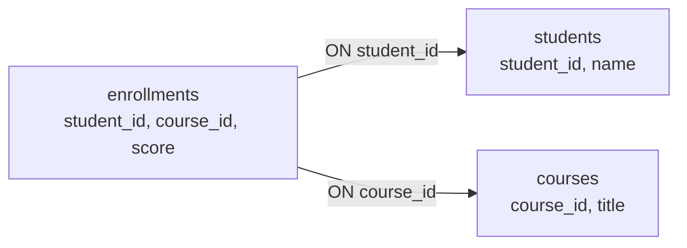

# 10. SQL：応用

[📖 データベースの目次](./00_はじめに.md#目次) ｜ [🏠 全体の目次](../README.md#目次)

[← 前へ：09 SQL：基本操作](09_SQL_基本操作.md) ｜ [次へ：11 トランザクション →](11_トランザクション.md)

## この章のゴール
- 集約関数と `GROUP BY` / `HAVING` で、集計できる
- `JOIN` で、複数のテーブルをつないで取り出せる（`INNER JOIN` と `LEFT JOIN` の違い）
- サブクエリと `VIEW` の使い方が分かる
- 「どこまでを SQL でやり、どこから Java でやるか」の考え方を持てる

## 目次

1. [集約関数](#1-集約関数)
2. [GROUP BY：グループごとに集計する](#2-group-byグループごとに集計する)
3. [HAVING：グループを絞り込む](#3-havingグループを絞り込む)
4. [SQL が実行される順序](#4-sql-が実行される順序)
5. [JOIN：テーブルをつなぐ](#5-joinテーブルをつなぐ)
6. [LEFT JOIN：片方にしかない行も残す](#6-left-join片方にしかない行も残す)
7. [サブクエリ](#7-サブクエリ)
8. [VIEW：よく使う SELECT に名前を付ける](#8-viewよく使う-select-に名前を付ける)
9. [実行計画を見る](#9-実行計画を見る)
10. [SQL と Java の役割分担](#10-sql-と-java-の役割分担)
11. [よくあるミス](#11-よくあるミス)

---

## 1. 集約関数

複数の行を**1 つの値にまとめる**関数です。

| 関数 | 内容 |
|---|---|
| `COUNT(*)` | 行数 |
| `COUNT(列)` | その列が **NULL でない**行数 |
| `SUM(列)` | 合計 |
| `AVG(列)` | 平均 |
| `MAX(列)` / `MIN(列)` | 最大値 / 最小値 |

```sql
SELECT COUNT(*) AS total, COUNT(score) AS graded, AVG(score) AS average FROM enrollments;
```

| total | graded | average |
|---|---|---|
| 15 | 12 | 73.75 |

- `COUNT(*)` は全 15 行、`COUNT(score)` は点数のある 12 行
- `AVG(score)` は、**NULL の 3 行を除いた** 12 件の平均

> 💡 集約関数は NULL を**無視**します。「履修中」を平均に含めたくない成績管理では都合がよいですが、**意図を意識して使う**ことが大切です（`COALESCE(score, 0)` で 0 点扱いにすると、平均が下がります）。

## 2. GROUP BY：グループごとに集計する

`GROUP BY` で、列の値が同じ行をグループにして、グループごとに集約関数を計算します。

```sql
SELECT student_id, COUNT(*) AS courses, ROUND(AVG(score), 1) AS average
FROM enrollments
GROUP BY student_id
ORDER BY student_id;
```

| student_id | courses | average |
|---|---|---|
| 1 | 3 | 69.0 |
| 2 | 3 | 91.5 |
| 3 | 3 | 58.3 |
| 4 | 2 | 84.5 |
| 5 | 2 | 85.0 |
| 6 | 2 | 66.0 |

学生ごとの履修数と、評価済みの科目の平均点です。4層アーキテクチャ編の `GradeService.transcript` が Java で計算していた平均点と同じものを、SQL の 1 文で求めています。

> [!WARNING]
> **`GROUP BY` を使うとき、`SELECT` に書ける列は、`GROUP BY` に指定した列と、集約関数だけ**です。`SELECT course_id, AVG(score) ... GROUP BY student_id` のように、グループにない列を書くとエラーになります。

## 3. HAVING：グループを絞り込む

集計した**結果**に条件を付けるには、`WHERE` ではなく `HAVING` を使います。

```sql
SELECT student_id, ROUND(AVG(score), 1) AS average
FROM enrollments
GROUP BY student_id
HAVING AVG(score) >= 80;
```

| student_id | average |
|---|---|
| 2 | 91.5 |
| 4 | 84.5 |
| 5 | 85.0 |

| | `WHERE` | `HAVING` |
|---|---|---|
| 絞り込む対象 | **集計する前**の行 | **集計した後**のグループ |
| 集約関数 | 使えない | 使える |
| 例 | `WHERE academic_year = 2025`（2025 年度の履修だけ集計する） | `HAVING AVG(score) >= 80`（平均が 80 以上の学生だけ残す） |

## 4. SQL が実行される順序

SQL は、**書く順序と、実行される順序が違います**。


- `WHERE` は `SELECT` より前に実行されるため、`SELECT` で付けた**別名（AS）は `WHERE` では使えません**
- `HAVING` も同様。`HAVING average >= 80` ではなく `HAVING AVG(score) >= 80` と書く
- `ORDER BY` は `SELECT` の後なので、別名を使えます

## 5. JOIN：テーブルをつなぐ

正規化（05 章）で、情報を複数のテーブルに分けました。**分けたデータを、取り出すときにつなぐ**のが `JOIN` です。

```sql
SELECT s.name, c.title, e.academic_year, e.score
FROM enrollments e
JOIN students s ON s.student_id = e.student_id
JOIN courses  c ON c.course_id  = e.course_id
WHERE s.name = 'Taro';
```

| name | title | academic_year | score |
|---|---|---|---|
| Taro | プログラミング基礎 | 2024 | 80 |
| Taro | データベース | 2025 | 72 |
| Taro | 線形代数 | 2024 | 55 |

| 部分 | 意味 |
|---|---|
| `FROM enrollments e` | 履修テーブルに `e` という**別名**を付ける（長い名前を短く書ける） |
| `JOIN students s ON s.student_id = e.student_id` | 学生テーブルを、**`student_id` が等しい行同士**でつなぐ |
| `s.name` | どのテーブルの列かを、`別名.列名` で明示する |

つなぎ方のイメージです。外部キーの列と、参照先の主キーを、`ON` で結びます。



> 💡 外部キーは「**つなぐ線**」です。`ON` の条件は、ほとんどの場合、外部キーと参照先の主キーを `=` で結ぶ形になります。05 章の正規化で分けたテーブルは、`JOIN` で元の「全部入りの表」の形に戻せます。

### INNER JOIN

上の `JOIN` は、正しくは **`INNER JOIN`**（`INNER` は省略可）で、**両方のテーブルに対応する行がある場合だけ**結果に出ます。

## 6. LEFT JOIN：片方にしかない行も残す

「履修が 1 件もない学生」も含めて、学生ごとの履修数を出したいとします。`INNER JOIN` では、履修がない学生は**結果から消えてしまいます**。

**`LEFT JOIN`** は、**左側のテーブルの行をすべて残し**、右側に対応する行がなければ、右側の列を **NULL** にします。正式には `LEFT OUTER JOIN` と書きますが、`OUTER` は省略できます。

```sql
SELECT s.name, COUNT(e.enrollment_id) AS courses
FROM students s
LEFT JOIN enrollments e ON e.student_id = s.student_id
GROUP BY s.student_id, s.name
ORDER BY s.student_id;
```

| name | courses |
|---|---|
| Taro | 3 |
| Hanako | 3 |
| Jiro | 3 |
| Sakura | 2 |
| Ken | 2 |
| Yuki | 2 |
| （09 章で追加した Mika） | 0 |

| 種類 | 結果 |
|---|---|
| `INNER JOIN` | 両側に対応する行がある行だけ |
| `LEFT JOIN` | **左側の行はすべて**。右側が無ければ NULL |

このほか、右側の行をすべて残す `RIGHT OUTER JOIN`（`RIGHT JOIN`）と、両方の行のすべての組み合わせを作る `CROSS JOIN` もあります。どちらも使う機会は多くありません。

> 💡 `COUNT(e.enrollment_id)` と書いたのは、`COUNT(*)` だと、履修がない学生も「1 行」と数えてしまうためです。右側の列を数えれば、NULL の行は数えられず、0 になります。

## 7. サブクエリ

`SELECT` の中に、別の `SELECT` を書くことができます。これを**サブクエリ**といいます。

```sql
SELECT student_id, course_id, score
FROM enrollments
WHERE score > (SELECT AVG(score) FROM enrollments);
```

全体の平均（73.75）より高い点数の履修が、6 件出力されます。括弧の中の `SELECT` が先に実行されて**1 つの値**を返し、外側の条件に使われます。

`IN` と組み合わせると、**複数の値**を条件にできます。

```sql
SELECT name FROM students
WHERE student_id IN (SELECT student_id FROM enrollments WHERE score < 60);
```

「60 点未満の履修がある学生」（Taro、Jiro）の名前が出ます。

> 💡 サブクエリで書けることの多くは、`JOIN` でも書けます。読みやすいほうを選びましょう。

## 8. VIEW：よく使う SELECT に名前を付ける

複数の `JOIN` を含む長い `SELECT` は、何度も書くのが大変です。**`VIEW`**（ビュー）は、`SELECT` に名前を付けて保存し、**テーブルのように使える**ようにする仕組みです。

```sql
CREATE VIEW transcripts AS
SELECT s.student_id, s.name AS student_name, c.title, c.credits, e.academic_year, e.score
FROM enrollments e
JOIN students s ON s.student_id = e.student_id
JOIN courses  c ON c.course_id  = e.course_id;

SELECT * FROM transcripts WHERE student_id = 1;
```

| | 内容 |
|---|---|
| 実体 | **保存された SELECT 文**。データのコピーを持つわけではない（見るたびに、元のテーブルから取り出す） |
| 利点 | 複雑な `JOIN` を隠せる。よく使う形を共通化できる |
| 注意 | 元のテーブルの構造を変えると、ビューも影響を受ける |

この `transcripts` ビューは、4層アーキテクチャ編の `Transcript`（成績一覧の DTO）の元になるデータと同じ形です。

> 💡 正規化（05 章）でテーブルを細かく分けると、取り出すときに `JOIN` が必要になります。`VIEW` は、**その面倒さを解消**する手段の 1 つです。

> 🔒 **セキュリティの視点**：`VIEW` は、**見せる列や行を絞る**ためにも使えます。たとえば、点数の列を含まない VIEW だけを読めるユーザーを作れば、そのユーザーには点数が見えません（権限は `GRANT` で与えます：[PostgreSQL 文書「GRANT」](https://www.postgresql.jp/document/18/html/sql-grant.html)）。上流工程の「学生は、自分の成績だけを見られる」（[上流工程 06 章](../上流工程/06_設計への受け渡し.md#3-機能要件と非機能要件)）のような**行ごとの制限**は、PostgreSQL の**行単位セキュリティ**でも実現できます（[PostgreSQL 文書「行セキュリティポリシー」](https://www.postgresql.jp/document/18/html/ddl-rowsecurity.html)、いずれも閲覧日：2026-11-08）。

## 9. 実行計画を見る

SQL が**どのように実行されるか**は、`EXPLAIN` で確認できます。

```sql
EXPLAIN SELECT * FROM enrollments WHERE course_id = 3;
```

| 表示 | 意味 |
|---|---|
| `Seq Scan` | 全行を順に調べている（インデックスを使っていない） |
| `Index Scan` / `Bitmap Index Scan` | インデックスを使っている |

06 章の `idx_enrollments_course_id` は、`course_id` で探す検索で使われます。ただし、**行数が少ないテーブルでは、PostgreSQL は全行を調べるほうが速いと判断し、インデックスがあっても `Seq Scan` を選ぶ**ことがあります。サンプルのデータ量では、`Seq Scan` になっても正常です。

## 10. SQL と Java の役割分担

同じことを、SQL でも Java でも書けることがあります。どちらでやるかの目安です。

| 処理 | 向いている場所 | 理由 |
|---|---|---|
| 条件に合う行の絞り込み | **SQL**（`WHERE`） | 全件を Java に持ってきて絞ると遅い。インデックスも使える |
| 大量データの集計（平均・件数） | **SQL**（`GROUP BY`） | データベースが得意。転送量が減る |
| 複数テーブルの結合 | **SQL**（`JOIN`） | Java でループして 1 件ずつ取りに行くと遅くなる（**N+1 問題**） |
| 合否の判定など、**業務のルール** | **Java（Domain 層）** | ルールを 1 か所に集める（09 章 7 節） |
| 画面に出す文字列の整形 | **Java（Presentation 層）** | 画面の都合は、データベースに持ち込まない |

> [!WARNING]
> **N+1 問題**：「学生 100 人の成績一覧」を作るとき、Java で「学生を 1 回取得 → 学生ごとに履修を 100 回取得」とすると、SQL が 101 回発行されて遅くなります。`JOIN` を使って 1 回で取得するようにします。

4層アーキテクチャでは、これらの SQL は **Infrastructure 層**（Repository の実装）に書きます。Application 層や Domain 層に SQL は書きません（12 章）。

## 11. よくあるミス

| ミス | 原因・対処 |
|---|---|
| `GROUP BY` にない列を `SELECT` に書いてエラーになる | `GROUP BY` に指定した列か、集約関数だけを書く |
| 集計の結果に `WHERE` で条件を付けようとする | 集計後の条件は `HAVING`。集計前の条件は `WHERE` |
| `WHERE` で `SELECT` の別名を使ってエラーになる | `WHERE` は `SELECT` より先に実行される。元の式を書く |
| `JOIN` の `ON` を忘れて、結果が掛け算（直積）になる | `ON` で外部キーと主キーを結ぶ。結果の行数が不自然に多くないか確認する |
| `INNER JOIN` で、履修のない学生が消える | 「左のテーブルの行を全部残したい」場合は `LEFT JOIN` |
| `LEFT JOIN` の後で `COUNT(*)` を使い、0 件が 1 になる | 右側の列を数える（`COUNT(e.enrollment_id)`） |
| 平均を取る前に NULL を 0 に置き換える | 平均が下がる。「履修中」を含めるべきか、意味を考える |
| 一覧の表示のために、ループで 1 件ずつ SQL を発行する | N+1 問題。`JOIN` でまとめて取得する |
| 「ビューはデータのコピーだ」と思う | ビューは保存された SELECT。見るたびに元のテーブルから取り出す |

---

[← 前へ：09 SQL：基本操作](09_SQL_基本操作.md) ｜ [次へ：11 トランザクション →](11_トランザクション.md)

[📖 データベースの目次](./00_はじめに.md#目次) ｜ [🏠 全体の目次](../README.md#目次)
