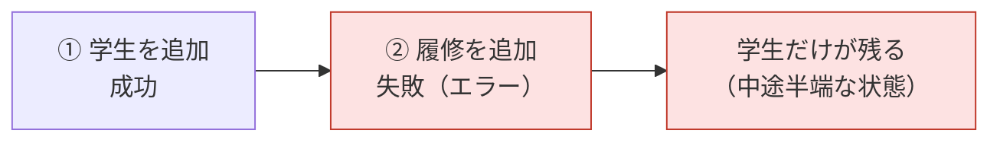
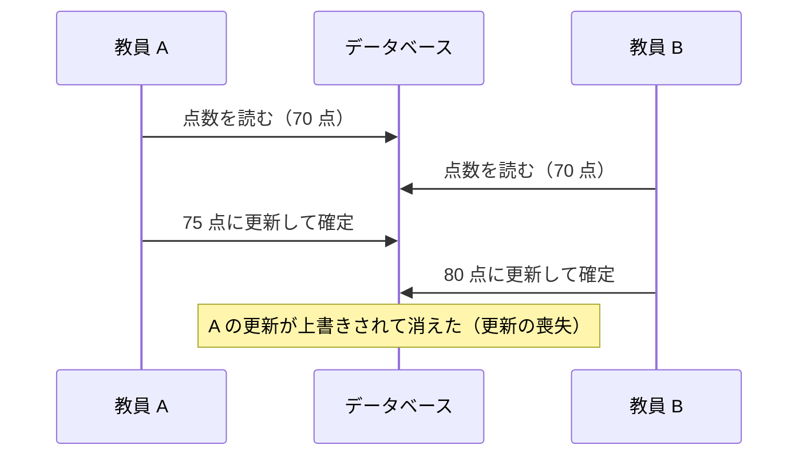
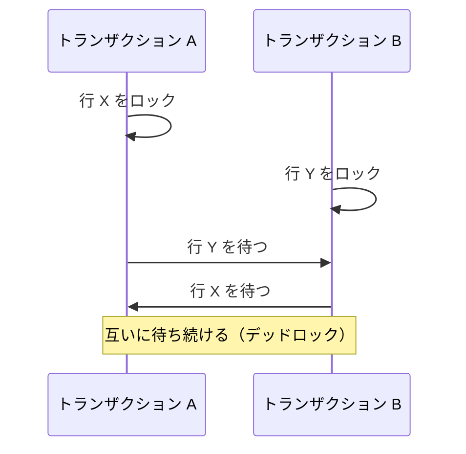
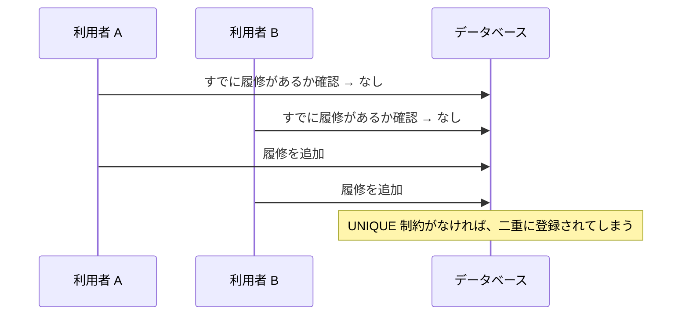
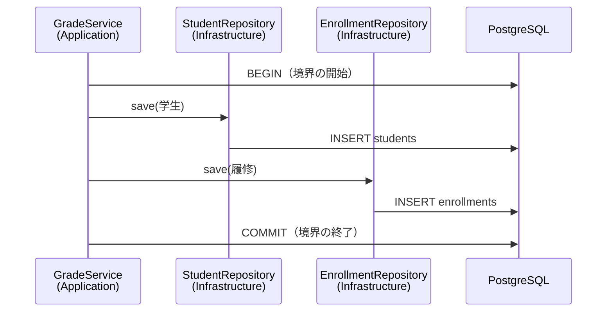

# 11. トランザクション

[📖 データベースの目次](./00_はじめに.md#目次) ｜ [🏠 全体の目次](../README.md#目次)

[← 前へ：10 SQL：応用](10_SQL_応用.md) ｜ [次へ：12 JavaからDBを使う（JDBC） →](12_JavaからDBを使う_JDBC.md)

## この章のゴール
- トランザクションが必要な場面を説明できる
- `BEGIN` / `COMMIT` / `ROLLBACK` を使える
- ACID の 4 つの性質を説明できる
- 同時に実行されたときに起きる問題と、分離レベル・ロックの考え方が分かる
- 4 層のうち、どの層がトランザクションの範囲を決めるのかを説明できる

## 目次

1. [トランザクションとは](#1-トランザクションとは)
2. [BEGIN / COMMIT / ROLLBACK](#2-begin--commit--rollback)
3. [ACID](#3-acid)
4. [同時実行で起きる問題](#4-同時実行で起きる問題)
5. [分離レベル](#5-分離レベル)
6. [ロック](#6-ロック)
7. [制約が最後の砦になる場面](#7-制約が最後の砦になる場面)
8. [4層とトランザクションの境界](#8-4層とトランザクションの境界)
9. [よくあるミス](#9-よくあるミス)

---

## 1. トランザクションとは

成績管理で、「新しい学生を登録し、同時に最初の履修も登録する」処理を考えます。これは 2 つの `INSERT` に分かれます。

1. `students` に学生を追加する
2. `enrollments` に履修を追加する

もし、**1 は成功し、2 でエラー**になったら、どうなるでしょうか。



履修のない学生だけが残ってしまいます。このように、**複数の操作を「全部成功」か「全部なかったこと」のどちらかにしたい**場面で使うのが、**トランザクション**です。

## 2. BEGIN / COMMIT / ROLLBACK

| 命令 | 意味 |
|---|---|
| `BEGIN` | トランザクションを**開始**する |
| `COMMIT` | ここまでの変更を**確定**する（他の人からも見えるようになる） |
| `ROLLBACK` | ここまでの変更を**取り消す**（なかったことにする） |

```sql
BEGIN;
INSERT INTO students (name, department_id, enrolled_year) VALUES ('Mika', 3, 2025);
INSERT INTO enrollments (student_id, course_id, academic_year, score)
VALUES (currval(pg_get_serial_sequence('students', 'student_id')), 1, 2025, NULL);
COMMIT;
```

`BEGIN` から `COMMIT` までが 1 つのトランザクションです。途中でエラーが起きたら、`COMMIT` ではなく `ROLLBACK` を実行すれば、1 つ目の `INSERT` も取り消されます。

> 💡 `currval(...)` は、直前に自動採番された ID を取り出す関数です（Java から使うときは、`RETURNING` で受け取るほうが一般的です：09 章）。

### 自動コミット

`BEGIN` を書かなければ、PostgreSQL は **1 つの SQL 文ごとに、自動で `BEGIN` ～ `COMMIT`** を行います（**自動コミット**）。これまで書いてきた SQL は、すべてそうでした。

### 取り消せることを活用する

`UPDATE` や `DELETE` を試すときに、結果を確認してから確定できます。09 章で述べた「実行前の確認」を、さらに安全にできます。

```sql
BEGIN;
UPDATE enrollments SET score = 85 WHERE student_id = 2 AND course_id = 3 AND academic_year = 2025;
SELECT * FROM enrollments WHERE student_id = 2;   -- 意図どおりか確認
ROLLBACK;                                          -- 問題があれば取り消す（OK なら COMMIT）
```

> [!WARNING]
> トランザクションの途中で SQL がエラーになると、PostgreSQL は `current transaction is aborted, commands ignored until end of transaction block` と表示し、以降の命令を受け付けなくなります。**`ROLLBACK` を実行して、トランザクションを終わらせる**必要があります。

## 3. ACID

信頼できるトランザクションが満たすべき 4 つの性質です。頭文字を取って **ACID**（アシッド）といいます。

| 性質 | 意味 | 成績管理での例 |
|---|---|---|
| **A**tomicity（原子性） | 全部成功か、全部なかったことになる | 学生の追加と履修の追加が、**両方成功するか、両方なかったことになる** |
| **C**onsistency（一貫性） | トランザクションの前後で、制約を満たした正しい状態が保たれる | 外部キーや `CHECK` に違反する状態には**ならない** |
| **I**solation（独立性） | 同時に実行されても、互いに干渉しない（途中経過が見えない） | 他の人の**途中の更新**が、自分の処理に影響しない |
| **D**urability（永続性） | 確定（`COMMIT`）した内容は、障害が起きても失われない | `COMMIT` 後に停電しても、**データは残る** |

> データベースが「信頼できる」のは、この ACID を DBMS が保証してくれるからです。ファイルに自分で書き込むのとの、大きな違いです（01 章）。

## 4. 同時実行で起きる問題

データベースは、複数の人・プログラムが**同時に**使います。何も対策しないと、次のような問題が起きます。

### 更新の喪失（Lost Update）

2 人の教員が、同じ履修の点数を同時に直す例です。



### 代表的な問題

| 問題 | 内容 |
|---|---|
| **ダーティリード** | 他のトランザクションの、**まだ確定していない**変更を読んでしまう |
| **ノンリピータブルリード** | 同じトランザクション内で同じ行を 2 回読んだら、**値が変わっていた**（他者が更新・確定した） |
| **ファントムリード** | 同じ条件で 2 回検索したら、**行が増えて（減って）いた**（他者が追加・削除・確定した） |
| **更新の喪失** | 同時の更新で、**一方の更新が消える** |

## 5. 分離レベル

どこまで干渉を防ぐかを、**分離レベル**で選べます。レベルを上げるほど安全ですが、同時に処理できる量や速度が下がることがあります。

| 分離レベル | ダーティリード | ノンリピータブルリード | ファントムリード |
|---|---|---|---|
| READ COMMITTED（**既定**） | 起きない | 起きうる | 起きうる |
| REPEATABLE READ | 起きない | 起きない | 起きない（PostgreSQL の場合） |
| SERIALIZABLE | 起きない | 起きない | 起きない |

- PostgreSQL の既定は **READ COMMITTED**。**確定した**変更だけを読むが、1 つのトランザクションの途中でも、他者の確定した変更は見える
- PostgreSQL では、ダーティリードは**どのレベルでも起きません**（`READ UNCOMMITTED` を指定しても、`READ COMMITTED` と同じに動く）
- **SERIALIZABLE** は、「1 つずつ順番に実行した」場合と同じ結果になることを保証する。競合したトランザクションは、エラーで失敗するので、**再実行する処理**が必要になる

```sql
BEGIN ISOLATION LEVEL REPEATABLE READ;   -- レベルを指定して開始する
```

> 💡 通常のアプリケーションは、**既定の READ COMMITTED のまま**で、ほとんど困りません。更新の喪失のような問題は、次のロックなどで個別に対策します。この資料では、分離レベルの存在と違いを知っておけば十分です。

## 6. ロック

**ロック**は、ある行を処理している間、他者が同じ行を変更できないようにする仕組みです。PostgreSQL は、`UPDATE` や `DELETE` で**対象の行を自動でロック**します。他のトランザクションがその行を変更しようとすると、**先のトランザクションが終わる（`COMMIT` / `ROLLBACK`）まで待たされます**。

### 読んだ行を、更新するまで確保する

先ほどの「更新の喪失」は、**読んだ時点で行をロック**すれば防げます。

```sql
BEGIN;
SELECT score FROM enrollments WHERE enrollment_id = 1 FOR UPDATE;   -- この行をロックして読む
UPDATE enrollments SET score = 75 WHERE enrollment_id = 1;
COMMIT;                                                              -- ここでロック解除
```

`FOR UPDATE` を付けると、他のトランザクションは、この行を更新できず**待たされます**。これが **悲観ロック**（「競合するだろう」と考え、先に確保する）の考え方です。

### 楽観ロック

もう 1 つの方法が **楽観ロック**（「競合は滅多に起きないだろう」と考え、更新時に確認する）です。行に**バージョン番号の列**を持たせ（今回のスキーマには無いので、あくまで考え方の例です）、更新時に「読んだときと同じバージョンか」を条件にします。

```sql
UPDATE enrollments SET score = 75, version = version + 1
WHERE enrollment_id = 1 AND version = 3;   -- 0 行しか更新されなければ、他者に先に更新されたと分かる
```

| | 悲観ロック | 楽観ロック |
|---|---|---|
| 考え方 | 先にロックして、他者を待たせる | ロックせず、更新時に衝突を検出する |
| 向く場面 | 競合が頻繁に起きる | 競合が滅多に起きない（画面で編集する時間が長いなど） |

### デッドロック

2 つのトランザクションが、**お互いが持つロックを待ち合う**と、どちらも進めなくなります。これを**デッドロック**といいます。



PostgreSQL は、デッドロックを**自動で検出**し、一方のトランザクションをエラーで終了させます。完全には避けられないので、**複数の行を更新するときは、常に同じ順序で更新する**とよいとされています。

## 7. 制約が最後の砦になる場面

06 章で述べたとおり、制約は「同時実行」でも効きます。

「同じ学生が、同じ年度に、同じ科目を二重に履修しない」というルールを、Java で「すでにあるか調べてから追加する」と書いたとします。



確認と追加の**間に別の人が追加**できてしまうため、アプリ側の確認だけでは防げません。**`UNIQUE` 制約があれば、後から来た追加がエラーになり、二重登録は起きません**。アプリケーションは、そのエラーを受け取って、「すでに登録されています」と利用者に伝えます。

## 8. 4層とトランザクションの境界

「どこからどこまでを 1 つのトランザクションにするか」を、**トランザクションの境界**といいます。4 層のうち、これを決めるのは **Application 層**です。



| 層 | トランザクションとの関係 |
|---|---|
| **Application** | **ユースケース 1 つ = トランザクション 1 つ**として、開始と終了を決める |
| **Infrastructure** | 渡された接続（トランザクション）の中で、SQL を実行する。自分では確定しない |
| **Domain** | トランザクションを**知らない** |

> [!WARNING]
> **Repository のメソッド（`save` など）の中で、それぞれ `COMMIT` してしまってはいけません。** 「学生の保存」と「履修の保存」が別々に確定してしまい、1 つ目だけが残る可能性が出ます。確定するのは、ユースケース全体が終わった**Application 層**です。

Java でのトランザクションの扱い方は、次のとおりです。

| 方式 | 内容 |
|---|---|
| 素の JDBC（12 章の補足） | `setAutoCommit(false)` → 処理 → `commit()` / `rollback()` を、自分で書く |
| Spring | メソッドに `@Transactional` を付けると、フレームワークが開始・確定・取り消しを行う（06 章） |

## 9. よくあるミス

| ミス | 原因・対処 |
|---|---|
| `BEGIN` したまま `COMMIT` を忘れる | 変更が確定せず、他の接続から見えない。ロックも残り、他者を待たせる。必ず `COMMIT` か `ROLLBACK` で終える |
| エラーのあとに `ROLLBACK` せず、次の SQL が全部失敗する | トランザクションが中止状態になっている。`ROLLBACK` で終わらせる |
| Repository の中でそれぞれ `COMMIT` する | ユースケース全体の原子性が失われる。境界は Application 層で決める |
| 「確認してから追加」だけで二重登録を防げると思う | 同時実行で破られる。`UNIQUE` 制約も付ける |
| 分離レベルを上げれば安心だと思う | 性能が下がり、再実行の処理も必要になる。まず既定のまま、ロックなどで個別に対策する |
| 長い時間、トランザクションを開いたままにする | ロックを持ち続けて、他者が待たされる。画面での入力待ちなどは、トランザクションの外で行う |
| 複数の行を、処理ごとに違う順序で更新する | デッドロックの原因。更新の順序をそろえる |

---

[← 前へ：10 SQL：応用](10_SQL_応用.md) ｜ [次へ：12 JavaからDBを使う（JDBC） →](12_JavaからDBを使う_JDBC.md)

[📖 データベースの目次](./00_はじめに.md#目次) ｜ [🏠 全体の目次](../README.md#目次)
