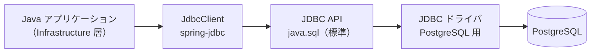
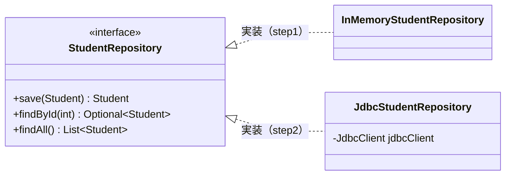
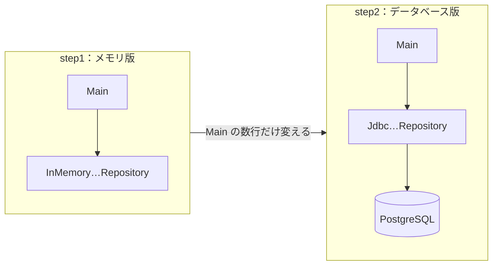

# 12. JavaからDBを使う（JDBC）

[📖 データベースの目次](./00_はじめに.md#目次) ｜ [🏠 全体の目次](../README.md#目次)

[← 前へ：11 トランザクション](11_トランザクション.md) ｜ [はじめに（目次）へ](00_はじめに.md)

## この章のゴール
- JDBC の役割と、ドライバの仕組みが分かる
- `JdbcClient` で、SQL の実行と結果の取得ができる
- **SQL インジェクション**の危険性と、プレースホルダによる対策を説明できる
- `JdbcClient` を使った Repository を、Infrastructure 層に実装する流れが分かる
- 保存先をメモリからデータベースに差し替えるとき、**何を変えて、何を変えないか**を説明できる

## 目次

1. [JDBC と JdbcClient](#1-jdbc-と-jdbcclient)
2. [接続する](#2-接続する)
3. [SQL を実行して結果を受け取る](#3-sql-を実行して結果を受け取る)
4. [SQL インジェクション](#4-sql-インジェクション)
5. [行を追加する：採番された ID の受け取り](#5-行を追加する採番された-id-の受け取り)
6. [NULL の扱い](#6-null-の扱い)
7. [Repository を実装する](#7-repository-を実装する)
8. [保存先を差し替える](#8-保存先を差し替える)
9. [例外の扱い](#9-例外の扱い)
10. [トランザクション](#10-トランザクション)
11. [接続の使い回し（コネクションプール）](#11-接続の使い回しコネクションプール)
12. [補足：素の JDBC](#12-補足素の-jdbc)
13. [よくあるミス](#13-よくあるミス)

---

## 1. JDBC と JdbcClient

**JDBC**（Java Database Connectivity）は、Java からデータベースに接続して SQL を実行するための、Java **標準の仕組み**です（`java.sql` パッケージ）。データベースごとの違いは、**JDBC ドライバ**が吸収します。

ただし、標準の JDBC をそのまま使うと、接続を閉じる処理や例外の処理を毎回書くことになります。そこでこの資料では、JDBC を簡単に呼び出せる Spring の部品、**`JdbcClient`** を使います。素の JDBC の書き方は、[12 節](#12-補足素の-jdbc)にまとめました。



| 用語 | 内容 |
|---|---|
| **JdbcClient** | SQL の実行を簡単にする部品。接続の管理と例外の変換を代わりに行う。`spring-jdbc` に含まれる |
| **JDBC API** | `Connection`、`PreparedStatement`、`ResultSet` など。JDK に含まれる |
| **JDBC ドライバ** | データベースごとのライブラリ。PostgreSQL では「PostgreSQL JDBC Driver」 |

ライブラリは、プロジェクトの依存関係に追加します（Maven の場合）。使うのは `spring-jdbc` だけで、**Spring Boot は必要ありません**（Spring Boot は [4層アーキテクチャ編 07 章](../4層アーキテクチャ/07_Spring_Bootで書き直す.md) で扱います）。

```xml
<dependency>
    <groupId>org.springframework</groupId>
    <artifactId>spring-jdbc</artifactId>
    <version><!-- 最新版を Maven Central で確認 --></version>
</dependency>
<dependency>
    <groupId>org.postgresql</groupId>
    <artifactId>postgresql</artifactId>
    <version><!-- 最新版を Maven Central で確認 --></version>
</dependency>
```

> [!IMPORTANT]
> 4 層のうち、データベースを直接扱うのは **Infrastructure 層だけ**です。`JdbcClient` や `java.sql` を import してよいのは、`infrastructure.jdbc` パッケージの中だけ、という約束にします。

## 2. 接続する

接続先は `DataSource`（接続を作る部品）で表します。接続には **URL**、**ユーザー名**、**パスワード**が必要です。`JdbcClient` は、この `DataSource` から作ります。

```java
PGSimpleDataSource dataSource = new PGSimpleDataSource();
dataSource.setUrl("jdbc:postgresql://localhost:5432/grades_db");
dataSource.setUser("postgres");
dataSource.setPassword(System.getenv("DB_PASSWORD"));

JdbcClient jdbcClient = JdbcClient.create(dataSource);
```

| URL の部分 | 意味 |
|---|---|
| `jdbc:postgresql:` | PostgreSQL に JDBC で接続する |
| `localhost:5432` | ホスト名とポート |
| `grades_db` | データベース名 |

> [!WARNING]
> **パスワードをソースコードに書かない**でください。上の例のように環境変数から読むか、設定ファイルに分けて、Git にコミットしないようにします。

> [!CAUTION]
> **セキュリティの視点**：この章の例では管理者の `postgres` で接続していますが、実際のアプリケーションでは、**アプリ専用のユーザー**を作り、必要な権限だけを与えます。こうしておくと、SQL インジェクション（4 節）などで乗っ取られても、テーブルの削除や作成はできません。IPA も、データベースのアカウントの権限を必要最小限にすることを、保険的対策として挙げています（[IPA「安全なウェブサイトの作り方 1.1 SQL インジェクション」](https://www.ipa.go.jp/security/vuln/websecurity/sql.html)、閲覧日：2026-11-08）。
>
> ```sql
> CREATE ROLE grades_app LOGIN PASSWORD '（推測されにくいパスワード）';
> -- 行の読み書きだけを許可する（DROP TABLE や CREATE TABLE はできない）
> GRANT SELECT, INSERT, UPDATE, DELETE ON ALL TABLES IN SCHEMA public TO grades_app;
> ```
>
> パスワードを書いたコードを GitHub に上げてしまった実例は、[Git 02 章の「やってはいけないこと」](../Git/02_CUI基本編.md#9-やってはいけないこと)にあります。

接続を開く・閉じる処理は、`JdbcClient` が SQL の実行ごとに行います。自分で閉じる必要はありません。

### 参考：Spring Boot を使う場合

この章では Spring Boot を使わないので、`DataSource` と `JdbcClient` を Java のコードで作りました。**Spring Boot を使う場合は、接続設定を Java で書きません**。`src/main/resources/application.properties` に次のように書くと、Spring Boot が `DataSource`（コネクションプール：11 節）と `JdbcClient` を自動で用意し、Repository のコンストラクタに渡してくれます（[4層アーキテクチャ編 07 章 4 節](../4層アーキテクチャ/07_Spring_Bootで書き直す.md#4-設定ファイル)）。

```properties
spring.datasource.driver-class-name=org.postgresql.Driver
spring.datasource.url=jdbc:postgresql://localhost:5432/grades_db
spring.datasource.username=postgres
spring.datasource.password=${DB_PASSWORD}
```

> [!NOTE]
> `${DB_PASSWORD}` は、環境変数 `DB_PASSWORD` の値に置き換わります。パスワードを設定ファイルに直接書かないためです。`driver-class-name` は、URL から自動で判断されるので省略することもできます。

## 3. SQL を実行して結果を受け取る

SQL の値を入れたい場所に `:名前`（名前付きプレースホルダ）を書き、`param` で値を渡します。`StudentRepository` を実装する `JdbcStudentRepository` の `findById` です。

```java
public class JdbcStudentRepository implements StudentRepository {
    private final JdbcClient jdbcClient;

    // コンストラクタインジェクション：JdbcClient は外から受け取る（自分で作らない）
    public JdbcStudentRepository(JdbcClient jdbcClient) {
        this.jdbcClient = jdbcClient;
    }

    @Override
    public Optional<Student> findById(int id) {
        String sql = """
                SELECT student_id, name, department_id, enrolled_year
                FROM students
                WHERE student_id = :id
                """;
        return jdbcClient.sql(sql)
                .param("id", id)                              // :id に値を渡す
                .query((rs, rowNum) -> new Student(rs.getInt("student_id"), rs.getString("name"),
                        rs.getInt("department_id"), rs.getInt("enrolled_year")))   // 行 → Domain のオブジェクト
                .optional();                                  // 0 件なら Optional.empty()
    }
}
```

- `JdbcClient` は、コンストラクタの引数で受け取ります（**コンストラクタインジェクション**）。誰が `JdbcClient` を作るか（8 節の `Main`、または Spring Boot）を、Repository は知らなくて済みます（4層アーキテクチャ編 03 章）
- SQL は、**テキストブロック**（`"""` で囲む複数行の文字列：[Java 入門 02 章](../付録/Java入門/02_基本文法・変数と型.md)）で変数に入れてから、`sql(...)` に渡します。SQL が長くなっても、改行して読みやすく書けます

> [!NOTE]
> **サンプル**：[`step2-jdbc/src/grades/infrastructure/jdbc/JdbcStudentRepository.java`](https://github.com/YTS0418/PRMN_SYSTEM_Sample/blob/main/step2-jdbc/src/grades/infrastructure/jdbc/JdbcStudentRepository.java)

SQL の種類と欲しい結果に合わせて、最後に呼ぶメソッドを選びます。

| 書き方 | 使う場面 | 戻り値 |
|---|---|---|
| `.query(...).optional()` | `SELECT`（0 件か 1 件） | `Optional` |
| `.query(...).list()` | `SELECT`（複数行） | `List` |
| `.query(Integer.class).single()` | `SELECT`（必ず 1 行、1 列） | その値（0 件や NULL は例外） |
| `.update()` | `INSERT` / `UPDATE` / `DELETE` | 変更された行数（`int`） |

ポイントです。

- 「**行（`rs`）→ Domain のオブジェクト（Student）**」の変換を、Infrastructure 層が担当する。`ResultSet` は、この層から外に出さない（4層アーキテクチャ編 02 章・04 章）
- `(rs, rowNum) -> ...` は、1 行を 1 つのオブジェクトに変換する処理。行を進める処理は `JdbcClient` が行う
- 列は、名前（`rs.getString("name")`）か、番号（1 から）で読み取る。名前のほうが間違いにくい

| SQL の型 | 読み取りメソッド |
|---|---|
| `INTEGER` / `SMALLINT` | `getInt` |
| `VARCHAR` / `TEXT` | `getString` |
| `BOOLEAN` | `getBoolean` |
| `DATE` | `getObject("列名", LocalDate.class)` |

## 4. SQL インジェクション

SQL に値を入れるとき、**文字列を連結して SQL を組み立ててはいけません**。

> [!WARNING]
> `"SELECT * FROM students WHERE name = '" + name + "'"` のように、入力値を連結して SQL を作ると、**SQL インジェクション**という攻撃を受けます。`JdbcClient` を使っていても、連結すれば同じです。

名前に次の文字列を入力されたとします。

```
' OR '1'='1
```

連結した SQL は、次のようになります。

```sql
SELECT * FROM students WHERE name = '' OR '1'='1'
```

`'1'='1'` は常に真なので、**全学生が取り出されて**しまいます。入力が `'; DROP TABLE students; --` のようなら、テーブルを消されるおそれもあります。入力値が、**SQL の一部として解釈されてしまう**のが原因です。

### 対策：プレースホルダ

`:name` と `param` で値を渡すと、値は**あくまで「値」として**扱われ、SQL の構文として解釈されません。

| | 書き方 | 安全性 |
|---|---|---|
| ✕ 連結 | `"... WHERE name = '" + name + "'"` | **危険**（SQL インジェクション） |
| ○ プレースホルダ | `"... WHERE name = :name"` + `.param("name", name)` | 安全（値は SQL として解釈されない） |

### 参考：位置パラメータと名前付きパラメータ

プレースホルダには、`?` と `:名前` の 2 種類があります。`JdbcClient` はどちらも使えます。安全性は同じです。

| | 位置パラメータ | 名前付きパラメータ（この資料） |
|---|---|---|
| SQL での書き方 | `WHERE name = ? AND enrolled_year = ?` | `WHERE name = :name AND enrolled_year = :year` |
| 値の渡し方 | `.param("Taro").param(2024)`（**書いた順番**に対応） | `.param("name", "Taro").param("year", 2024)`（**名前**で対応） |
| 長所 | 短く書ける。素の JDBC（12 節）と同じ | 順番を気にしなくてよい。同じ値を 2 か所で使える |
| 短所 | `?` が多いと、順番を取り違えやすい | 名前の書き間違いに注意（13 節） |

この資料では、取り違えの起きにくい**名前付きパラメータ**を使います。

> [!TIP]
> **SQL に値を入れるときは、必ずプレースホルダを使う**。これは例外なしのルールです。テーブル名や列名のように、プレースホルダでは指定できない部分を動的に変える場合は、あらかじめ決めた**選択肢の中から選ぶ**（利用者の入力をそのまま使わない）ようにします。

> [!CAUTION]
> **セキュリティの視点**：SQL インジェクションは、昔から知られている攻撃ですが、**今も被害が出ています**。
>
> #### 実例
> - 2025 年には、模試を運営する会社のサーバーが SQL インジェクションで不正アクセスされ、受験者の情報 約 28 万件などが流出した可能性があると公表されました（[学悠出版「不正アクセスによる情報流出の可能性に関するお詫びとお知らせ」](https://www.zenkenmoshi.jp/)、2025-06-30、閲覧日：2026-11-08）。
>
> IPA の「情報セキュリティ10大脅威 2026」（組織編）でも、「システムの脆弱性を悪用した攻撃」が 4 位です（[IPA](https://www.ipa.go.jp/security/10threats/10threats2026.html)）。対策の考え方は、IPA の「[安全なウェブサイトの作り方 1.1 SQL インジェクション](https://www.ipa.go.jp/security/vuln/websecurity/sql.html)」にまとまっています。

## 5. 行を追加する：採番された ID の受け取り

`StudentRepository.save` は、学生を追加し、**採番された ID を持つ `Student`** を返します（4層アーキテクチャ編）。09 章の `RETURNING` を使います。

```java
@Override
public Student save(Student student) {
    String sql = """
            INSERT INTO students (name, department_id, enrolled_year)
            VALUES (:name, :departmentId, :enrolledYear)
            RETURNING student_id
            """;
    int id = jdbcClient.sql(sql)
            .param("name", student.name())
            .param("departmentId", student.departmentId())
            .param("enrolledYear", student.enrolledYear())
            .query(Integer.class)                         // RETURNING があるので query
            .single();
    return student.withId(id);                            // 採番された ID を持つ Student を返す
}
```

> [!TIP]
> `RETURNING` がある `INSERT` は、結果の行を返すので、`update` ではなく `query` を使います。

履修の保存（`EnrollmentRepository.save`）は、メモリ版の「同じ（学生, 科目, 年度）があれば上書き」を、SQL の `ON CONFLICT` で実現できます。

```sql
INSERT INTO enrollments (student_id, course_id, academic_year, score) VALUES (:studentId, :courseId, :academicYear, :score)
ON CONFLICT (student_id, course_id, academic_year) DO UPDATE SET score = EXCLUDED.score;
```

「同じ組み合わせがすでにあれば、点数だけ更新する」という意味です。メモリ版では**コードで**守っていたルールを、データベースでは **`UNIQUE` 制約が支える**ことが分かります。

## 6. NULL の扱い

`score` のように NULL を許す列は、注意が必要です。

| 操作 | 注意 | 書き方 |
|---|---|---|
| **読み取り** | `rs.getInt("score")` は、NULL のとき **0 を返す**（0 点と区別できない） | `rs.getObject("score", Integer.class)`（NULL なら `null`） |
| **書き込み** | `null` を渡すときは、列の型を明示すると確実 | `.param("score", score, Types.SMALLINT)`（`null` も渡せる） |

4層アーキテクチャ編で `Enrollment` の `score` を `Integer` にしていたのは、このためです。Java 側の `null`（履修中）と、データベース側の `NULL` を、Infrastructure 層で対応させます。

> [!WARNING]
> `getInt` を使うと、**履修中の行が 0 点として読み込まれます**。合否の判定は誤り（0 点＝不合格）になるので、気づきにくいバグになります。

## 7. Repository を実装する

4層アーキテクチャ編 06 章で読んだ `InMemory…Repository` に対応する、**データベース版**を Infrastructure 層に追加します。



| Repository | 主な SQL |
|---|---|
| `JdbcStudentRepository` | `INSERT`（`RETURNING`）、`SELECT ... WHERE student_id = :id`、`SELECT ... ORDER BY student_id` |
| `JdbcCourseRepository` | `SELECT ... FROM courses`（読み取りのみ） |
| `JdbcEnrollmentRepository` | `INSERT ... ON CONFLICT`、`SELECT ... WHERE student_id = :studentId` |

> [!NOTE]
> **サンプル**：[`step2-jdbc/src/grades/infrastructure/jdbc/`](https://github.com/YTS0418/PRMN_SYSTEM_Sample/tree/main/step2-jdbc/src/grades/infrastructure/jdbc)

### Domain のオブジェクトとテーブルは、同じ形でなくてよい

| テーブルの列 | Domain のオブジェクト |
|---|---|
| `courses.teacher_id`（NOT NULL） | `Course` には持たせない（今回のユースケースでは使わない。`SELECT` で取らなければよい） |
| `enrollments.enrollment_id`（代理キー） | `Enrollment` には持たせない（業務上の意味がなく、Domain は知らなくてよい） |
| `students.enrolled_year` | `Student` に持たせる（登録時に必須なので） |

テーブルは**データを保存するための形**、Domain のオブジェクトは**業務で使う形**です。両者を対応づける（マッピング）のが、Infrastructure 層の役割です。

## 8. 保存先を差し替える

ここが、4 層に分けた効果を確かめる場面です。メモリ版（step1）からデータベース版（step2）へ、何を変えるでしょうか。

| 層 | 変更 |
|---|---|
| **Domain** | **変更なし**（`Student`、`Enrollment`、`…Repository` のインタフェース） |
| **Application** | **変更なし**（`GradeService`、`Transcript`） |
| **Presentation** | **変更なし**（`ConsoleApp`） |
| **Infrastructure** | `jdbc` パッケージに **`Jdbc…Repository` を追加**（`memory` パッケージはそのまま残してよい） |
| **Main**（組み立て） | `new InMemory…` を `new Jdbc…(jdbcClient)` に**差し替える** |



`Main` では、2 節のとおり `DataSource` と `JdbcClient` を用意して、`Jdbc…Repository` に渡します。

```java
JdbcClient jdbcClient = JdbcClient.create(dataSource);
StudentRepository students = new JdbcStudentRepository(jdbcClient);   // new InMemoryStudentRepository() から差し替え
```

> [!NOTE]
> 03 章で「保存先を変えたいときに書き換えるのは、組み立てる場所の数行だけ」と説明したことが、ここで確認できます。**`GradeService` も `ConsoleApp` も、1 行も変更していません**。これが、インタフェースを Domain 層に置き、コンストラクタで受け取るようにした効果です。

## 9. 例外の扱い

`JdbcClient` は、失敗すると、JDBC の `SQLException`（チェック例外）を **`DataAccessException`** の仲間（実行時例外）に変換して投げます。`try-catch` を毎回書く必要はありません。

| 起きたこと | 投げられる例外 | 対応する制約 |
|---|---|---|
| 一意制約違反 | `DuplicateKeyException` | `UNIQUE` / `PRIMARY KEY` |
| 外部キー、NOT NULL などの違反 | `DataIntegrityViolationException` | `FOREIGN KEY` / `NOT NULL` / `CHECK` |
| SQL の書き間違い | `BadSqlGrammarException` | なし |

ただし、これらは Spring の例外です。Application 層に Spring を知らせないよう、**業務で意味のある例外は Infrastructure 層で変換**します。`RepositoryException` は Domain 層に置き、どの層からも使えるようにします（4層アーキテクチャ編 03 章）。

```java
try {
    // …（INSERT を実行）
} catch (DataAccessException e) {
    throw new RepositoryException("学生の登録に失敗しました", e);
}
```

> [!TIP]
> たとえば `DuplicateKeyException` を受け取ったら、「すでに登録されています」という分かりやすいエラーに変換して、上の層に伝えます（11 章 7 節の二重登録の例）。

> [!CAUTION]
> **セキュリティの視点**：例外のメッセージ（SQL 文、テーブル名、制約名）を、**そのまま利用者の画面に出さない**でください。攻撃者にとっては、データベースの構造を知る手がかりになります。利用者には「登録に失敗しました」のような短い文を見せ、詳しい内容は開発者用の**ログ**に残します。ただし、パスワードや個人情報は、ログにも書きません。IPA も、エラーメッセージをそのまま表示しないことを、保険的対策として挙げています（[IPA「安全なウェブサイトの作り方 1.1 SQL インジェクション」](https://www.ipa.go.jp/security/vuln/websecurity/sql.html)、閲覧日：2026-11-08）。

## 10. トランザクション

`JdbcClient` は、そのまま使うと、SQL を 1 つ実行するごとに確定します（**自動コミット**：11 章）。

今回のサンプルのユースケース（学生の登録、成績の登録）は、**どれも更新が 1 回だけ**です。自動コミットで足りるので、step2 ではトランザクションの処理を書きません。

ただし、「学生と最初の履修を同時に登録する」のような、**複数の更新が必要なユースケース**では、トランザクションの境界を **Application 層**で決める必要があります（11 章 8 節）。Spring では、メソッドに **`@Transactional`** を付けるだけで済みます（4層アーキテクチャ編 07 章）。

## 11. 接続の使い回し（コネクションプール）

データベースへの接続を作るには時間がかかります。リクエストのたびに作って閉じるのは無駄なので、**あらかじめ作った接続をプールしておき、使い回す**仕組みが一般的です。これを**コネクションプール**といいます。

| | 内容 |
|---|---|
| `PGSimpleDataSource` / `DriverManager` | 呼ぶたびに新しい接続を作る。学習用・小規模向け |
| コネクションプール（**HikariCP** など） | 接続を使い回す。実際のアプリケーション向け。Spring Boot は既定で HikariCP を使う |

> [!NOTE]
> `JdbcClient.create(dataSource)` と書くコードは、`DataSource` の実体がプールでも単純な実装でも**変わりません**。これも、インタフェースを通して使う利点です。プールの場合、接続を閉じる処理は「**プールに返す**」動作になります。

## 12. 補足：素の JDBC

`JdbcClient` の内側では、標準の JDBC が動いています。他の資料やコードを読むときのために、`JdbcClient` を使わない書き方も知っておきましょう。必要なのは PostgreSQL のドライバだけです。

### 接続する

接続は `Connection` で表します。使い終わったら**必ず閉じます**。**try-with-resources** を使えば、例外が起きても確実に閉じられます（付録 Java 入門 09 章で扱っています）。

```java
String url = "jdbc:postgresql://localhost:5432/grades_db";
try (Connection conn = DriverManager.getConnection(url, "postgres", System.getenv("DB_PASSWORD"))) {
    System.out.println("接続成功: " + conn.getMetaData().getDatabaseProductVersion());
}   // try-with-resources で、自動的に閉じる
```

### SQL を実行して結果を受け取る

SQL の実行には `PreparedStatement` を使います。値を入れたい場所に `?`（プレースホルダ）を書き、あとから値を設定します。`?` の番号は **1 から**数えます。

| メソッド | 使う場面 | 戻り値 |
|---|---|---|
| `executeQuery()` | `SELECT` | `ResultSet`（結果の行の集まり） |
| `executeUpdate()` | `INSERT` / `UPDATE` / `DELETE` | 変更された行数（`int`） |

`ResultSet` は、`next()` で 1 行ずつ進めながら、列の値を読み取ります。3 節の `findById` を素の JDBC で書くと、次のようになります。

```java
@Override
public Optional<Student> findById(int id) {
    String sql = "SELECT student_id, name, department_id, enrolled_year FROM students WHERE student_id = ?";
    try (Connection conn = dataSource.getConnection();
         PreparedStatement ps = conn.prepareStatement(sql)) {
        ps.setInt(1, id);                                 // 1 番目の ? に値を入れる（番号は 1 から）
        try (ResultSet rs = ps.executeQuery()) {
            if (!rs.next()) return Optional.empty();      // 行がなければ空
            return Optional.of(new Student(rs.getInt("student_id"), rs.getString("name"),
                    rs.getInt("department_id"), rs.getInt("enrolled_year")));   // 行 → Domain のオブジェクト
        }
    } catch (SQLException e) {
        throw new RepositoryException("学生の取得に失敗しました", e);
    }
}
```

1 行だけ取る場合は `if (rs.next())`、複数行は `while (rs.next())` です。

### 行を追加する

```java
String sql = "INSERT INTO students (name, department_id, enrolled_year) VALUES (?, ?, ?) RETURNING student_id";
try (Connection conn = dataSource.getConnection(); PreparedStatement ps = conn.prepareStatement(sql)) {
    ps.setString(1, student.name());
    ps.setInt(2, student.departmentId());
    ps.setInt(3, student.enrolledYear());
    try (ResultSet rs = ps.executeQuery()) {          // RETURNING があるので executeQuery
        rs.next();
        return student.withId(rs.getInt("student_id"));   // 採番された ID を持つ Student を返す
    }
}   // catch (SQLException e) は findById と同様
```

### NULL の扱い

書き込みでは、`ps.setInt(4, score)` に `null`（`Integer`）を渡せません。`ps.setObject(4, score, Types.SMALLINT)` を使います。読み取りの注意は、6 節と同じです。

### 例外の扱い

JDBC のメソッドは、失敗すると **`SQLException`**（チェック例外）を投げます。

| 層 | 方針 |
|---|---|
| **Infrastructure** | `SQLException` を**捕まえる**。独自の**実行時例外**（例：`RepositoryException`）に包んで投げ直す |
| **Application / Presentation** | `java.sql` を import しない。`SQLException` を**知らない** |

`SQLException` のままだと、Application 層が「JDBC を使っている」ことを知ってしまい、依存の向きが崩れます（4層アーキテクチャ編 03 章）。

制約に違反した場合は、`SQLException.getSQLState()` で原因を区別できます。

| SQLState | 意味 | 対応する制約 |
|---|---|---|
| `23505` | 一意制約違反 | `UNIQUE` / `PRIMARY KEY` |
| `23503` | 外部キー制約違反 | `FOREIGN KEY` |
| `23514` | チェック制約違反 | `CHECK` |
| `23502` | NOT NULL 制約違反 | `NOT NULL` |

### トランザクション

JDBC は、既定で**自動コミット**です（11 章）。複数の SQL を 1 つのトランザクションにするには、自動コミットをやめて、自分で確定・取り消しをします。

```java
try (Connection conn = dataSource.getConnection()) {
    conn.setAutoCommit(false);                 // 自動コミットをやめる = トランザクションの開始
    try {
        // …（複数の SQL を実行）
        conn.commit();                         // すべて成功したら確定
    } catch (SQLException e) {
        conn.rollback();                       // 失敗したら取り消す
        throw e;
    }
}
```

素の JDBC では、Application 層が `Connection` を扱わずに境界を決める仕組みを、自分で作る必要があります。`@Transactional` は、これを肩代わりします。

## 13. よくあるミス

| ミス | 原因・対処 |
|---|---|
| SQL に変数を `+` で連結する | **SQL インジェクション**の危険。`:名前` のプレースホルダと `param` を使う |
| `No suitable driver found` | ドライバが依存関係に入っていない、または URL が間違っている（`jdbc:postgresql://…`） |
| `.param` の名前と、SQL の `:名前` が食い違う | 実行時に例外になる。同じ名前にする |
| `.single()` で例外になる | 結果が 0 件、または値が NULL。0 件がありうるなら `.optional()` を使う |
| `getInt` で NULL が 0 になる | `getObject("列名", Integer.class)` を使う |
| `RETURNING` つきの `INSERT` に `.update()` を使う | 結果の行を受け取れない。`.query(...)` を使う |
| Spring の例外を Application 層まで投げてしまう | 業務で意味のある例外は、Infrastructure 層で `RepositoryException` などに変換する |
| パスワードをソースコードに書いて、Git にコミットする | 環境変数や設定ファイルを使う。コミットしてしまったら、パスワードを変更する |
| `ResultSet` を Repository の外に返す | 閉じられたあとは読めない。Domain のオブジェクトに変換してから返す |
| Repository のメソッドごとに確定する | ユースケース全体の原子性が失われる（11 章）。境界は Application 層で決める |
| （素の JDBC）`Connection` / `ResultSet` を閉じ忘れる | 接続が枯渇する。try-with-resources で必ず閉じる |
| （素の JDBC）`ps.setInt(0, ...)` で例外 | `?` の番号は **1 から**数える |
| （素の JDBC）`rs.next()` を呼ばずに `rs.getInt` を呼ぶ | 最初の `next()` で最初の行に進む。呼ばずに読むと例外になる |

---

[← 前へ：11 トランザクション](11_トランザクション.md) ｜ [はじめに（目次）へ](00_はじめに.md)

[📖 データベースの目次](./00_はじめに.md#目次) ｜ [🏠 全体の目次](../README.md#目次)
