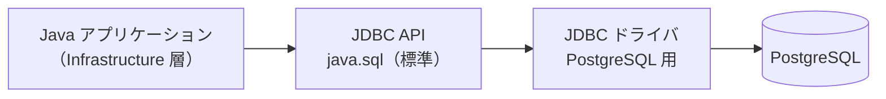
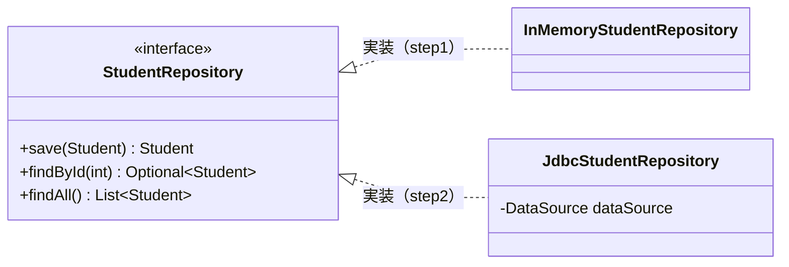
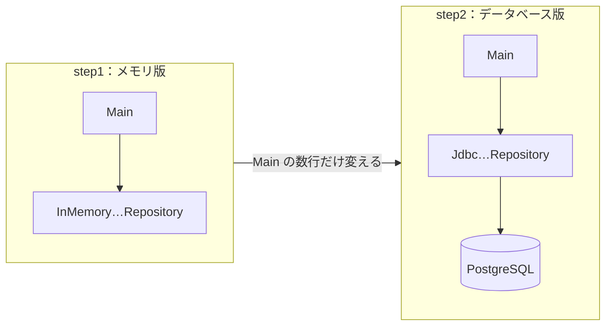

# 12. JavaからDBを使う（JDBC）

[📖 データベースの目次](./00_はじめに.md#目次) ｜ [🏠 全体の目次](../README.md#目次)

[← 前へ：11 トランザクション](11_トランザクション.md) ｜ [はじめに（目次）へ](00_はじめに.md)

## この章のゴール
- JDBC の役割と、ドライバの仕組みが分かる
- `PreparedStatement` と `ResultSet` で、SQL の実行と結果の取得ができる
- **SQL インジェクション**の危険性と、`PreparedStatement` による対策を説明できる
- JDBC を使った Repository を、Infrastructure 層に実装する流れが分かる
- 保存先をメモリからデータベースに差し替えるとき、**何を変えて、何を変えないか**を説明できる

## 目次

1. [JDBC とは](#1-jdbc-とは)
2. [接続する](#2-接続する)
3. [SQL を実行して結果を受け取る](#3-sql-を実行して結果を受け取る)
4. [SQL インジェクション](#4-sql-インジェクション)
5. [行を追加する：採番された ID の受け取り](#5-行を追加する採番された-id-の受け取り)
6. [NULL の扱い](#6-null-の扱い)
7. [Repository を JDBC で実装する](#7-repository-を-jdbc-で実装する)
8. [保存先を差し替える](#8-保存先を差し替える)
9. [例外の扱い](#9-例外の扱い)
10. [トランザクション](#10-トランザクション)
11. [接続の使い回し（コネクションプール）](#11-接続の使い回しコネクションプール)
12. [よくあるミス](#12-よくあるミス)

---

## 1. JDBC とは

**JDBC**（Java Database Connectivity）は、Java からデータベースに接続して SQL を実行するための、Java **標準の仕組み**です（`java.sql` パッケージ）。

データベースごとの違いは、**JDBC ドライバ**が吸収します。Java のコードは JDBC の決まった書き方で書き、PostgreSQL との実際のやり取りはドライバが担当します。



| 用語 | 内容 |
|---|---|
| **JDBC API** | `Connection`、`PreparedStatement`、`ResultSet` など。JDK に含まれる |
| **JDBC ドライバ** | データベースごとのライブラリ。PostgreSQL では「PostgreSQL JDBC Driver」 |

ドライバは、プロジェクトの依存関係に追加します（Maven の場合）。

```xml
<dependency>
    <groupId>org.postgresql</groupId>
    <artifactId>postgresql</artifactId>
    <version><!-- 最新版を Maven Central で確認 --></version>
</dependency>
```

> 4 層のうち、JDBC を使うのは **Infrastructure 層だけ**です。`java.sql` を import してよいのは、`infrastructure.jdbc` パッケージの中だけ、という約束にします。

## 2. 接続する

データベースへの接続は、`Connection` で表します。接続には **URL**、**ユーザー名**、**パスワード**が必要です。

```java
String url = "jdbc:postgresql://localhost:5432/grades_db";
try (Connection conn = DriverManager.getConnection(url, "postgres", System.getenv("DB_PASSWORD"))) {
    System.out.println("接続成功: " + conn.getMetaData().getDatabaseProductVersion());
}   // try-with-resources で、自動的に閉じる
```

| URL の部分 | 意味 |
|---|---|
| `jdbc:postgresql:` | PostgreSQL に JDBC で接続する |
| `localhost:5432` | ホスト名とポート |
| `grades_db` | データベース名 |

> ⚠️ **パスワードをソースコードに書かない**でください。上の例のように環境変数から読むか、設定ファイルに分けて、Git にコミットしないようにします。

`Connection` は、使い終わったら**必ず閉じます**。Java 入門 09 章で学んだ **try-with-resources** を使えば、例外が起きても確実に閉じられます。

## 3. SQL を実行して結果を受け取る

SQL の実行には `PreparedStatement` を使います。SQL の値を入れたい場所に `?`（プレースホルダ）を書き、あとから値を設定します。

| メソッド | 使う場面 | 戻り値 |
|---|---|---|
| `executeQuery()` | `SELECT` | `ResultSet`（結果の行の集まり） |
| `executeUpdate()` | `INSERT` / `UPDATE` / `DELETE` | 変更された行数（`int`） |

`ResultSet` は、`next()` で 1 行ずつ進めながら、列の値を読み取ります。`StudentRepository.findById` の実装です。

```java
@Override
public Optional<Student> findById(int id) {
    String sql = "SELECT student_id, name, department_id, enrolled_year FROM students WHERE student_id = ?";
    try (Connection conn = dataSource.getConnection();
         PreparedStatement ps = conn.prepareStatement(sql)) {
        ps.setInt(1, id);                                 // 1 番目の ? に値を入れる（番号は 1 から）
        try (ResultSet rs = ps.executeQuery()) {
            if (!rs.next()) return Optional.empty();      // 行がなければ空
            return Optional.of(new Student(rs.getInt("student_id"), rs.getString("name"),
                    rs.getInt("department_id"), rs.getInt("enrolled_year")));   // 行 → Domain のオブジェクト
        }
    } catch (SQLException e) {
        throw new RepositoryException("学生の取得に失敗しました", e);
    }
}
```

> 📦 **サンプル**：[`step2-jdbc/src/grades/infrastructure/jdbc/JdbcStudentRepository.java`](https://github.com/<ORG>/PRMN_SYSTEM_Sample/blob/main/step2-jdbc/src/grades/infrastructure/jdbc/JdbcStudentRepository.java)

ポイントです。

- 「**行（ResultSet）→ Domain のオブジェクト（Student）**」の変換を、Infrastructure 層が担当する。`ResultSet` は、この層から外に出さない（4層アーキテクチャ編 02 章）
- 列は、名前（`rs.getString("name")`）か、番号（1 から）で読み取る。名前のほうが間違いにくい
- 1 行だけ取る場合は `if (rs.next())`、複数行は `while (rs.next())`

| SQL の型 | 読み取りメソッド |
|---|---|
| `INTEGER` / `SMALLINT` | `getInt` |
| `VARCHAR` / `TEXT` | `getString` |
| `BOOLEAN` | `getBoolean` |
| `DATE` | `getObject("列名", LocalDate.class)` |

## 4. SQL インジェクション

SQL に値を入れるとき、**文字列を連結して SQL を組み立ててはいけません**。

> [!WARNING]
> `"SELECT * FROM students WHERE name = '" + name + "'"` のように、入力値を連結して SQL を作ると、**SQL インジェクション**という攻撃を受けます。

名前に次の文字列を入力されたとします。

```
' OR '1'='1
```

連結した SQL は、次のようになります。

```sql
SELECT * FROM students WHERE name = '' OR '1'='1'
```

`'1'='1'` は常に真なので、**全学生が取り出されて**しまいます。入力が `'; DROP TABLE students; --` のようなら、テーブルを消されるおそれもあります。入力値が、**SQL の一部として解釈されてしまう**のが原因です。

### 対策：PreparedStatement

`?` と `setString` などで値を渡すと、値は**あくまで「値」として**扱われ、SQL の構文として解釈されません。

| | 書き方 | 安全性 |
|---|---|---|
| ✕ 連結 | `"... WHERE name = '" + name + "'"` | **危険**（SQL インジェクション） |
| ○ プレースホルダ | `"... WHERE name = ?"` + `ps.setString(1, name)` | 安全（値は SQL として解釈されない） |

> 💡 **SQL に値を入れるときは、必ずプレースホルダ（`?`）を使う**。これは例外なしのルールです。テーブル名や列名のように、`?` では指定できない部分を動的に変える場合は、あらかじめ決めた**選択肢の中から選ぶ**（利用者の入力をそのまま使わない）ようにします。

## 5. 行を追加する：採番された ID の受け取り

`StudentRepository.save` は、学生を追加し、**採番された ID を持つ `Student`** を返します（4層アーキテクチャ編）。09 章の `RETURNING` を使います。

```java
String sql = "INSERT INTO students (name, department_id, enrolled_year) VALUES (?, ?, ?) RETURNING student_id";
try (Connection conn = dataSource.getConnection(); PreparedStatement ps = conn.prepareStatement(sql)) {
    ps.setString(1, student.name());
    ps.setInt(2, student.departmentId());
    ps.setInt(3, student.enrolledYear());
    try (ResultSet rs = ps.executeQuery()) {          // RETURNING があるので executeQuery
        rs.next();
        return student.withId(rs.getInt("student_id"));   // 採番された ID を持つ Student を返す
    }
}   // catch (SQLException e) は findById と同様
```

> 💡 `RETURNING` がある `INSERT` は、結果の行を返すので、`executeQuery` を使います。

履修の保存（`EnrollmentRepository.save`）は、メモリ版の「同じ（学生, 科目, 年度）があれば上書き」を、SQL の `ON CONFLICT` で実現できます。

```sql
INSERT INTO enrollments (student_id, course_id, academic_year, score) VALUES (?, ?, ?, ?)
ON CONFLICT (student_id, course_id, academic_year) DO UPDATE SET score = EXCLUDED.score;
```

「同じ組み合わせがすでにあれば、点数だけ更新する」という意味です。メモリ版では**コードで**守っていたルールを、データベースでは **`UNIQUE` 制約が支える**ことが分かります。

## 6. NULL の扱い

`score` のように NULL を許す列は、JDBC では注意が必要です。

| 操作 | 注意 | 書き方 |
|---|---|---|
| **読み取り** | `rs.getInt("score")` は、NULL のとき **0 を返す**（0 点と区別できない） | `rs.getObject("score", Integer.class)`（NULL なら `null`） |
| **書き込み** | `ps.setInt(4, score)` は、`null`（`Integer`）を渡せない | `ps.setObject(4, score, Types.SMALLINT)`（`null` も渡せる） |

4層アーキテクチャ編で `Enrollment` の `score` を `Integer` にしていたのは、このためです。Java 側の `null`（履修中）と、データベース側の `NULL` を、Infrastructure 層で対応させます。

> ⚠️ `getInt` を使うと、**履修中の行が 0 点として読み込まれます**。合否の判定は誤り（0 点＝不合格）になるので、気づきにくいバグになります。

## 7. Repository を JDBC で実装する

4層アーキテクチャ編 05 章で読んだ `InMemory…Repository` に対応する、**JDBC 版**を Infrastructure 層に追加します。



| Repository | 主な SQL |
|---|---|
| `JdbcStudentRepository` | `INSERT`（`RETURNING`）、`SELECT ... WHERE student_id = ?`、`SELECT ... ORDER BY student_id` |
| `JdbcCourseRepository` | `SELECT ... FROM courses`（読み取りのみ） |
| `JdbcEnrollmentRepository` | `INSERT ... ON CONFLICT`、`SELECT ... WHERE student_id = ?` |

> 📦 **サンプル**：[`step2-jdbc/src/grades/infrastructure/jdbc/`](https://github.com/<ORG>/PRMN_SYSTEM_Sample/tree/main/step2-jdbc/src/grades/infrastructure/jdbc)

### Domain のオブジェクトとテーブルは、同じ形でなくてよい

| テーブルの列 | Domain のオブジェクト |
|---|---|
| `courses.teacher_id`（NOT NULL） | `Course` には持たせない（今回のユースケースでは使わない。`SELECT` で取らなければよい） |
| `enrollments.enrollment_id`（代理キー） | `Enrollment` には持たせない（業務上の意味がなく、Domain は知らなくてよい） |
| `students.enrolled_year` | `Student` に持たせる（登録時に必須なので） |

テーブルは**データを保存するための形**、Domain のオブジェクトは**業務で使う形**です。両者を対応づける（マッピング）のが、Infrastructure 層の役割です。

## 8. 保存先を差し替える

ここが、4 層に分けた効果を確かめる場面です。メモリ版（step1）からデータベース版（step2）へ、何を変えるでしょうか。

| 層 | 変更 |
|---|---|
| **Domain** | **変更なし**（`Student`、`Enrollment`、`…Repository` のインタフェース） |
| **Application** | **変更なし**（`GradeService`、`Transcript`） |
| **Presentation** | **変更なし**（`ConsoleApp`） |
| **Infrastructure** | `jdbc` パッケージに **`Jdbc…Repository` を追加**（`memory` パッケージはそのまま残してよい） |
| **Main**（組み立て） | `new InMemory…` を `new Jdbc…(dataSource)` に**差し替える** |



`Main` では、`DataSource`（接続を作る部品）を用意して、`Jdbc…Repository` に渡します。学習用には、PostgreSQL ドライバの `PGSimpleDataSource` に URL・ユーザー・パスワードを設定するだけで足ります。

> 💡 03 章で「保存先を変えたいときに書き換えるのは、組み立てる場所の数行だけ」と説明したことが、ここで確認できます。**`GradeService` も `ConsoleApp` も、1 行も変更していません**。これが、インタフェースを Domain 層に置き、コンストラクタで受け取るようにした効果です。

## 9. 例外の扱い

JDBC のメソッドは、失敗すると **`SQLException`**（チェック例外）を投げます。

| 層 | 方針 |
|---|---|
| **Infrastructure** | `SQLException` を**捕まえる**。独自の**実行時例外**（例：`RepositoryException`）に包んで投げ直す |
| **Application / Presentation** | `java.sql` を import しない。`SQLException` を**知らない** |

`SQLException` のままだと、Application 層が「JDBC を使っている」ことを知ってしまい、依存の向きが崩れます（4層アーキテクチャ編 03 章）。`RepositoryException` は Domain 層に置き、どの層からも使えるようにします。

制約に違反した場合は、`SQLException.getSQLState()` で原因を区別できます。

| SQLState | 意味 | 対応する制約 |
|---|---|---|
| `23505` | 一意制約違反 | `UNIQUE` / `PRIMARY KEY` |
| `23503` | 外部キー制約違反 | `FOREIGN KEY` |
| `23514` | チェック制約違反 | `CHECK` |
| `23502` | NOT NULL 制約違反 | `NOT NULL` |

> 💡 たとえば `23505` を受け取ったら、「すでに登録されています」という分かりやすいエラーに変換して、上の層に伝えます（11 章 7 節の二重登録の例）。

## 10. トランザクション

JDBC は、既定で**自動コミット**です（11 章）。複数の SQL を 1 つのトランザクションにするには、自動コミットをやめて、自分で確定・取り消しをします。

```java
try (Connection conn = dataSource.getConnection()) {
    conn.setAutoCommit(false);                 // 自動コミットをやめる = トランザクションの開始
    try {
        // …（複数の SQL を実行）
        conn.commit();                         // すべて成功したら確定
    } catch (SQLException e) {
        conn.rollback();                       // 失敗したら取り消す
        throw e;
    }
}
```

今回のサンプルのユースケース（学生の登録、成績の登録）は、**どれも更新が 1 回だけ**です。自動コミットで足りるので、step2 ではこの書き方は使いません。

ただし、「学生と最初の履修を同時に登録する」のような、**複数の更新が必要なユースケース**では、トランザクションの境界を **Application 層**で決める必要があります（11 章 8 節）。素の JDBC では、Application 層が `Connection` を扱わずに境界を決める仕組みを自分で作る必要があり、手間がかかります。Spring では **`@Transactional`** を付けるだけで済みます（4層アーキテクチャ編 06 章）。

## 11. 接続の使い回し（コネクションプール）

データベースへの接続を作るには時間がかかります。リクエストのたびに作って閉じるのは無駄なので、**あらかじめ作った接続をプールしておき、使い回す**仕組みが一般的です。これを**コネクションプール**といいます。

| | 内容 |
|---|---|
| `DriverManager` / `PGSimpleDataSource` | 呼ぶたびに新しい接続を作る。学習用・小規模向け |
| コネクションプール（**HikariCP** など） | 接続を使い回す。実際のアプリケーション向け。Spring Boot は既定で HikariCP を使う |

> `dataSource.getConnection()` と書くコードは、`DataSource` の実体がプールでも単純な実装でも**変わりません**。これも、インタフェースを通して使う利点です。使い終わったら `close()` するのも同じですが、プールの場合は「接続を閉じる」のではなく「**プールに返す**」動作になります。

## 12. よくあるミス

| ミス | 原因・対処 |
|---|---|
| SQL に変数を `+` で連結する | **SQL インジェクション**の危険。`?` とプレースホルダを使う |
| `No suitable driver found` | ドライバが依存関係に入っていない、または URL が間違っている（`jdbc:postgresql://…`） |
| `Connection` / `ResultSet` を閉じ忘れる | 接続が枯渇する。try-with-resources で必ず閉じる |
| `ps.setInt(0, ...)` で例外 | `?` の番号は **1 から**数える |
| `rs.next()` を呼ばずに `rs.getInt` を呼ぶ | 最初の `next()` で最初の行に進む。呼ばずに読むと例外になる |
| `getInt` で NULL が 0 になる | `getObject("列名", Integer.class)` を使う。NULL かは `rs.wasNull()` でも調べられる |
| `SELECT` に `executeUpdate` を使う（逆も同様） | `SELECT` は `executeQuery`、`INSERT` / `UPDATE` / `DELETE` は `executeUpdate`。`RETURNING` つきの `INSERT` は `executeQuery` |
| `SQLException` を Application 層まで投げてしまう | Infrastructure 層で `RepositoryException` に包んで投げ直す |
| パスワードをソースコードに書いて、Git にコミットする | 環境変数や設定ファイルを使う。コミットしてしまったら、パスワードを変更する |
| `ResultSet` を Repository の外に返す | 閉じられたあとは読めない。Domain のオブジェクトに変換してから返す |
| Repository のメソッドごとに `commit` する | ユースケース全体の原子性が失われる（11 章）。境界は Application 層で決める |

---

[← 前へ：11 トランザクション](11_トランザクション.md) ｜ [はじめに（目次）へ](00_はじめに.md)

[📖 データベースの目次](./00_はじめに.md#目次) ｜ [🏠 全体の目次](../README.md#目次)
