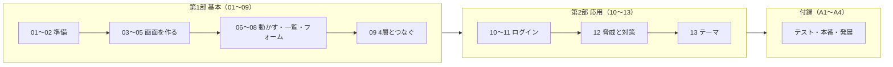
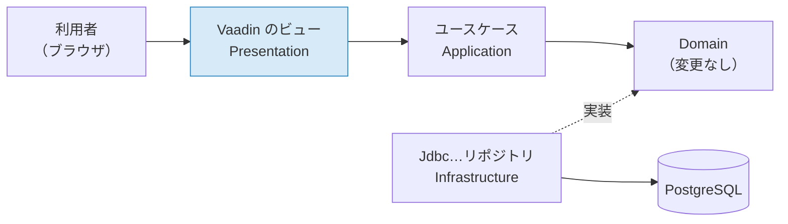

# フロントエンド（Vaadin） — はじめに

[📖 フロントエンドの目次](./00_はじめに.md#目次) ｜ [🏠 全体の目次](../README.md#目次)

4 層アーキテクチャの **Presentation 層**（画面・入力）を、Java のフレームワーク **Vaadin** で作る資料です。HTML・CSS・JavaScript を書かずに、**Java だけで Web の画面を作る**方法を学びます。題材は、他の資料と同じ**成績管理システム**です。

## 目次

1. [この資料について](#1-この資料について)
2. [章の構成](#2-章の構成)
3. [前提知識](#3-前提知識)
4. [前提バージョン](#4-前提バージョン)
5. [4層の中での位置づけ](#5-4層の中での位置づけ)
6. [サンプルリポジトリと資料の役割分担](#6-サンプルリポジトリと資料の役割分担)
7. [画面の画像について](#7-画面の画像について)
8. [各章の書き方](#8-各章の書き方)

---

## 1. この資料について

- 対象：Java の基礎（クラス・インタフェース・ラムダ式）と、4 層アーキテクチャ編 07 章（Spring Boot）の内容を理解している人。HTML・CSS・JavaScript の知識は**不要**です
- ゴール：
  - Vaadin が、**サーバー側の Java で画面を組み立てる仕組み**であることを説明できる
  - ビュー・レイアウト・コンポーネントを組み合わせて、入力フォームと一覧の画面を作れる
  - 画面から、Application 層のユースケースを呼び出せる（4 層を崩さずにつなげる）
  - Spring Security で**ログイン**と**ロール（権限）による画面の制限**を実装できる
  - 画面の制限だけに頼らない、Web アプリ特有の**脅威と対策**を説明できる
  - 使いやすい画面の**考え方**（ユーザビリティ）を、設計の判断に使える

## 2. 章の構成

### 第 1 部：基本（コンポーネントと文法）

| 章 | タイトル | 内容 |
|---|---|---|
| 01 | [Vaadin とは](01_Vaadinとは.md) | サーバーサイド UI の考え方、他の方式との比較、LTS とバージョン |
| 02 | [環境構築とプロジェクト作成](02_環境構築とプロジェクト作成.md) | JDK 25、プロジェクトの作成、起動、フォルダ構成 |
| 03 | [ビューとルーティング](03_ビューとルーティング.md) | `@Route`、URL パラメータ、画面遷移、共通レイアウト |
| 04 | [レイアウト](04_レイアウト.md) | 部品の並べ方、余白、フォームの配置、画面幅への対応 |
| 05 | [基本コンポーネント](05_基本コンポーネント.md) | 入力部品、ボタン、通知、ダイアログ |
| 06 | [イベントと画面の仕組み](06_イベントと画面の仕組み.md) | リスナー、サーバーとブラウザのやりとり、セッション |
| 07 | [Grid で一覧を表示する](07_Gridで一覧を表示する.md) | 列、並べ替え、選択、データの渡し方 |
| 08 | [フォームと Binder](08_フォームとBinder.md) | 入力と Java オブジェクトの結びつけ、入力チェック |
| 09 | [4層とつなぐ](09_4層とつなぐ.md) | ビューからユースケースを呼ぶ、例外を画面のメッセージにする |

### 第 2 部：応用（セキュリティと見た目）

| 章 | タイトル | 内容 |
|---|---|---|
| 10 | [ログインの基本](10_ログインの基本.md) | 認証と認可、Spring Security、ログイン画面、アクセス制御の注釈 |
| 11 | [DB認証とロール](11_DB認証とロール.md) | users テーブル、パスワードのハッシュ化、教員・学生の出し分け |
| 12 | [Webアプリの脅威と対策](12_Webアプリの脅威と対策.md) | 権限の確認、XSS、CSRF、総当たり攻撃、情報の漏えい |
| 13 | [テーマとスタイル](13_テーマとスタイル.md) | テーマ、CSS、ダークモード、見た目と使いやすさ |

### 付録

| 章 | タイトル | 内容 |
|---|---|---|
| A1 | [画面のテスト](A1_画面のテスト.md) | ブラウザを使わない UI テスト、E2E テスト |
| A2 | [本番ビルドとデプロイ](A2_本番ビルドとデプロイ.md) | 本番モード、jar での起動、設定の分け方 |
| A3 | [発展的な認証](A3_発展的な認証.md) | OAuth2 / OpenID Connect、SSO、二要素認証 |
| A4 | [発展的な機能](A4_発展的な機能.md) | 非同期処理と Push、国際化、ファイルのアップロード、Signals |

> [!TIP]
> **読む順番**：画面を作ることが目的なら、01〜09 章の順に読み、第 2 部は必要になったときに読みます。ただし、**Web アプリを公開する場合は、10〜12 章（ログインと脅威への対策）まで必ず読んでください**。

## 3. 前提知識

- クラス、インタフェース、**ラムダ式**（[付録 Java入門](../付録/Java入門/00_はじめに.md) 06〜07 章）。Vaadin のイベント処理は、ラムダ式を多用します
- 4 層の考え方（[4層アーキテクチャ編 01〜03 章](../4層アーキテクチャ/00_はじめに.md)）と、Spring Boot の基本（同 05・07 章）
- 11 章では SQL と JDBC（[データベース編](../データベース/00_はじめに.md)）を使います

## 4. 前提バージョン

| 項目 | バージョン | 備考 |
|---|---|---|
| **Vaadin** | **25（LTS）**。この資料は 25.3 系で確認 | 2025-12-17 に公開。商用の保守は 2030-12-17 まで |
| **Java** | **25** | Vaadin 25 の要件は Java 21 以上。この資料は Java 25 を使う |
| **Spring Boot** | **4.1 以上** | Vaadin 25.3 の要件。4 層編 07 章（step3）と同じ |
| ビルドツール | Maven | |

> [!NOTE]
> **LTS** とは、長期サポート版のことです。Vaadin は、新しい機能を含む通常版と、長く保守される LTS を分けています。この資料では「最新の LTS」を前提にします。バージョンの考え方は [01 章](01_Vaadinとは.md#6-バージョンと-lts) にあります。

> [!WARNING]
> Vaadin は、メジャーバージョンごとに API が大きく変わります（例：24 → 25 で、Spring Security の設定クラスやテーマの指定方法が変わりました）。**インターネット上の古い記事のコードは、そのままでは動かないことがあります**。調べるときは、必ずバージョンを確認し、公式ドキュメント（<https://vaadin.com/docs/latest>）を優先してください。

## 5. 4層の中での位置づけ

この資料が扱うのは、4 層のうち **Presentation 層**です。4 層編 07 章では、Presentation 層を **Web API（REST）** で作りました。この資料では、同じ層を **Vaadin の画面**で作ります。

| 層 | 4層編 07 章（REST） | この資料（Vaadin） |
|---|---|---|
| Presentation | `@RestController`（JSON を返す） | **ビュー**（Java で画面を組み立てる） |
| Application | ユースケースのクラス | **同じ** |
| Domain | 業務のルール | **同じ** |
| Infrastructure | JDBC のリポジトリ | **同じ** |

「Presentation 層だけを差し替えても、他の層は変わらない」ことを、実際のコードで確かめられます（[09 章](09_4層とつなぐ.md)）。

> [!NOTE]
> 利用者が何に困っていて、画面に何が必要なのかを整理する方法は、[上流工程](../上流工程/00_はじめに.md) の資料にあります。画面の設計は、そこで作ったユーザーストーリーとユースケースから始まります。

## 6. サンプルリポジトリと資料の役割分担

4 層編と同じく、**動く完成コードはサンプルリポジトリにまとめ**、この資料では考え方と、要点の短いコードを説明します。

| 置き場所 | 役割 | 内容 |
|---|---|---|
| **この資料** | **なぜ・何を・どう使う** | 考え方、コンポーネントの使い分け、図、表、短いコードの抜粋 |
| **サンプルリポジトリ** | **どう書くか** | 画面ごとの完成コード、起動の方法、ログイン用の SQL |

> [!NOTE]
> **サンプル**：[`<VAADIN_STEP>/`](https://github.com/<ORG>/PRMN_SYSTEM_Sample/tree/main/<VAADIN_STEP>)（Vaadin 版のサンプルの置き場所は検討中です。決まり次第、差し替えます）

資料の中では、サンプルのファイルを次の形式で案内します。

> [!NOTE]
> **サンプル**：[`<VAADIN_STEP>/src/main/java/grades/presentation/学生登録ビュー.java`](https://github.com/<ORG>/PRMN_SYSTEM_Sample/blob/main/<VAADIN_STEP>/src/main/java/grades/presentation/学生登録ビュー.java)（検討中）

この資料のコードは、サンプルに合わせて、**クラス名・メソッド名を日本語**で書きます（例：`学生を登録する.実行する(...)`）。Vaadin が用意するクラス（`TextField`、`Grid` など）は、英語のままです。

## 7. 画面の画像について

Vaadin の画面は、見た目が大事なので、画像を多く使います。画像は次の 2 種類に分けて用意します。

| 種類 | 例 | 撮り方 |
|---|---|---|
| **アプリの画面** | コンポーネント、ログイン画面、エラー表示 | サンプルを起動し、スクリプトで**自動撮影**（赤枠・番号つき） |
| **外部サイト・IDE の画面** | プロジェクト作成サイト、IntelliJ の画面 | **手動撮影**（Git・データベース編と同じ方法） |

撮影が済むまでは、画像の場所に「📷 スクショ指定」のブロックを置いてあります。一覧は [撮影リスト](../images/frontend/撮影リスト.md) にあります。

## 8. 各章の書き方

各章は次の順で進みます。

1. **この章のゴール**：何ができるようになるか
2. **説明、図、表**：コンポーネントの使い分けは表で、仕組みは図（mermaid）で示す。コードは要点の抜粋だけ
3. **サンプルへのリンク**：全体のコードはサンプルリポジトリで確認する
4. **よくあるミス**

説明の途中で、次の 2 種類の囲みが出てきます。

> [!CAUTION]
> **セキュリティの視点**：セキュリティ上のリスクと、その対策を示す囲みです（既存の資料と同じ）。

> [!TIP]
> **ユーザビリティの視点**：使いやすい画面のための考え方を示す囲みです。デザインの理論（ヒューリスティクス、アクセシビリティなど）を、その場面の判断に結びつけて紹介します。理論の詳しい背景は、`NOTE` で補足します。

---

[次へ：01 Vaadin とは →](01_Vaadinとは.md)

[📖 フロントエンドの目次](./00_はじめに.md#目次) ｜ [🏠 全体の目次](../README.md#目次)
