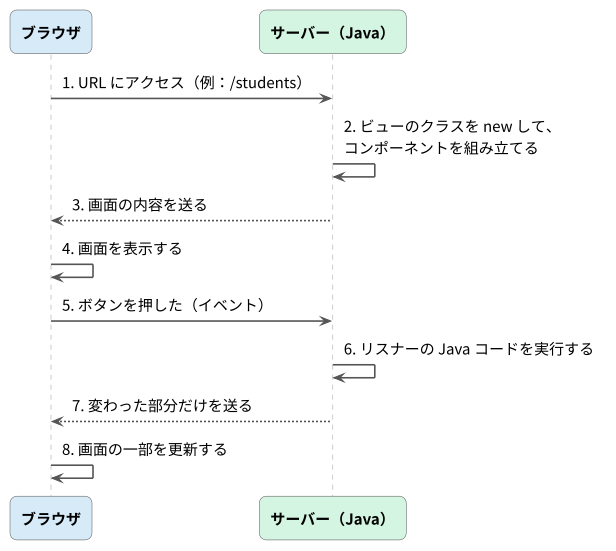
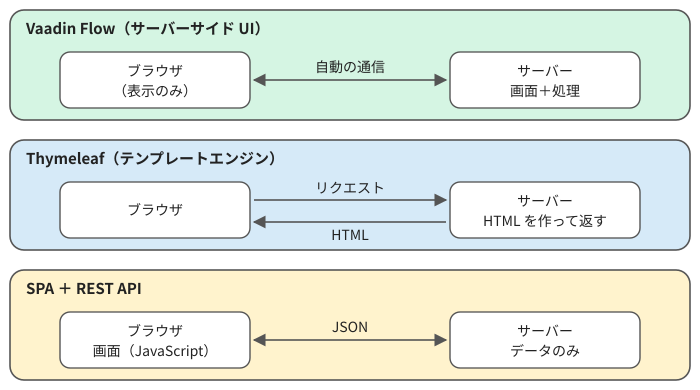

# 01. Vaadin とは

[📖 フロントエンドの目次](./00_はじめに.md#目次) ｜ [🏠 全体の目次](../README.md#目次)

[← 前へ：00 はじめに](00_はじめに.md) ｜ [次へ：02 環境構築とプロジェクト作成 →](02_環境構築とプロジェクト作成.md)

## この章のゴール
- Vaadin が、どんな問題を解決するフレームワークか説明できる
- **サーバーサイド UI** の仕組み（ブラウザには何が届くか）を説明できる
- Vaadin Flow と Hilla の違い、他の方式（テンプレート、SPA）との違いを言える
- LTS の意味と、バージョンの調べ方が分かる

## 目次

1. [Web の画面は何でできているか](#1-web-の画面は何でできているか)
2. [Vaadin の考え方](#2-vaadin-の考え方)
3. [仕組み：ブラウザとサーバー](#3-仕組みブラウザとサーバー)
4. [Flow と Hilla](#4-flow-と-hilla)
5. [他の方式との比較](#5-他の方式との比較)
6. [バージョンと LTS](#6-バージョンと-lts)
7. [向いているもの・向かないもの](#7-向いているもの向かないもの)
8. [よくあるミス](#8-よくあるミス)

---

## 1. Web の画面は何でできているか

ブラウザに表示される画面は、3 つの技術でできています。

| 技術 | 役割 | 例え |
|---|---|---|
| **HTML** | 画面の**構造**（見出し、入力欄、表） | 建物の骨組み |
| **CSS** | **見た目**（色、余白、配置） | 内装 |
| **JavaScript** | **動き**（ボタンを押したときの処理） | 設備 |

通常、Web アプリを作るには、この 3 つに加えて、サーバー側の言語（Java など）の両方を学ぶ必要があります。特に、**画面とサーバーの間のデータのやりとり**（JSON を作って返し、画面側で受け取って表示する）を、両側で書くことになります。

## 2. Vaadin の考え方

**Vaadin** は、画面を **Java のコードだけで**組み立てるフレームワークです。入力欄は `TextField`、表は `Grid`、ボタンは `Button` というクラスで、`new` して並べるだけです。

```java
TextField 氏名 = new TextField("氏名");
Button 登録 = new Button("登録", e -> Notification.show("登録しました"));
add(氏名, 登録);                       // 画面に並べる
```

| 項目 | 内容 |
|---|---|
| 画面の部品 | **コンポーネント**（`TextField`、`Button`、`Grid` など）。80 以上が用意されている |
| 書く言語 | **Java**（画面もサーバーの処理も同じ言語） |
| 状態を持つ場所 | **サーバー側**（コンポーネントの値は、サーバーのメモリにある） |
| HTML・CSS・JavaScript | 基本的に**書かない**（見た目を変えるときだけ CSS を使う） |

> [!NOTE]
> Vaadin は、フィンランドの Vaadin 社が開発している、**オープンソース**のフレームワークです。基本の機能は、無料で使えます。一部の高度なコンポーネントや、延長サポートは、有料です。

## 3. 仕組み：ブラウザとサーバー

Vaadin の画面は、**サーバー側のコンポーネントの木**（Java のオブジェクト）が元になっています。ブラウザには、その内容を表示する部品（Web Components）と、**サーバーと通信する小さな JavaScript** が届きます。



> [!IMPORTANT]
> **ブラウザは「表示」と「操作の通知」だけを担当し、判断や処理は、すべてサーバーの Java が行います。** この性質は、**セキュリティ**にとって大きな利点です（業務のコードがブラウザに送られない）。一方で、**操作のたびにサーバーと通信する**ので、サーバーの負荷と、通信の遅れを意識する必要があります（[06 章](06_イベントと画面の仕組み.md)）。

## 4. Flow と Hilla

Vaadin には、画面の作り方が 2 種類あります。

| | **Flow**（フロー） | **Hilla**（ヒラ） |
|---|---|---|
| 画面を書く言語 | **Java** | **TypeScript（React）** |
| サーバーとの通信 | 自動（Vaadin が行う） | Java のメソッドを、型つきで呼ぶ（エンドポイント） |
| 向いている人 | Java だけで作りたい | React を使いたい、既存のフロントエンドの知識がある |

この資料が扱うのは、**Flow** です（Java の資料なので）。以降、「Vaadin」は Flow を指します。

## 5. 他の方式との比較

Java で Web アプリを作る方法は、Vaadin 以外にもあります。

| 方式 | 例 | 画面を作る場所 | 特徴 |
|---|---|---|---|
| **サーバーサイド UI** | **Vaadin Flow** | サーバー（Java） | Java だけで完結。画面の部品が豊富 |
| テンプレートエンジン | Thymeleaf | サーバー（HTML のテンプレート） | HTML を書く。シンプル。動きのある画面は JavaScript が必要 |
| SPA ＋ REST API | React / Vue ＋ Spring の `@RestController` | ブラウザ（JavaScript） | 画面の自由度が高い。フロントとバックで言語が分かれる |



> [!TIP]
> **この資料で Vaadin を選ぶ理由**：①Java だけで画面まで作れる（学習の対象を増やさない）、②部品が揃っていて、**使いやすい画面を作りやすい**、③4 層の Presentation 層として、Application 層を直接呼べる、の 3 つです。どの方式が良いかは、チームの経験と、作るものによって変わります。

## 6. バージョンと LTS

### バージョンの読み方

Vaadin のバージョンは、`メジャー.マイナー.パッチ`（例：`25.3.5`）です。

| 部分 | 意味 | 変わるときの影響 |
|---|---|---|
| メジャー（`25`） | 大きな変更。**API が変わる** | 移行の作業が必要 |
| マイナー（`.3`） | 新機能の追加 | 基本的に、そのまま更新できる |
| パッチ（`.5`） | 不具合・脆弱性の修正 | **すぐに更新する** |

### LTS（長期サポート）

| 版 | 内容 |
|---|---|
| **LTS** | 長期間、不具合と**セキュリティの修正**が提供される版。本番のアプリ向け |
| 通常版 | 新機能を試せる版。次のメジャーが出ると、保守が終わる |

Vaadin 25 は LTS で、公式サイトでは「本番アプリ、新規プロジェクトにおすすめの版」とされています（2025-12-17 公開。商用の保守は 2030-12-17 まで）。

> [!WARNING]
> **保守が終わった版を使い続けないでください。** 保守が終わると、新しく見つかった脆弱性が修正されなくなります。使っているバージョンの保守期限は、公式の [リリースのページ](https://vaadin.com/releases) で確認できます。

### 組み合わせ（Vaadin 25.3 の場合）

| 項目 | 要件 |
|---|---|
| Java | 21 以上（この資料は 25） |
| Spring Boot | 4.1 以上 |
| Servlet | 6.1 以上 |

> [!NOTE]
> 最新の要件は、公式ドキュメントの「Supported Technologies」のページで確認してください。

## 7. 向いているもの・向かないもの

| 向いている | 向かない |
|---|---|
| 業務システム、管理画面（入力フォーム、一覧、検索） | 一般公開の、アクセスが非常に多い Web サイト |
| 社内・学内の、利用者が限られたアプリ | 通信が不安定な環境（操作のたびにサーバーと通信する） |
| Java の開発者が中心のチーム | 画面の見た目を、細かくデザインしたいサイト（ブランドサイト、LP） |

成績管理システムは、**利用者が限られた業務システム**なので、Vaadin に向いています。

## 8. よくあるミス

| ミス | 原因・対処 |
|---|---|
| 古い記事のコードがエラーになる | バージョンが違う。Vaadin 14 / 23 / 24 の記事の API は、25 で変わっていることがある。公式ドキュメントで確認する |
| 「JavaScript を書かなくていい」＝「何も知らなくていい」と思う | 見た目の調整（CSS）や、ブラウザの動き（通信、キャッシュ）の基本は、知っておく必要がある |
| ブラウザ側で処理されていると思う | 処理はサーバー。画面上の「入力チェック」だけでは、安全ではない（[12 章](12_Webアプリの脅威と対策.md)） |
| 通常版を本番で使い続ける | 次のメジャーが出ると保守が終わる。本番は LTS を使う |

---

[← 前へ：00 はじめに](00_はじめに.md) ｜ [次へ：02 環境構築とプロジェクト作成 →](02_環境構築とプロジェクト作成.md)

[📖 フロントエンドの目次](./00_はじめに.md#目次) ｜ [🏠 全体の目次](../README.md#目次)
