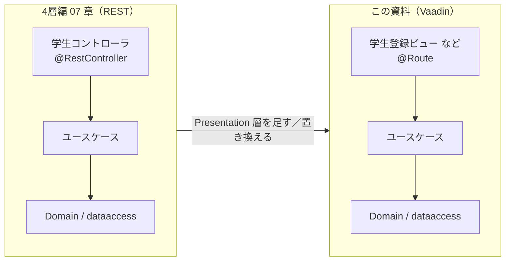

# 02. 環境構築とプロジェクト作成

[📖 フロントエンドの目次](./00_はじめに.md#目次) ｜ [🏠 全体の目次](../README.md#目次)

[← 前へ：01 Vaadin とは](01_Vaadinとは.md) ｜ [次へ：03 ビューとルーティング →](03_ビューとルーティング.md)

## この章のゴール
- Vaadin のプロジェクトを作成し、起動して、ブラウザで画面を確認できる
- プロジェクトのフォルダ構成と、`pom.xml` の要点が分かる
- 開発モードと本番モードの違いを説明できる
- 4 層のサンプル（step3）に、Vaadin を追加する方法が分かる

## 目次

1. [用意するもの](#1-用意するもの)
2. [プロジェクトの作り方](#2-プロジェクトの作り方)
3. [起動して確かめる](#3-起動して確かめる)
4. [フォルダ構成](#4-フォルダ構成)
5. [pom.xml の要点](#5-pomxml-の要点)
6. [開発モードと本番モード](#6-開発モードと本番モード)
7. [4層のサンプルに Vaadin を追加する](#7-4層のサンプルに-vaadin-を追加する)
8. [よくあるミス](#8-よくあるミス)

---

## 1. 用意するもの

| 必要なもの | 内容 |
|---|---|
| **JDK 25** | [付録 Java入門 01 章](../付録/Java入門/01_Javaとは・環境構築.md) で入れたもの。Vaadin 25 の要件は 21 以上 |
| **IDE** | IntelliJ IDEA または VSCode |
| **Maven** | プロジェクトに同梱の `mvnw` を使うので、別にインストールしなくてよい |
| **PostgreSQL** | 成績管理のデータを使う場合（[データベース編 07 章](../データベース/07_PostgreSQL環境構築.md)） |

> [!NOTE]
> Vaadin は、開発中に、画面用の部品（JavaScript）を準備するための道具を、**自動でダウンロード**します。初回の起動は、時間がかかります（公式の案内では 30 秒ほど。ネットワークの状況による）。

## 2. プロジェクトの作り方

作り方は 3 つあります。

| 方法 | 内容 | この資料での扱い |
|---|---|---|
| **Vaadin Start**（<https://start.vaadin.com/>） | 画面で選んで、zip をダウンロード。公式がおすすめしている方法 | **基本** |
| Spring Initializr（<https://start.spring.io/>） | 4 層編 07 章と同じ方法。依存関係で Vaadin を選ぶ | 既存の Spring プロジェクトがあるとき |
| 手で `pom.xml` に追加 | 既存のプロジェクトに Vaadin を足す | [7 節](#7-4層のサンプルに-vaadin-を追加する) |

### Vaadin Start を使う

1. <https://start.vaadin.com/> を開く
2. Project の種類（**Flow**、Maven、Spring Boot の構成）と、Java のバージョン（**25**）を選ぶ
3. グループ ID・アーティファクト ID・パッケージ名を決める（例：`grades`）
4. 「Download」で zip を取得して、展開する
5. IDE でフォルダを開く

<!-- 📷 SS: ../images/frontend/setup/vdn-02-01-vaadin-start.png -->
> 📷 **スクショ指定：`vdn-02-01-vaadin-start.png`**（手動撮影）
> - 画面：[Vaadin Start](https://start.vaadin.com/) で、Flow・Maven・Java 25 を選び、ダウンロード直前の状態
> - 強調：プロジェクトの種類、Java のバージョン、ダウンロードのボタンをそれぞれ赤枠で囲み、番号①〜③を振る

> [!NOTE]
> 選択肢の名前や配置は、サイトの更新で変わることがあります。画面と資料が違うときは、画面の指示に従ってください。

## 3. 起動して確かめる

IDE から、`Application` クラス（`main` メソッドがあるクラス）を実行します。または、ターミナルで次のコマンドを実行します。

```bash
./mvnw spring-boot:run
```

起動したら、ブラウザで <http://localhost:8080> を開きます。画面が表示されれば成功です。

<!-- 📷 SS: ../images/frontend/app/app-02-01-first-view.png -->
> 📷 **スクショ指定：`app-02-01-first-view.png`**（自動撮影）
> - 画面：起動直後のサンプルの最初の画面（`http://localhost:8080`）
> - 強調：なし（全体）

> [!TIP]
> **変更を画面に反映する**：開発モードでは、Java のコードを変更して保存し、ブラウザを再読み込みすると、変更が反映されます。IntelliJ IDEA では、ホットスワップ（再起動なしでの差し替え）を使うと、さらに速く確認できます。

## 4. フォルダ構成

```
プロジェクト/
├── pom.xml                                ← Maven の設定（依存関係）
├── src/main/
│   ├── java/grades/
│   │   ├── Application.java               ← 起動クラス（@SpringBootApplication）
│   │   └── presentation/                  ← ビューを置く
│   └── resources/
│       ├── application.properties         ← 設定（ポート、DB の接続先）
│       └── META-INF/resources/            ← 画像、CSS などの静的ファイル
└── src/main/frontend/                     ← フロントエンドのファイル（自動生成されるものを含む）
```

| 場所 | 内容 |
|---|---|
| `Application.java` | 起動クラス。4 層編 07 章と同じ。画面のテーマの指定も、ここに書く（[13 章](13_テーマとスタイル.md)） |
| `presentation/` | **ビュー**（画面のクラス）。4 層の Presentation 層 |
| `META-INF/resources/` | ブラウザにそのまま届ける静的ファイル（`styles.css`、画像） |
| `src/main/frontend/` | Vaadin が使うフロントエンドのファイル。**基本的に触らない** |

> [!TIP]
> `node_modules/` や `src/main/frontend/generated/` など、**自動で作られるファイルは、Git で管理しません**（`.gitignore` に入っているか確認する）。

## 5. pom.xml の要点

Vaadin のプロジェクトでは、`pom.xml` に次の 3 つがあります。

```xml
<!-- 1. Vaadin のバージョンをそろえる（BOM） -->
<dependencyManagement>
  <dependencies>
    <dependency>
      <groupId>com.vaadin</groupId>
      <artifactId>vaadin-bom</artifactId>
      <version>${vaadin.version}</version>
      <type>pom</type>
      <scope>import</scope>
    </dependency>
  </dependencies>
</dependencyManagement>

<!-- 2. Vaadin ＋ Spring Boot の依存関係 -->
<dependency>
  <groupId>com.vaadin</groupId>
  <artifactId>vaadin-spring-boot-starter</artifactId>
</dependency>

<!-- 3. 本番用のビルド（ビルド時に、画面用のファイルを最適化する） -->
<plugin>
  <groupId>com.vaadin</groupId>
  <artifactId>vaadin-maven-plugin</artifactId>
  <version>${vaadin.version}</version>
</plugin>
```

| 設定 | 役割 |
|---|---|
| `vaadin-bom` | Vaadin の部品のバージョンを**まとめて管理**する。個別にバージョンを書かなくてよい |
| `vaadin-spring-boot-starter` | Vaadin と Spring Boot をつなぐ（4 層編 07 章の `spring-boot-starter-…` と同じ考え方） |
| `vaadin-maven-plugin` | 本番用のビルドで、画面用のファイルを作る |

> [!WARNING]
> **開発モードで起動するには、`vaadin-dev` が必要です。** 付いていないと、起動時に「`'vaadin-dev-server' not found`」というエラーで、Tomcat が始まりません。エラーメッセージの案内では、`vaadin-dev` を `optional`（任意の依存関係）として入れます。**本番用のビルドには、含めません。** サンプルは、`dev` という profile（`-Pproduction` を付けないときだけ有効）に入れて、本番の jar に入らないようにしています（動作を確認済み）。

> [!NOTE]
> 実際のバージョン番号（`${vaadin.version}`）と、設定の細かい書き方は、Vaadin Start が作ったものを使ってください。公式ドキュメントの「Spring Boot」のページ（<https://vaadin.com/docs/latest/flow/integrations/spring/spring-boot>）に、最新の書き方があります。

## 6. 開発モードと本番モード

| | **開発モード** | **本番モード** |
|---|---|---|
| 目的 | 開発中の確認 | 公開（デプロイ） |
| 起動 | `./mvnw spring-boot:run` や IDE | ビルドした jar を `java -jar` で実行（[A2](A2_本番ビルドとデプロイ.md)） |
| 画面用のファイル | 起動時に必要に応じて作る（遅い） | ビルド時に最適化済み（速い） |
| 開発者向けの機能 | あり（変更の自動反映、デバッグ用の表示） | **なし** |

> [!CAUTION]
> **セキュリティの視点**：開発モードは、**公開してはいけません**。開発者向けの機能が有効で、動作も遅いからです。公開するときは、必ず**本番モード**でビルドしてください（[A2](A2_本番ビルドとデプロイ.md)）。

## 7. 4層のサンプルに Vaadin を追加する

4 層編 07 章のサンプル（step3、Spring Boot 4.1.2 / Java 25）は、Vaadin 25.3 と組み合わせられます。次の 3 つを行います。

1. `pom.xml` に、BOM、`vaadin-spring-boot-starter`、`vaadin-maven-plugin` を追加する（[5 節](#5-pomxml-の要点)）
2. `presentation` パッケージに、**ビュー**（Vaadin の画面のクラス）を追加する
3. 起動して、<http://localhost:8080> を開く



> [!NOTE]
> サンプルリポジトリでは、資料ごとに独立して動かせるよう、step3 に足すのではなく、**`frontend/` に、Vaadin 版を別のプロジェクトとして置く**予定です（Domain・ユースケース・リポジトリの Java は、コピーして使います）。

> [!NOTE]
> **サンプル**：[`frontend/grades-vaadin/pom.xml`](https://github.com/<ORG>/PRMN_SYSTEM_Sample/blob/main/frontend/grades-vaadin/pom.xml)（作成予定）

> [!TIP]
> REST の `@RestController` を**残したまま**、Vaadin の画面を足すこともできます。外部のプログラムから呼ぶ API と、人が使う画面を、同じ Application 層で共有できるのは、4 層に分けた利点です。

## 8. よくあるミス

| ミス | 原因・対処 |
|---|---|
| 初回の起動が終わらない | 画面用の部品をダウンロードしている。ネットワークにつながっているか確認し、しばらく待つ |
| 起動時に `'vaadin-dev-server' not found` | 開発モードに必要な `vaadin-dev` が、依存関係にない（5 節の WARNING） |
| `Port 8080 was already in use` | 別のアプリが 8080 番を使っている。`server.port=8081` を `application.properties` に書く |
| 画面が真っ白になる | ブラウザの開発者ツール（F12）の Console のエラーを見る。`pom.xml` の Vaadin のバージョンがそろっていない（BOM を使っていない）ことがある |
| ビルドが `Unsupported class file major version` で失敗する | JDK のバージョンが合っていない。`java -version` と、`pom.xml` の `java.version` を確認する |
| `node_modules` や `generated` を Git に入れてしまう | `.gitignore` に追加する。自動で作られるファイルは管理しない |
| 本番モードを使わずに公開する | 開発用の機能が残る。必ず本番ビルドを使う（A2） |

---

[← 前へ：01 Vaadin とは](01_Vaadinとは.md) ｜ [次へ：03 ビューとルーティング →](03_ビューとルーティング.md)

[📖 フロントエンドの目次](./00_はじめに.md#目次) ｜ [🏠 全体の目次](../README.md#目次)
