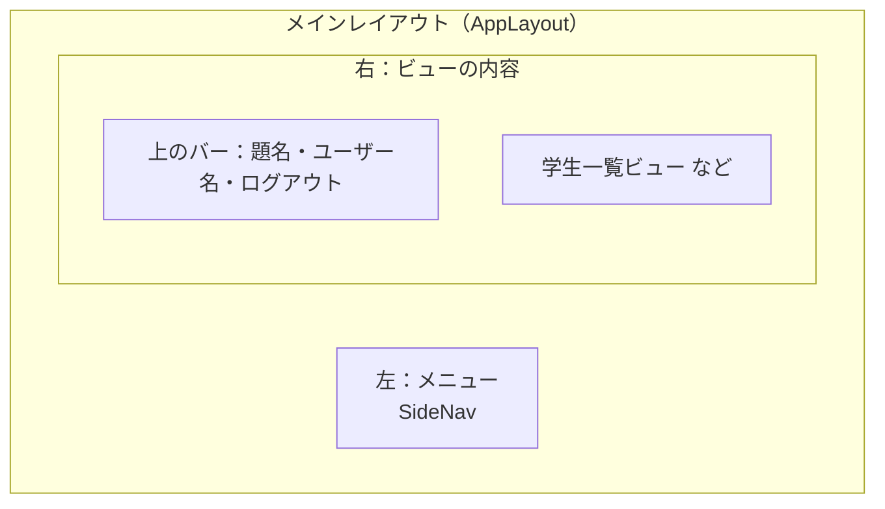
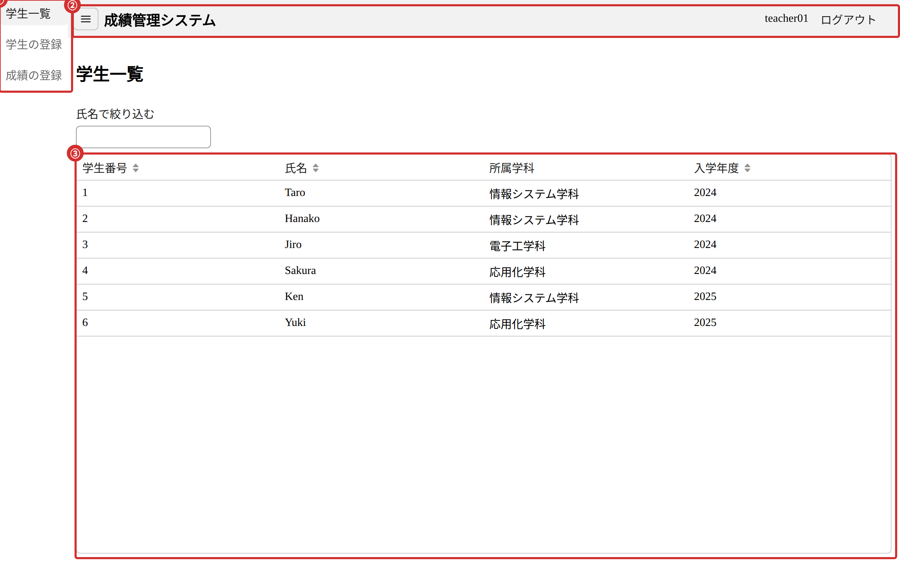

# 03. ビューとルーティング

[📖 フロントエンドの目次](./00_はじめに.md#目次) ｜ [🏠 全体の目次](../README.md#目次)

[← 前へ：02 環境構築とプロジェクト作成](02_環境構築とプロジェクト作成.md) ｜ [次へ：04 レイアウト →](04_レイアウト.md)

## この章のゴール
- **ビュー**とは何か、`@Route` で URL と結びつける方法を説明できる
- URL にパラメータを含めて、ビューで受け取れる
- 画面遷移（リンク、プログラムからの移動）を書ける
- 共通のレイアウト（ヘッダー、メニュー）を、全画面で使い回せる

## 目次

1. [ビューとは](#1-ビューとは)
2. [@Route で URL を決める](#2-route-で-url-を決める)
3. [URL パラメータ](#3-url-パラメータ)
4. [画面を移動する](#4-画面を移動する)
5. [共通のレイアウトとメニュー](#5-共通のレイアウトとメニュー)
6. [成績管理の画面一覧](#6-成績管理の画面一覧)
7. [よくあるミス](#7-よくあるミス)

---

## 1. ビューとは

**ビュー**（View）は、1 つの画面を表す Java のクラスです。`VerticalLayout` などのコンポーネントを継承し、コンストラクタの中で、部品を並べます。

```java
@Route("students")                          // URL: /students
@PageTitle("学生一覧")                       // ブラウザのタブに出る題名
@PermitAll                                  // ログイン済みなら誰でも（10 章）
public class 学生一覧ビュー extends VerticalLayout {

    public 学生一覧ビュー() {
        add(new H2("学生一覧"));            // 見出しを追加
    }
}
```

> [!NOTE]
> ビューは、4 層の **Presentation 層**のクラスです。ビューに、業務のルールや SQL を書いてはいけません（[09 章](09_4層とつなぐ.md)）。

### ビューの寿命

| 場面 | 何が起きるか |
|---|---|
| URL にアクセスしたとき | ビューのクラスが `new` される（**アクセスのたびに新しいオブジェクト**） |
| 別の画面に移動したとき | そのビューは破棄される |

ビューは、Spring の `@Service` のように**使い回されません**。ビューの中に、画面をまたいで残したい情報を持たせてはいけません（[06 章](06_イベントと画面の仕組み.md)）。

## 2. @Route で URL を決める

| 書き方 | URL |
|---|---|
| `@Route("")` | `/`（トップページ） |
| `@Route("students")` | `/students` |
| `@Route("students/register")` | `/students/register` |

> [!IMPORTANT]
> Vaadin 25 では、**注釈のないビューは、既定でアクセスできません**（10 章）。`@AnonymousAllowed`、`@PermitAll`、`@RolesAllowed` のどれかを、必ず付けます。ログイン機能を入れる前は、動作確認のために一時的に `@AnonymousAllowed` を付けますが、**そのまま公開してはいけません**。

`@PageTitle` は、ブラウザのタブや、ブックマーク、履歴に表示される題名です。

> [!TIP]
> **ユーザビリティの視点**：画面の題名と URL は、利用者が「いま、どこにいるか」を知る手がかりです（ニールセンの 10 ヒューリスティクスの「**システム状態の視認性**」）。全画面に `@PageTitle` を付け、URL は `/students/register` のように、**内容が分かる名前**にします。

## 3. URL パラメータ

「学生 1 の成績一覧」のように、URL の一部を、ビューに渡したいことがあります。

```java
@Route("students/:studentId/transcript")           // /students/1/transcript
@PermitAll
public class 成績一覧ビュー extends VerticalLayout implements BeforeEnterObserver {

    @Override
    public void beforeEnter(BeforeEnterEvent event) {          // 画面に入る直前に呼ばれる
        int 学生ID = event.getRouteParameters().get("studentId")
                .map(Integer::parseInt).orElseThrow();
        // 学生ID を使って、成績を取得して表示する
    }
}
```

| 書き方 | 意味 |
|---|---|
| `:studentId` | 必須のパラメータ（ないと、画面が見つからない） |
| `:studentId?` | 省略できるパラメータ（例：`user/:userID?/edit`） |
| `beforeEnter` | ビューが表示される**直前**に呼ばれる。パラメータの受け取りや、アクセスの可否の判断に使う |

URL の末尾に付ける `?tab=orders` のような**クエリ**は、`event.getLocation().getQueryParameters()` で取得できます。

> [!CAUTION]
> **セキュリティの視点**：URL は、**利用者が自由に書き換えられます**。`/students/1/transcript` を `/students/2/transcript` に変えると、他人の成績が見られるかもしれません。「**その人が、その学生の成績を見てよいか**」は、ビューではなく、**Application 層（ユースケース）で必ず確認**します（[12 章](12_Webアプリの脅威と対策.md)）。また、数値に変換できない値（`abc`）が来たときの処理（`NumberFormatException`）も、考えておきます。

> [!NOTE]
> パラメータの渡し方には、ほかにも、`HasUrlParameter<T>` を実装して、`/greet/Taro` のように 1 つの値を受け取る方法があります。

## 4. 画面を移動する

### リンク

`RouterLink` は、画面を**再読み込みせずに**移動するリンクです。

```java
add(new RouterLink("学生一覧", 学生一覧ビュー.class));          // クラスを指定して移動
```

### プログラムから移動する

ボタンを押したあとに移動する、といった場合は、`UI` の `navigate` を使います。

```java
Button 登録 = new Button("登録", e -> {
    // …登録の処理…
    登録.getUI().ifPresent(ui -> ui.navigate(学生一覧ビュー.class));   // 登録したら、一覧へ
});
```

| 書き方 | 内容 |
|---|---|
| `ui.navigate(ビュー.class)` | クラスを指定して移動（URL を変更しても、コードを直さなくてよい） |
| `ui.navigate(ビュー.class, "123")` | パラメータを付けて移動 |
| `ui.navigate("students/1/transcript")` | URL の文字列で移動 |

> [!TIP]
> クラスを指定する書き方を、おすすめします。URL を変更したとき、コンパイルエラーや、IDE の機能（名前の変更）で、修正の漏れを防げます。

## 5. 共通のレイアウトとメニュー

全画面で共通の、ヘッダーとメニューは、**レイアウトのクラス**にまとめます。`AppLayout`（アプリの枠組み）を継承し、`@Layout` を付けると、すべてのビューの外枠になります。

```java
@Layout                                              // 全ビューの外枠になる
@PermitAll                                           // レイアウトにも、アクセスの注釈が必要（10 章）
public class メインレイアウト extends AppLayout {

    public メインレイアウト() {
        setPrimarySection(Section.DRAWER);           // メニューを左側（ドロワー）に置く
        var メニュー = new SideNav();                 // 左側のメニュー
        メニュー.addItem(new SideNavItem("学生一覧", 学生一覧ビュー.class));
        メニュー.addItem(new SideNavItem("成績の登録", 成績登録ビュー.class));
        addToDrawer(new Scroller(メニュー));
        addToNavbar(new DrawerToggle(), new H1("成績管理システム"));   // 上のバー
    }
}
```

> [!WARNING]
> **レイアウトにも、アクセスの注釈（`@PermitAll` など）が必要です。** 付けていないと、ビューに注釈があっても、「レイアウトのアクセスの規則により、アクセスが拒否された」と表示されます（開発モードでは、「Denied access to view … due to layout … access rules」というメッセージが出ます）。ログイン画面のように、レイアウトを使わない画面は、`autoLayout = false`（[10 章](10_ログインの基本.md)）で外します。





> [!NOTE]
> `@Layout` の使い方（パスごとに別のレイアウトを使う、レイアウトを入れ子にする、など）は、公式ドキュメントの「Router Layouts」（<https://vaadin.com/docs/latest/flow/routing/layout>）にあります。メニューの項目を、ビューの注釈（`@Menu`）から自動で作る方法もあります。

> [!TIP]
> **ユーザビリティの視点**：メニューは、**全画面で同じ場所・同じ並び**にします（ヒューリスティクスの「**一貫性と標準**」）。利用者は、画面ごとに操作の場所を探さずに済み、「どこに何があるか」を覚えられます。また、**今いる画面のメニューが強調される**ことで、現在地が分かります（SideNav は、現在のビューの項目を自動で強調します）。

## 6. 成績管理の画面一覧

この資料で作る画面を整理します。上流工程で整理したユースケースに、1 対 1 で対応させるのが基本です。

| 画面（ビュー） | URL | 対応するユースケース | 使えるロール（11 章） |
|---|---|---|---|
| ログイン | `/login` | （認証） | 誰でも |
| 学生一覧 | `/students` | 学生一覧を取得する | 教員 |
| 学生の登録 | `/students/register` | 学生を登録する | 教員 |
| 成績の登録 | `/enrollments/register` | 成績を登録する | 教員 |
| 成績一覧 | `/students/:studentId/transcript` | 成績一覧を取得する | 教員、本人の学生 |

> [!NOTE]
> ユースケースから画面を決める流れは、[上流工程 05 章](../上流工程/05_ユースケースに落とし込む.md)・[06 章](../上流工程/06_設計への受け渡し.md) にあります。

## 7. よくあるミス

| ミス | 原因・対処 |
|---|---|
| 画面にアクセスすると「アクセスが拒否された」と出る | ビューに、`@PermitAll` などの**アクセスの注釈**がない（Vaadin 25 では既定で拒否）。**レイアウトのクラスにも、注釈が必要** |
| 画面が `404`（見つからない）になる | `@Route` の URL が違う、ビューのクラスが、起動クラスのパッケージの外にある |
| ビューの `new` のたびに、データが消える | ビューは、アクセスのたびに作り直される。残したい情報は、サーバー側のデータ（DB、セッション）に置く |
| URL パラメータが `null` / 変換に失敗する | 必須のパラメータを省略している、数値でない値が来ている。`beforeEnter` で確認し、見つからないときは「見つからない」画面を出す |
| `@Route` が同じ URL で 2 つある | 起動時にエラーになる。URL は、ビューごとに一意にする |
| 他人のデータの URL を、確認せずに表示する | URL は書き換えられる。**ユースケース側で、見る権限を確認する**（12 章） |

---

[← 前へ：02 環境構築とプロジェクト作成](02_環境構築とプロジェクト作成.md) ｜ [次へ：04 レイアウト →](04_レイアウト.md)

[📖 フロントエンドの目次](./00_はじめに.md#目次) ｜ [🏠 全体の目次](../README.md#目次)
