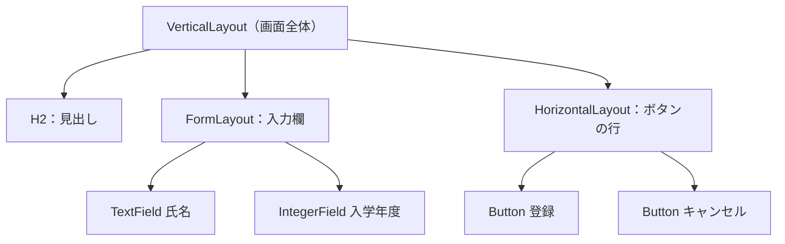
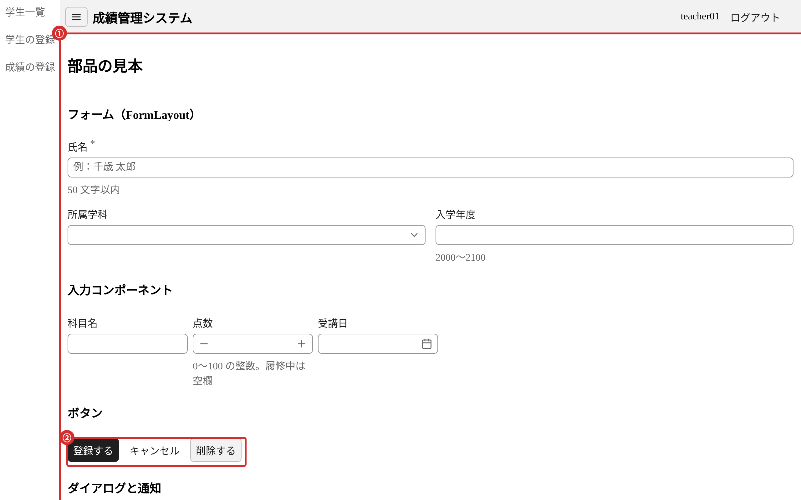
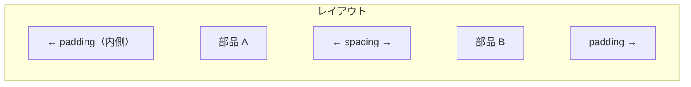
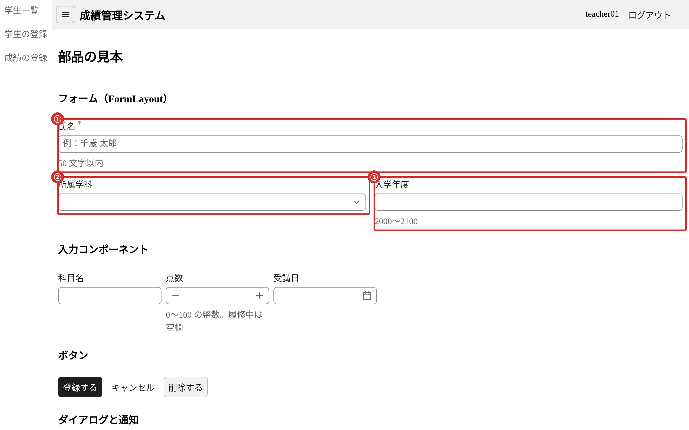
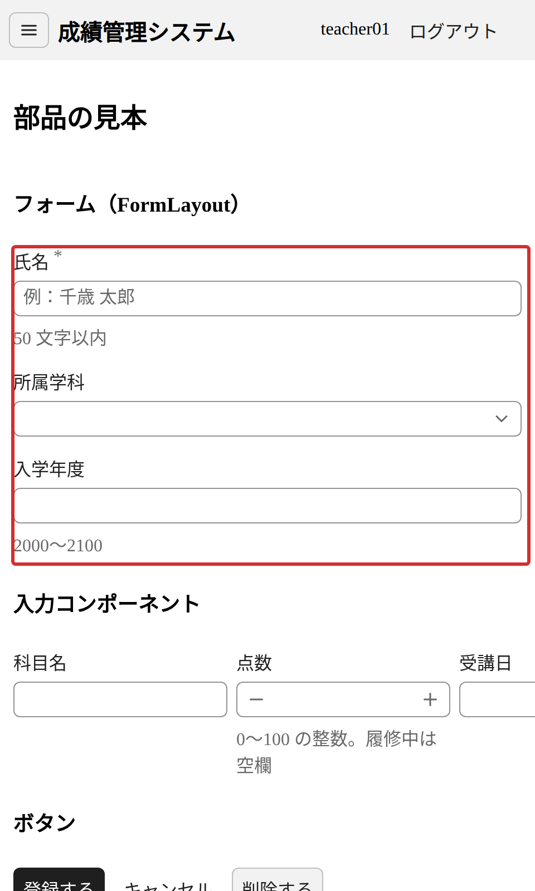

# 04. レイアウト

[📖 フロントエンドの目次](./00_はじめに.md#目次) ｜ [🏠 全体の目次](../README.md#目次)

[← 前へ：03 ビューとルーティング](03_ビューとルーティング.md) ｜ [次へ：05 基本コンポーネント →](05_基本コンポーネント.md)

## この章のゴール
- `VerticalLayout` / `HorizontalLayout` で、部品を縦・横に並べられる
- 余白（padding / margin / spacing）と、配置・伸縮の違いを説明できる
- `FormLayout` で、入力フォームを整えられる
- 画面の幅が変わっても、崩れない画面にする考え方が分かる

## 目次

1. [レイアウトとは](#1-レイアウトとは)
2. [縦と横に並べる](#2-縦と横に並べる)
3. [余白と間隔](#3-余白と間隔)
4. [配置と伸縮](#4-配置と伸縮)
5. [FormLayout：フォームの配置](#5-formlayoutフォームの配置)
6. [画面の幅への対応](#6-画面の幅への対応)
7. [その他のレイアウト](#7-その他のレイアウト)
8. [よくあるミス](#8-よくあるミス)

---

## 1. レイアウトとは

**レイアウト**は、中に入れた部品の**並べ方を決める入れ物**です。レイアウトの中にレイアウトを入れて、画面を組み立てます。



| レイアウト | 並べ方 | 主な用途 |
|---|---|---|
| `VerticalLayout` | **縦**に並べる | 画面全体、ページの構成 |
| `HorizontalLayout` | **横**に並べる | ボタンの行、検索の行 |
| `FormLayout` | **入力欄**を、ラベルつきで、列に並べる | 入力フォーム |
| `FlexLayout` | 横・縦の細かい制御（CSS の flexbox） | 細かい調整が必要なとき |
| `SplitLayout` | 2 つの領域を、境界を動かせる形で分ける | 一覧と詳細の並べ表示 |

## 2. 縦と横に並べる

```java
var 見出し = new H2("学生の登録");
var 登録 = new Button("登録");
var キャンセル = new Button("キャンセル");

var ボタン行 = new HorizontalLayout(登録, キャンセル);     // 横に並べる
add(見出し, ボタン行);                                       // この（Vertical）レイアウトに、縦に追加
```

`new HorizontalLayout(部品, 部品, …)` や、`add(部品, 部品, …)` で、部品を追加します。



## 3. 余白と間隔

| 設定 | 意味 | 書き方 |
|---|---|---|
| **padding**（内側の余白） | レイアウトの**内側**の余白 | `setPadding(true)` |
| **spacing**（間隔） | 並べた部品の**間**の余白 | `setSpacing(true)` |
| **margin**（外側の余白） | レイアウトの**外側**の余白 | `setMargin(true)`（`VerticalLayout` などでは、既定で `false`） |



> [!TIP]
> **ユーザビリティの視点**：余白は、**情報のまとまり**を伝えます（ゲシュタルト心理学の「**近接の法則**」：近くにあるものは、まとまりとして見える）。関連する入力欄は、間隔を狭く、別のまとまりとは、間隔を広くします。余白を詰めすぎると、読みにくく、押し間違いも増えます。

## 4. 配置と伸縮

### 配置（どこに寄せるか）

| 方向 | 設定 | 内容 |
|---|---|---|
| 主軸（並ぶ方向） | `setJustifyContentMode(...)` | `START`（先頭）、`CENTER`（中央）、`END`（末尾）、`BETWEEN`（均等に離す） |
| 交差軸（直交する方向） | `setAlignItems(...)` | `START`、`CENTER`、`END`、`STRETCH`（引き伸ばす） |

縦に並べるレイアウトでは、主軸が**縦**、交差軸が**横**です。横に並べるレイアウトでは、その逆です。

### 伸縮（余った場所をどう使うか）

| 設定 | 内容 |
|---|---|
| `setSizeFull()` | 親の領域いっぱいに広げる（幅 100%、高さ 100%） |
| `setWidthFull()` | 幅だけ、いっぱいに |
| `expand(部品)` | 余った場所を、その部品に使わせる（例：一覧の `Grid` を、画面の残りいっぱいに） |
| `setWidth("300px")` | 幅を固定する（できるだけ**避ける**。[6 節](#6-画面の幅への対応)） |

```java
var 一覧 = new Grid<学生の表示>();
var 画面 = new VerticalLayout(new H2("学生一覧"), 一覧);
画面.setSizeFull();             // 画面いっぱい
画面.expand(一覧);              // 余った高さは、Grid に使わせる
```

> [!NOTE]
> `VerticalLayout` と `HorizontalLayout` は、既定で、**padding と spacing が有効**です。使わないときは、`setPadding(false)`、`setSpacing(false)` で無効にします。

## 5. FormLayout：フォームの配置

`FormLayout` は、**入力欄を、画面の幅に合わせて、列の数を変えながら並べる**レイアウトです。入力欄のラベル（`TextField` の題名）を、入力欄の上に、そろえて表示します。

```java
var フォーム = new FormLayout();
フォーム.add(氏名, 学科, 入学年度);
フォーム.setResponsiveSteps(                       // 画面の幅に応じた、列の数
    new ResponsiveStep("0", 1),                    // 幅 0 以上：1 列
    new ResponsiveStep("500px", 2));               // 幅 500px 以上：2 列
フォーム.setColspan(氏名, 2);                       // 氏名は、2 列分の幅を使う
```





> [!TIP]
> **ユーザビリティの視点**：入力フォームは、**1 列で、上から下に並べる**のが、基本です。視線の動きが一方向になり、入力の漏れが減ると言われています。2 列にするのは、「姓・名」「郵便番号・都道府県」のように、**関連が強い項目**だけにします。

## 6. 画面の幅への対応

利用者の画面は、PC、タブレット、スマートフォンなど、幅がさまざまです。幅が変わっても、使える画面にします（**レスポンシブ**）。

| 考え方 | 内容 |
|---|---|
| 幅を**固定しない** | `setWidth("800px")` ではなく、`setWidthFull()` や、`setMaxWidth("800px")`（最大幅の指定）を使う |
| 列の数を**変える** | `FormLayout` の `setResponsiveSteps` を使う |
| 横に並べて入りきらないものは**折り返す** | `HorizontalLayout` の `setWrap(true)`（折り返しを許可） |
| 横にスクロールさせない | 表（`Grid`）は、横にスクロールできるが、重要な列を左に置く |

> [!TIP]
> **ユーザビリティの視点**：業務システムは PC で使うことが多いですが、**スマートフォンで、成績を確認する**場面は、実際にあります。「どの機器で、どんな場面で使うか」を、上流工程で聞き取り（[上流工程 03 章](../上流工程/03_メンタルモデルを理解する.md)）、**優先して対応する画面**を決めます。全画面を、全機器で完璧にする必要は、ありません。

## 7. その他のレイアウト

| レイアウト | 内容 |
|---|---|
| `Div`、`Span` | 汎用の入れ物（HTML の `div`、`span`）。単に、部品をまとめたいときに使う |
| `Scroller` | 中身が大きいとき、スクロールできるようにする |
| `Tabs` / `TabSheet` | タブで、画面の内容を切り替える |
| `Details`、`Accordion` | 折りたたんで、必要なときだけ開く |
| `Card` | 関連する情報を、枠でまとめて見せる |

> [!NOTE]
> コンポーネントの一覧は、公式ドキュメント（<https://vaadin.com/docs/latest/components>）にあります。使いたい部品があるか、まず**一覧で探す**ようにします。自分で組み立てる前に、部品があるかを確認すると、見た目や動きが、ほかの画面とそろいます。

## 8. よくあるミス

| ミス | 原因・対処 |
|---|---|
| `Grid` が小さいまま／表示されない | 親の高さが決まっていない。`setSizeFull()` と、`expand` で高さを決める |
| 画面の端に、部品がくっつく | padding が無効。`setPadding(true)` |
| 余白が二重に出る | レイアウトを入れ子にして、それぞれに padding を付けている。内側は `setPadding(false)` |
| 幅を `px` で固定して、スマートフォンで崩れる | `setWidthFull()` と、`setMaxWidth` を使う |
| 縦と横の「寄せる」設定の方向を逆にする | 主軸（並ぶ方向）が `justify`、交差軸が `align`。縦のレイアウトでは、主軸が縦 |
| 部品を並べるためだけに、レイアウトを何重にも入れ子にする | まず、`FormLayout` や `expand` で足りないか考える。入れ子が深いと、直しにくい |

---

[← 前へ：03 ビューとルーティング](03_ビューとルーティング.md) ｜ [次へ：05 基本コンポーネント →](05_基本コンポーネント.md)

[📖 フロントエンドの目次](./00_はじめに.md#目次) ｜ [🏠 全体の目次](../README.md#目次)
