# 05. 基本コンポーネント

[📖 フロントエンドの目次](./00_はじめに.md#目次) ｜ [🏠 全体の目次](../README.md#目次)

[← 前へ：04 レイアウト](04_レイアウト.md) ｜ [次へ：06 イベントと画面の仕組み →](06_イベントと画面の仕組み.md)

## この章のゴール
- 入力の種類に合った、入力コンポーネントを選べる
- ボタンの種類（主・副・危険）を、役割に応じて使い分けられる
- 通知（`Notification`）、確認ダイアログ（`ConfirmDialog`）、ダイアログ（`Dialog`）を使い分けられる
- 利用者に分かりやすい、ラベル・ヘルプ・エラーの書き方が分かる

## 目次

1. [コンポーネントの基本](#1-コンポーネントの基本)
2. [入力コンポーネント](#2-入力コンポーネント)
3. [選択コンポーネント](#3-選択コンポーネント)
4. [ボタン](#4-ボタン)
5. [通知・確認・ダイアログ](#5-通知確認ダイアログ)
6. [文字・アイコンなどの表示](#6-文字アイコンなどの表示)
7. [成績管理で使う部品の対応](#7-成績管理で使う部品の対応)
8. [よくあるミス](#8-よくあるミス)

---

## 1. コンポーネントの基本

コンポーネントは、**クラスを `new` して、レイアウトに `add` する**ことで使います。多くの入力コンポーネントに共通する、基本の操作は次のとおりです。

| 操作 | 書き方 | 内容 |
|---|---|---|
| ラベル | `new TextField("氏名")` / `setLabel("氏名")` | 入力欄の名前（欄の上に表示される） |
| 値の取得・設定 | `getValue()` / `setValue(...)` | 現在の値 |
| 初期値のヒント | `setPlaceholder("例：千歳 太郎")` | 空のときだけ見える、薄い文字 |
| 補足の説明 | `setHelperText("全角で入力してください")` | 欄の下に出る説明 |
| 必須 | `setRequired(true)` | 必須の印（`*`）が出る |
| 無効化・読み取り専用 | `setEnabled(false)` / `setReadOnly(true)` | 入力できなくする |
| エラー表示 | `setInvalid(true)` / `setErrorMessage("…")` | 赤く表示して、メッセージを出す（検査は [08 章](08_フォームとBinder.md) の Binder が行う） |

> [!NOTE]
> 公式ドキュメントでは、コンポーネントごとに、「使い方」「見た目」「API」が説明されています（<https://vaadin.com/docs/latest/components>）。この資料では、**選び方**に集中します。

## 2. 入力コンポーネント

| コンポーネント | 用途 | 値の型 | 成績管理での例 |
|---|---|---|---|
| `TextField` | 短い文字 | `String` | 氏名 |
| `TextArea` | 長い文字（複数行） | `String` | 備考 |
| `IntegerField` | 整数 | `Integer` | 入学年度、点数 |
| `NumberField` | 小数も含む数値 | `Double` | 平均点（表示用） |
| `EmailField` | メールアドレス | `String` | 連絡先 |
| `PasswordField` | パスワード（伏せ字） | `String` | ログイン（10 章） |
| `DatePicker` | 日付 | `LocalDate` | 受講日 |
| `Checkbox` | はい／いいえ | `Boolean` | 履修中かどうか |

### TextField

**短い文字を入力する**部品です。ほかの入力部品も、ラベル、ヘルパーテキスト、エラーの表示など、同じ仕組みを持っています。

<!-- snippet: input-text-all -->
```java
var 氏名 = new TextField("氏名");
氏名.setPlaceholder("例：千歳 太郎");
氏名.setHelperText("50 文字以内");
氏名.setRequiredIndicatorVisible(true);
```

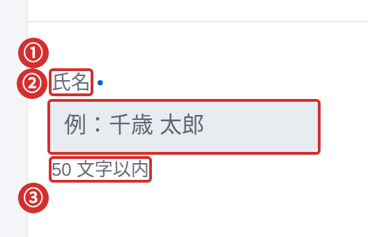

<!-- legend:parts/input-text-all -->
| 番号 | 説明 |
|---|---|
| ① | ラベル（コンストラクタの引数。必須のときは、横に印が付く） |
| ② | 入力欄（空のときは、プレースホルダーが薄く表示される） |
| ③ | ヘルパーテキスト（`setHelperText`） |
<!-- /legend -->

#### 状態ごとの表示

| 設定 | 内容 |
|---|---|
| コンストラクタの引数 | ラベル（入力欄の上に表示される名前） |
| `setPlaceholder` | 空のときだけ見える、薄い文字（入力例） |
| `setHelperText` | 入力欄の下に、ずっと表示される説明 |
| `setRequiredIndicatorVisible(true)` | 必須の印（ラベルの横の点）を出す |
| `setInvalid(true)` / `setErrorMessage` | エラーの表示（赤い入力欄と、メッセージ）。入力チェックは、[08 章](08_フォームとBinder.md) の Binder が行う |
| `setReadOnly(true)` | 読み取り専用（見えるが、変更できない） |
| `setEnabled(false)` | 無効（グレーになり、操作できない） |

**ラベルだけ**

<!-- snippet: input-text-basic -->
```java
var 氏名 = new TextField("氏名");
```


**プレースホルダー**

<!-- snippet: input-text-placeholder -->
```java
var 氏名 = new TextField("氏名");
氏名.setPlaceholder("例：千歳 太郎");
```

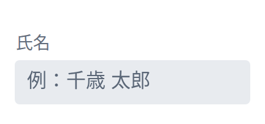

**ヘルパーテキスト**

<!-- snippet: input-text-helper -->
```java
var 氏名 = new TextField("氏名");
氏名.setHelperText("50 文字以内");
```

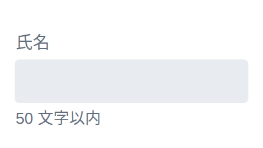

**必須**

<!-- snippet: input-text-required -->
```java
var 氏名 = new TextField("氏名");
氏名.setRequiredIndicatorVisible(true);
```

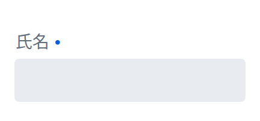

**エラー**

<!-- snippet: input-text-error -->
```java
var 氏名 = new TextField("氏名");
氏名.setInvalid(true);
氏名.setErrorMessage("氏名を入力してください");
```

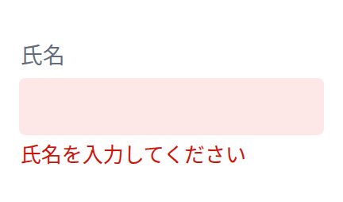

**読み取り専用**

<!-- snippet: input-text-readonly -->
```java
var 学生番号 = new TextField("学生番号");
学生番号.setValue("20240001");
学生番号.setReadOnly(true);
```

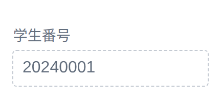

**無効**

<!-- snippet: input-text-disabled -->
```java
var 備考 = new TextField("備考");
備考.setEnabled(false);
```

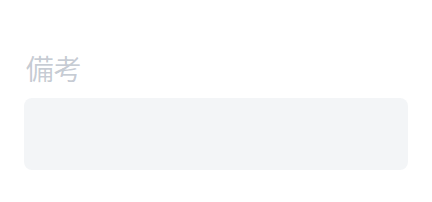

### IntegerField

**整数**を入力する部品です。値は `Integer`（空欄のときは `null`）です。

<!-- snippet: input-integer -->
```java
var 点数 = new IntegerField("点数");
点数.setHelperText("0〜100 の整数");
点数.setMin(0);
点数.setMax(100);
点数.setStepButtonsVisible(true);
```

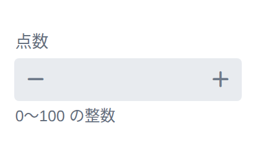

### PasswordField

入力した文字を**伏せ字**にする部品です。右端のボタンで、表示と非表示を切り替えられます。

<!-- snippet: input-password -->
```java
var パスワード = new PasswordField("パスワード");
パスワード.setValue("grades-sample");
```

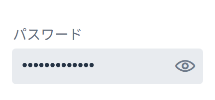

### DatePicker

**日付**を、カレンダーから選べる部品です。値は `LocalDate` です。

<!-- snippet: input-date -->
```java
var 受講日 = new DatePicker("受講日");
```

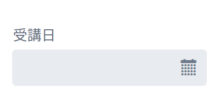

### TextArea

**複数行の文字**を入力する部品です。高さは、`setMinHeight` などで指定します。

<!-- snippet: input-text-area -->
```java
var 備考 = new TextArea("備考");
備考.setValue("遠隔授業で受講。\n課題は、期限内に提出済み。");
備考.setMinHeight("120px");
```

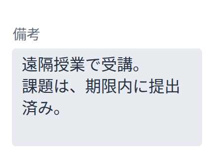

### EmailField

**メールアドレス**を入力する部品です。形式の簡易な確認（`@` を含むか）を、ブラウザが行います。

<!-- snippet: input-email -->
```java
var 連絡先 = new EmailField("連絡先のメールアドレス");
連絡先.setValue("taro@example.com");
```

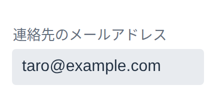

### NumberField

**小数も含む数値**を入力する部品です。値は `Double` です。`setReadOnly(true)` にすると、計算結果の表示にも使えます。

<!-- snippet: input-number -->
```java
var 平均点 = new NumberField("平均点");
平均点.setValue(91.5);
平均点.setReadOnly(true);
```

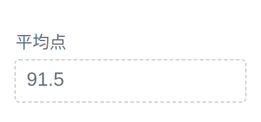

### Checkbox

**はい／いいえ**を選ぶ部品です。値は `Boolean` です。

<!-- snippet: input-checkbox -->
```java
var 履修中 = new Checkbox("履修中として登録する");
履修中.setValue(true);
```

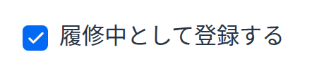

> [!CAUTION]
> **セキュリティの視点**：`setMin` / `setMax` / `setMaxLength` は、**使いやすさ**のための設定です。サーバーに届く値は、画面を通さずに、書き換えて送れます。点数の範囲などは、**Domain 層（と、データベースの制約）で必ず検査**します（4 層編 02 章）。

> [!TIP]
> **ユーザビリティの視点**：
> - 数値は、**数値用の部品**（`IntegerField`）を使います。文字用の欄に、数字を打たせると、全角の数字や、余分な空白の入力が増えます（ヒューリスティクスの「**エラーの防止**」）
> - プレースホルダーは、**入力すると消える**ので、大事な説明を書かないでください。ずっと見せたい説明は、**ヘルパーテキスト**に書きます
> - ラベルは、**欄の外**（上）に、**短い名詞**で書きます

## 3. 選択コンポーネント

選択肢から選ぶ部品は、**選択肢の数**と**複数選べるか**で選びます。

| コンポーネント | 選択肢の数 | 特徴 | 成績管理での例 |
|---|---|---|---|
| `RadioButtonGroup` | 2〜5 個 | すべての選択肢が見える | 履修の状態（履修中／評価済み） |
| `Select` | 5〜15 個 | プルダウン。選ぶだけ | 学科 |
| `ComboBox` | 多い | プルダウン＋**入力で絞り込める** | 学生、科目（多数） |
| `CheckboxGroup` | 少数 | **複数**を選べる | 表示する列 |
| `MultiSelectComboBox` | 多い | 複数を選べる ComboBox | 複数の科目 |

### RadioButtonGroup

**すべての選択肢を並べて**見せる部品です。1 つだけ選べます。

<!-- snippet: input-radio -->
```java
var 状態 = new RadioButtonGroup<String>("履修の状態");
状態.setItems("履修中", "評価済み");
状態.setValue("履修中");
```

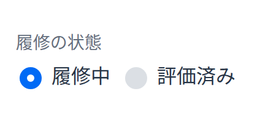

### Select

**プルダウン**から 1 つ選ぶ部品です。

<!-- snippet: input-select -->
```java
var 学科 = new Select<String>();
学科.setLabel("所属学科");
学科.setItems("情報システム学科", "電子工学科", "応用化学科");
学科.setValue("電子工学科");
```

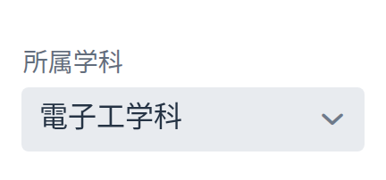

### ComboBox

プルダウンに加えて、**文字を入力して、選択肢を絞り込める**部品です。選択肢が多いときに使います。

<!-- snippet: input-combo -->
```java
var 科目 = new ComboBox<String>("科目");
科目.setItems("プログラミング基礎", "データベース", "線形代数");
科目.setValue("データベース");
```

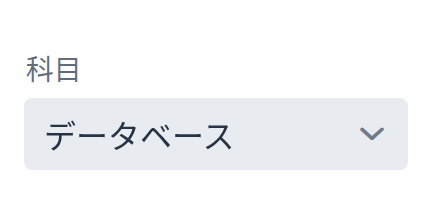

### CheckboxGroup

**複数**を選べる部品です。選んだものは、`getValue()` で `Set` として取得できます。

<!-- snippet: input-checkbox-group -->
```java
var 列 = new CheckboxGroup<String>("表示する列");
列.setItems("科目名", "単位", "年度", "点数");
列.select("科目名", "点数");
```

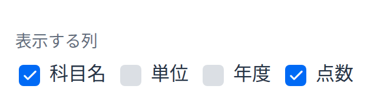

### MultiSelectComboBox

ComboBox と同じく**絞り込める**うえで、**複数**を選べる部品です。選択肢が多く、複数を選ぶときに使います。

<!-- snippet: input-multi-combo -->
```java
var 科目 = new MultiSelectComboBox<String>("科目（複数）");
科目.setItems("プログラミング基礎", "データベース", "線形代数");
科目.setWidth("360px");
科目.select("プログラミング基礎", "データベース");
```

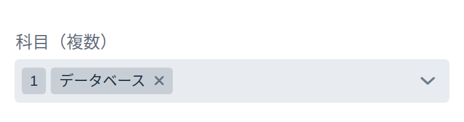

### 選択肢の表示

選択肢の型が `String` 以外のとき（学科、学生のオブジェクトなど）は、**画面に出す文字を決めます**。

```java
var 学科 = new Select<学科選択肢>();
学科.setLabel("所属学科");
学科.setItems(学科の一覧);                                  // 選択肢のリスト
学科.setItemLabelGenerator(学科選択肢::表示名);               // 画面に出す文字を決める

var 学生 = new ComboBox<学生>("学生");
学生.setItems(学生の一覧);                                  // 学生が多いので ComboBox
学生.setItemLabelGenerator(s -> s.学生ID() + " " + s.氏名());
```

> [!NOTE]
> 選択肢の型（`学科選択肢` など）は、画面に表示するための、**表示用のデータ**（DTO）です。一方、`学生` は、秘密の項目を持たないドメインの `record` なので、ユースケースの戻り値（`学生一覧を取得する` が返す一覧）を、そのまま使います（[09 章](09_4層とつなぐ.md)）。

> [!TIP]
> **ユーザビリティの視点**：選択肢が少ないなら、**ラジオボタンのように、すべて見せる**ほうが、操作が少なく、比較しやすいです（ヒューリスティクスの「**想起よりも再認**」：思い出させるより、見せて選ばせる）。選択肢が多いときは、**絞り込める ComboBox** にします。

## 4. ボタン

**操作を実行する**部品です。`new Button("文字", e -> 処理)` で作ります。見た目は、**種類**（`ButtonVariant`）で変えます。

| 種類 | 値 | 用途 |
|---|---|---|
| 通常 | （指定しない） | 通常のボタン |
| **主**（Primary） | `ButtonVariant.PRIMARY` | その画面で**一番大事な操作**（1 画面に 1 つ） |
| 控えめ（Tertiary） | `ButtonVariant.TERTIARY` | 補助的な操作（キャンセルなど） |
| **危険**（Error） | `ButtonVariant.ERROR` | 削除など、**取り消せない**操作 |
| 成功（Success） | `ButtonVariant.SUCCESS` | 確定など、前向きな操作 |
| 警告（Warning） | `ButtonVariant.WARNING` | 注意が必要な操作 |
| 小さい／大きい | `ButtonVariant.SMALL` / `LARGE` | 大きさを変える |

**通常**

<!-- snippet: button-default -->
```java
var 登録 = new Button("登録する");
```

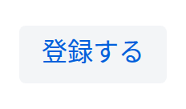

**主**

<!-- snippet: button-primary -->
```java
var 登録 = new Button("登録する");
登録.addThemeVariants(ButtonVariant.PRIMARY);
```

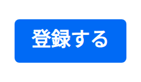

**控えめ**

<!-- snippet: button-tertiary -->
```java
var キャンセル = new Button("キャンセル");
キャンセル.addThemeVariants(ButtonVariant.TERTIARY);
```

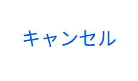

**危険**

<!-- snippet: button-error -->
```java
var 削除 = new Button("削除する");
削除.addThemeVariants(ButtonVariant.ERROR);
```

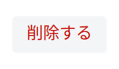

**成功**

<!-- snippet: button-success -->
```java
var 確定 = new Button("確定する");
確定.addThemeVariants(ButtonVariant.SUCCESS);
```

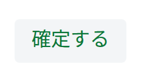

**警告**

<!-- snippet: button-warning -->
```java
var 再計算 = new Button("再計算する");
再計算.addThemeVariants(ButtonVariant.WARNING);
```

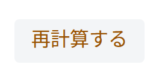

**大きさ**

<!-- snippet: button-small -->
```java
var 詳細 = new Button("詳細");
詳細.addThemeVariants(ButtonVariant.SMALL);
```

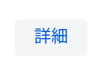

<!-- snippet: button-large -->
```java
var 開始 = new Button("開始する");
開始.addThemeVariants(ButtonVariant.LARGE);
```

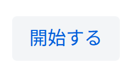

**アイコンつき**

<!-- snippet: button-icon -->
```java
var 追加 = new Button("追加", VaadinIcon.PLUS.create());
```

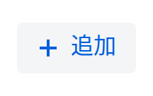

**無効**

<!-- snippet: button-disabled -->
```java
var 登録 = new Button("登録する");
登録.setEnabled(false);
```

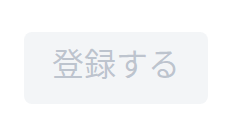

> [!NOTE]
> 種類の色は、**テーマ**（Lumo、Aura）が決めます。このページの画像は、Lumo です。`ButtonVariant` には、`LUMO_PRIMARY` など、テーマの名前が付いた値もあります（旧版からの名前）。Vaadin 25.3.5 では、テーマに関係なく使える `PRIMARY` / `TERTIARY` / `ERROR` / `SUCCESS` / `WARNING` / `SMALL` / `LARGE` を、使えます（クラスで確認）。**使うバージョンの API は、IDE の補完や、公式ドキュメントで確認**してください。

> [!TIP]
> **ユーザビリティの視点**：
> - **主ボタンは、1 画面に 1 つ**。何をすればよいか、一目で分かります
> - ボタンの文字は、**「OK」ではなく、動作を表す動詞**にします（「登録する」「削除する」）。何が起きるかが、押す前に分かります
> - 取り消せない操作（削除）は、**危険の色**にし、**確認の手順**を挟みます（ヒューリスティクスの「**エラーの防止**」。[5 節](#5-通知確認ダイアログ)）
> - 押したら、処理中であること・完了したことを、**必ず知らせます**（「**システム状態の視認性**」）。連打を防ぐため、処理中は無効にします

## 5. 通知・確認・ダイアログ

操作の結果や、確認を、画面に出すための部品です。**邪魔する度合い**で使い分けます。

| 部品 | 邪魔する度合い | 用途 | 例 |
|---|---|---|---|
| `Notification` | **小**（自動で消える） | 操作の結果を、軽く知らせる | 「登録しました」 |
| 画面内のメッセージ（`Span`、入力欄のエラー） | 小 | その場に、必要な情報を出し続ける | 入力のエラー |
| `ConfirmDialog` | **大**（答えるまで止まる） | 取り消せない操作の**確認** | 「削除しますか？」 |
| `Dialog` | 大 | 小さな入力や、詳細の表示 | 成績の修正フォーム |

### Notification

画面の隅に、短いメッセージを出して、**一定時間で消える**部品です。操作の結果を、軽く知らせます。

#### 基本形

<!-- snippet: notification-default -->
```java
Notification.show("学生を登録しました");
```

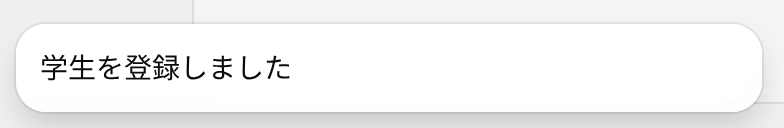


- 既定の表示時間は **5 秒**、既定の位置は**画面の左下**（`Position.BOTTOM_START`）です
- `Notification.show` は、表示した `Notification` を返します。そのオブジェクトに、種類や位置などを設定できます

#### 種類（見た目）

`addThemeVariants` で、**種類**を指定します。種類で、色が変わります。

| 種類 | 値 | 使う場面 |
|---|---|---|
| 種類なし | （指定しない） | 目立たせない、普通のお知らせ |
| **情報** | `NotificationVariant.INFO` | 中立的な情報（「更新しました」） |
| **成功** | `NotificationVariant.SUCCESS` | 操作が成功した（「登録しました」） |
| **警告** | `NotificationVariant.WARNING` | 処理は進むが、注意が必要（「未入力のため、履修中にします」） |
| **エラー** | `NotificationVariant.ERROR` | 操作が失敗した（「点数は0〜100にしてください」） |

> [!IMPORTANT]
> 種類の色は、**テーマ**（Lumo、Aura）が決めます。起動クラスで、テーマの `@StyleSheet` を指定していないと、種類を付けても、**見た目は変わりません**（サンプルで、指定の有無を変えて、確かめました。[13 章](13_テーマとスタイル.md)）。このページの画像は **Lumo** です。同じコードでも、**テーマによって、目立ち方が違います**（Aura は、控えめな色になります。[13 章](13_テーマとスタイル.md) に、比較があります）。

**情報**

<!-- snippet: notification-info -->
```java
Notification.show("成績を更新しました")
        .addThemeVariants(NotificationVariant.INFO);
```

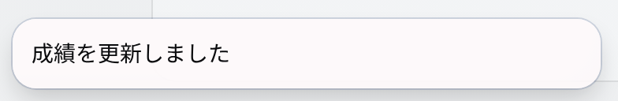


**成功**

<!-- snippet: notification-success -->
```java
Notification.show("学生を登録しました")
        .addThemeVariants(NotificationVariant.SUCCESS);
```

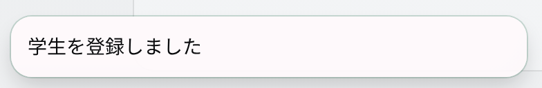


**警告**

<!-- snippet: notification-warning -->
```java
Notification.show("点数が未入力です。履修中として登録します")
        .addThemeVariants(NotificationVariant.WARNING);
```

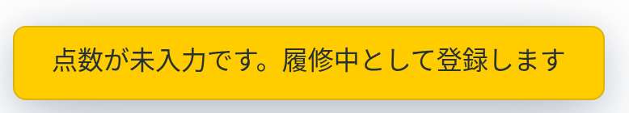


**エラー**

<!-- snippet: notification-error -->
```java
Notification.show("点数は0〜100にしてください: 150")
        .addThemeVariants(NotificationVariant.ERROR);
```

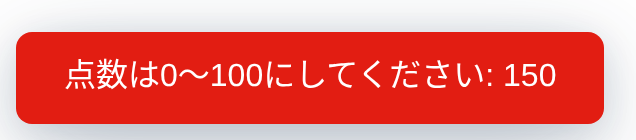


> [!NOTE]
> `NotificationVariant` には、`LUMO_PRIMARY`、`LUMO_CONTRAST`、`LUMO_SUCCESS`、`LUMO_ERROR`、`LUMO_WARNING` といった、**Lumo 専用の名前**もあります。この資料では、テーマに関係なく使える `INFO` / `SUCCESS` / `WARNING` / `ERROR` を使います（Vaadin 25.3.5 のクラスで確認）。

#### 位置と表示時間

`Notification.show(文字, 表示時間, 位置)` で、表示時間と位置を指定します。

<!-- snippet: notification-position -->
```java
Notification.show("登録しました", 5000, Notification.Position.TOP_CENTER);
```

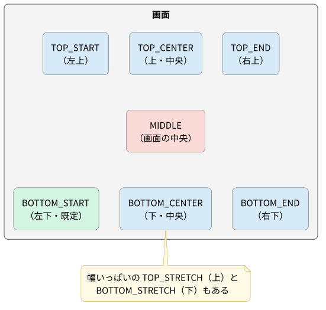

| 引数 | 内容 |
|---|---|
| 表示時間（ミリ秒） | `5000` なら 5 秒。**`0` は、閉じるまで表示**する（エラーなど、読み逃したくないもの） |
| 位置 | `Notification.Position` の 9 種類：`TOP_START` / `TOP_CENTER` / `TOP_END` / `MIDDLE` / `BOTTOM_START`（既定）/ `BOTTOM_CENTER` / `BOTTOM_END`、および、幅いっぱいの `TOP_STRETCH` / `BOTTOM_STRETCH` |

<!-- snippet: notification-middle -->
```java
Notification.show("登録に失敗しました", 0, Notification.Position.MIDDLE)
        .addThemeVariants(NotificationVariant.ERROR);
```

> [!TIP]
> **ユーザビリティの視点**：成功は、**短く・目立たず**（既定の 5 秒、左下）。エラーは、**読み終わるまで残し**（表示時間 `0`）、**気づきやすい位置**に出します。種類（色）を使うときは、色だけに頼らず、**文言でも、成功か失敗かが分かる**ようにします（色の見分けにくい人のため）。

### ConfirmDialog

**取り消せない操作の前に、利用者に確認する**ダイアログです。画面の背景が暗くなり、答えるまで、ほかの操作ができません。

<!-- snippet: confirm-dialog-basic -->
```java
var 確認 = new ConfirmDialog();
確認.setHeader("成績を保存します");
確認.setText("入力した内容で、成績を保存します。");
確認.setCancelable(true);
確認.setCancelText("キャンセル");
確認.setConfirmText("保存する");
確認.open();
```

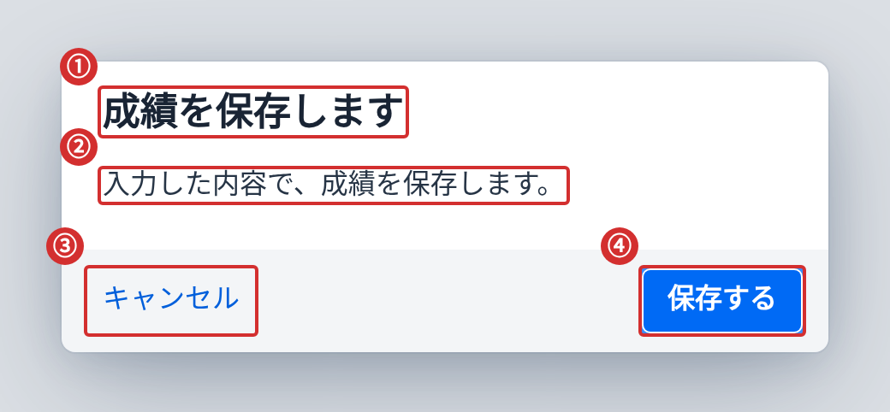

<!-- legend:parts/confirm-dialog-basic -->
| 番号 | 説明 |
|---|---|
| ① | 題名（`setHeader`） |
| ② | 本文（`setText`） |
| ③ | キャンセルのボタン（`setCancelable`、`setCancelText`） |
| ④ | 確認のボタン（`setConfirmText`） |
<!-- /legend -->

| 設定 | 内容 |
|---|---|
| `setHeader` / `setText` | 題名と本文。**何が起きるか**を、具体的に書く |
| `setCancelable(true)` | キャンセルのボタンを出す。`setCancelText` で、文言を指定する |
| `setConfirmText` | 確認のボタンの文言。**動詞**で書く（「保存する」「削除する」） |
| `addConfirmListener` | 確認のボタンを押したときの処理 |
| `setConfirmButtonTheme` | 確認のボタンの種類（見た目）。削除などは、`"error primary"` |

> [!NOTE]
> `ConfirmDialog` のボタンの文言は、既定では**英語**（`Cancel` など）です。日本語の画面では、`setCancelText` を、必ず設定します（サンプルで実際に表示して、確かめました）。

**削除などの、取り消せない操作**では、確認のボタンを、危険の色にします。

<!-- snippet: confirm-dialog-danger -->
```java
var 確認 = new ConfirmDialog();
確認.setHeader("成績を削除します");
確認.setText("この操作は、取り消せません。");
確認.setCancelable(true);
確認.setCancelText("キャンセル");
確認.setConfirmText("削除する");
確認.setConfirmButtonTheme("error primary");
確認.open();
```

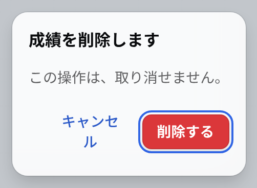

### Dialog

**小さな入力や、詳細の表示**のための、汎用のダイアログです。中身（本文）と、下部のボタン（フッター）を、自由に組み立てます。

<!-- snippet: dialog-basic -->
```java
var 点数 = new IntegerField("点数");
var ダイアログ = new Dialog();
ダイアログ.setHeaderTitle("点数の修正");
ダイアログ.add(点数);
ダイアログ.getFooter().add(
        new Button("キャンセル", e2 -> ダイアログ.close()),
        new Button("保存", e2 -> ダイアログ.close()));
ダイアログ.open();
```

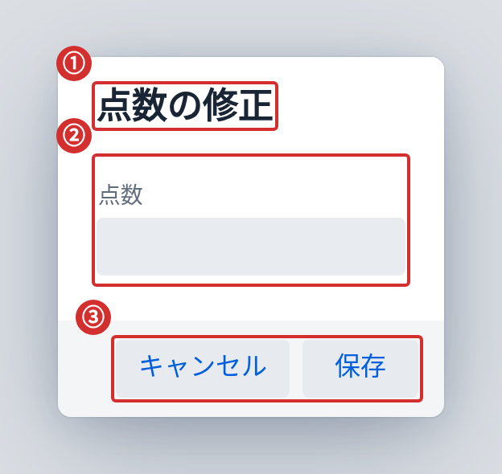

<!-- legend:parts/dialog-basic -->
| 番号 | 説明 |
|---|---|
| ① | 題名（`setHeaderTitle`） |
| ② | 本文（`add` で追加した部品） |
| ③ | フッターのボタン（`getFooter().add` で追加） |
<!-- /legend -->

| 設定 | 内容 |
|---|---|
| `setHeaderTitle` | 題名 |
| `add` | 本文に、部品を追加する |
| `getFooter().add` | フッターに、ボタンを追加する |
| `close()` | ダイアログを閉じる（ボタンの処理から呼ぶ） |

> [!NOTE]
> `ConfirmDialog` は「はい／いいえ」の確認専用、`Dialog` は、入力欄や一覧など、**自由な中身**を入れられます。

> [!TIP]
> **ユーザビリティの視点**：確認のダイアログを**多用しない**でください。毎回出ると、利用者は読まずに「はい」を押すようになり、本当に大事なときに効かなくなります（**警告疲れ**）。確認は、**取り消せない操作**だけに使い、取り消せる操作は、「**元に戻す**」を用意するほうが、使いやすくなります（ヒューリスティクスの「**ユーザーに主導権と自由を**」）。

> [!TIP]
> **ユーザビリティの視点**：エラーのメッセージは、①**何が起きたか**、②**どうすればよいか**を書きます（ヒューリスティクスの「**エラーの認識・診断・回復を助ける**」）。「エラーが発生しました」ではなく、「点数は 0〜100 の整数で入力してください」と書きます。ただし、**ログインの失敗などでは、詳しすぎる説明が、攻撃者の手がかりになります**（[12 章](12_Webアプリの脅威と対策.md)）。

## 6. 文字・アイコンなどの表示

| コンポーネント | 用途 |
|---|---|
| `H1`〜`H6` | 見出し |
| `Paragraph`、`Span` | 段落、文字の一部 |
| `Icon`（`VaadinIcon`） | アイコン |
| `Avatar` | 利用者のアイコン（頭文字） |
| `ProgressBar` | 進み具合 |

### 見出し

`H1`〜`H6` は、見出しです。数字が小さいほど、大きく表示されます。**画面の題名は `H2`**、その中の節は `H3`、のように、段階を飛ばさずに使います。

<!-- snippet: display-headings -->
```java
var 見出し = new VerticalLayout(new H1("成績管理システム"), new H2("学生一覧"), new H3("所属学科ごとの人数"));
```

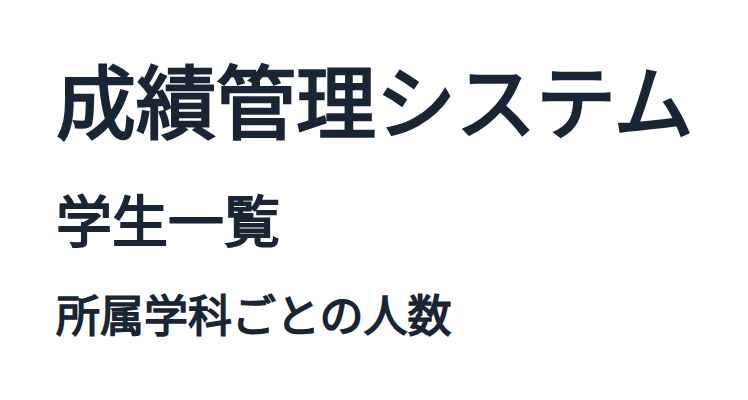

### 段落と文字

`Paragraph` は、**1 つの段落**です。`Span` は、文の**一部**や、短い文字に使います。

<!-- snippet: display-paragraph -->
```java
var 説明 = new Paragraph("履修の登録は、年度ごとに行います。点数が空欄のものは、履修中です。");
var 注記 = new Span("※ 平均点は、点数のある履修だけで計算します。");
```

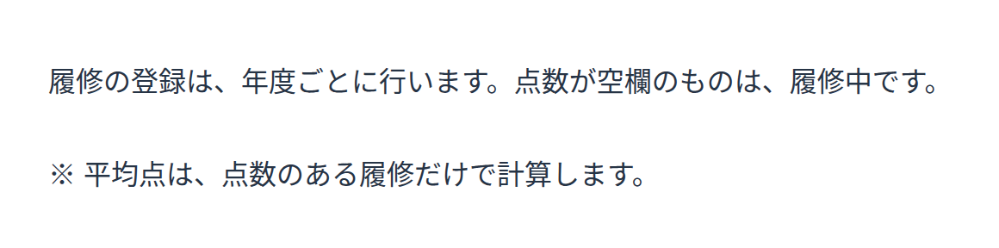

### アイコン

`VaadinIcon` に用意された、アイコンです。`create()` で、部品にします。ボタンの中（`new Button("追加", VaadinIcon.PLUS.create())`）にも置けます。

<!-- snippet: display-icon -->
```java
var 追加 = VaadinIcon.PLUS.create();
var 警告 = VaadinIcon.WARNING.create();
var 利用者 = VaadinIcon.USER.create();
```


### Avatar

利用者の**頭文字**を、丸いアイコンで表示します。名前から、自動で作られます。

<!-- snippet: display-avatar -->
```java
var 太郎 = new Avatar("千歳 太郎");
var 花子 = new Avatar("千歳 花子");
```

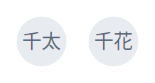

### ProgressBar

**進み具合**を、帯で表示します。値は、0〜1 です。

<!-- snippet: display-progress -->
```java
var 進み具合 = new ProgressBar();
進み具合.setValue(0.6);
進み具合.setWidth("240px");
```

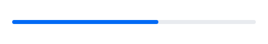

> [!CAUTION]
> **セキュリティの視点**：利用者が入力した文字（氏名など）を画面に表示するときは、`Span`、`Paragraph` の `setText(...)`、`new Span(文字)` を使います。文字は、**そのまま文字として**表示され、安全です。一方、`Html` や `setInnerHtml` のように、**HTML として解釈**する部品に、入力された文字を渡すと、**XSS**（悪意のあるスクリプトの実行）の原因になります（[12 章](12_Webアプリの脅威と対策.md)）。

## 7. 成績管理で使う部品の対応

| 画面 | 入力・表示の項目 | 使う部品 |
|---|---|---|
| 学生の登録 | 氏名 | `TextField` |
| | 所属学科 | `Select`（学科は少数） |
| | 入学年度 | `IntegerField` |
| 成績の登録 | 学生 | `ComboBox`（学生は多数） |
| | 科目 | `ComboBox` |
| | 年度 | `IntegerField` |
| | 点数（空欄で履修中） | `IntegerField` |
| 成績一覧 | 明細（科目名・単位数・年度・点数・合格） | `Grid`（[07 章](07_Gridで一覧を表示する.md)） |
| | 平均点 | `Span`、または `NumberField`（読み取り専用） |

## 8. よくあるミス

| ミス | 原因・対処 |
|---|---|
| `ComboBox` の選択肢が `オブジェクト@1a2b…` と表示される | 表示する文字を決めていない。`setItemLabelGenerator` を設定する |
| 数値の欄に、文字を入れられてしまう | `TextField` を使っている。数値は `IntegerField`（または `NumberField`）を使う |
| `getValue()` が `null` で、`NullPointerException` | `IntegerField` は、空欄のとき `null`。`null` を確認する（点数が空欄＝履修中、など意味がある） |
| `Notification` が、一瞬で消えて読めない | 表示時間が短い。エラーなど、大事な通知は、時間を長くするか `0`（閉じるまで）にする |
| `Notification.show` に、ユーザー入力をそのまま出す | 文字として表示されるので XSS にはならないが、長すぎる文字や、機密情報を出さない |
| ボタンを連打して、二重に登録される | 処理中は、`setEnabled(false)` で無効にする。サーバー側でも、重複を許さない（一意制約） |
| すべてのボタンが、主ボタンになっている | 主は 1 画面に 1 つ。どれが一番大事か決める |

---

[← 前へ：04 レイアウト](04_レイアウト.md) ｜ [次へ：06 イベントと画面の仕組み →](06_イベントと画面の仕組み.md)

[📖 フロントエンドの目次](./00_はじめに.md#目次) ｜ [🏠 全体の目次](../README.md#目次)
