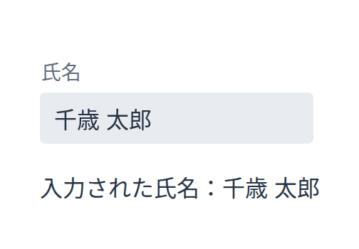
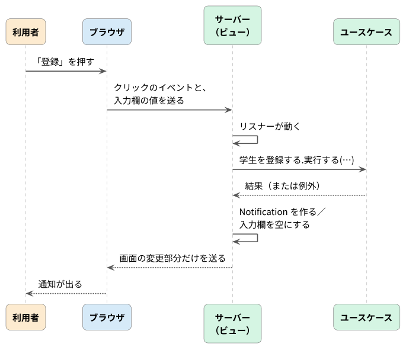
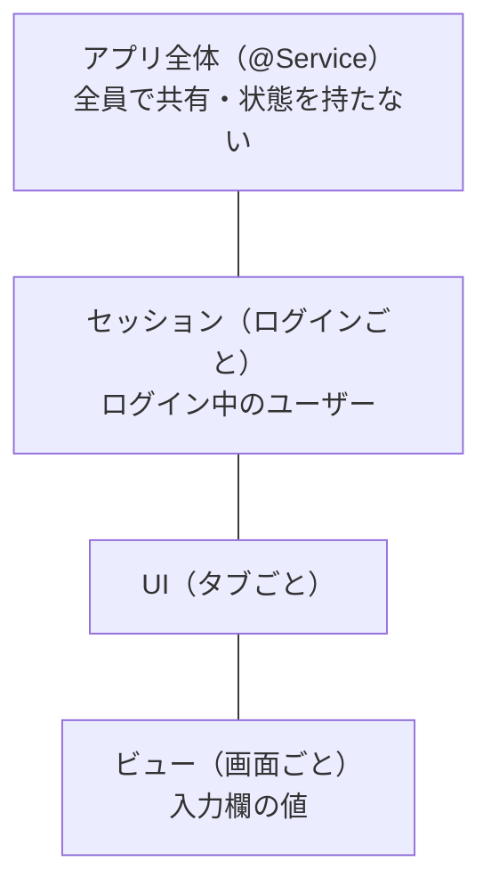

# 06. イベントと画面の仕組み

[📖 フロントエンドの目次](./00_はじめに.md#目次) ｜ [🏠 全体の目次](../README.md#目次)

[← 前へ：05 基本コンポーネント](05_基本コンポーネント.md) ｜ [次へ：07 Grid で一覧を表示する →](07_Gridで一覧を表示する.md)

## この章のゴール
- クリックや値の変更を、**リスナー**（ラムダ式）で処理できる
- 操作から画面の更新までの、ブラウザとサーバーのやりとりを説明できる
- `UI` とセッション、ビューの寿命と、状態の置き場所の違いを説明できる
- サーバーサイド UI で、注意すべきこと（通信、メモリ、同時操作）が分かる

## 目次

1. [イベントとリスナー](#1-イベントとリスナー)
2. [操作から更新までの流れ](#2-操作から更新までの流れ)
3. [状態はどこにあるか](#3-状態はどこにあるか)
4. [UI とセッション](#4-ui-とセッション)
5. [コンポーネントの表示・非表示と更新](#5-コンポーネントの表示非表示と更新)
6. [サーバーサイド UI の注意点](#6-サーバーサイド-ui-の注意点)
7. [よくあるミス](#7-よくあるミス)

---

## 1. イベントとリスナー

利用者の操作（クリック、値の変更）は、**イベント**として、Java のコードに届きます。それを処理するコードを、**リスナー**として登録します。リスナーは、**ラムダ式**で書くのが一般的です。

```java
var 登録 = new Button("登録");
登録.addClickListener(e -> {                           // クリックされたら、この処理を実行
    Notification.show("氏名：" + 氏名.getValue());
});

氏名.addValueChangeListener(e -> {                      // 値が変わったら
    var 新しい値 = e.getValue();
    var 前の値 = e.getOldValue();
    var 画面からの変更か = e.isFromClient();             // 利用者の入力か、コードからの変更か
});
```

| イベント | 登録する方法 | 主な用途 |
|---|---|---|
| クリック | `addClickListener` | ボタンの処理 |
| 値の変更 | `addValueChangeListener` | 入力に応じた表示の変更、絞り込み |
| 選択の変更 | `addSelectionListener`（Grid） | 選ばれた行の詳細の表示 |
| 画面に入る前 | `BeforeEnterObserver`（[03 章](03_ビューとルーティング.md)） | URL パラメータの受け取り |

値が変わったときの処理を、`addValueChangeListener` で登録し、`setValue` で値を変えると、**同じリスナーが動きます**（利用者の入力でも、コードからの変更でも）。

<!-- snippet: events-value-change -->
```java
var 氏名 = new TextField("氏名");
var 表示 = new Span();
氏名.addValueChangeListener(e -> 表示.setText("入力された氏名：" + e.getValue()));
氏名.setValue("千歳 太郎");
```



> [!NOTE]
> `Button("登録", e -> ...)` のように、**コンストラクタに、クリックのリスナーを渡す**書き方もあります。リスナーが短いときに便利です。

### 入力のたびにサーバーに送るか

`TextField` の値の変更は、既定では、入力欄を**離れたとき**にサーバーへ送られます。検索のように、入力のたびに反応させたいときは、送るタイミングを変えます。

```java
検索欄.setValueChangeMode(ValueChangeMode.LAZY);        // 入力が止まったら送る
検索欄.setValueChangeTimeout(400);                       // 400 ミリ秒、入力が止まったら
```

| モード | 送るタイミング |
|---|---|
| `ON_CHANGE`（既定） | 入力欄を離れたとき |
| `LAZY` | 入力が**止まって**から、指定の時間が経ったとき（検索におすすめ） |
| `EAGER` | 1 文字ごと（通信が多いので、避ける） |

## 2. 操作から更新までの流れ

ボタンを押したとき、何が起きているかを、順に追います。



重要なのは、次の 3 点です。

| ポイント | 内容 |
|---|---|
| リスナーは**サーバーで**動く | ブラウザでは、動かない。**リスナーの中から、ユースケースを直接呼べる** |
| 画面の更新は**自動** | コンポーネントの値や状態を変えるだけで、**変更が、ブラウザに送られる**。自分で通信のコードを書かなくてよい |
| 通信は**操作のたび**に起きる | 通信の回数と、1 回のデータ量を、意識する |

> [!TIP]
> **ユーザビリティの視点**：サーバーと通信する間（処理が重いとき）、利用者には、何も起きていないように見えます。**1 秒を超える処理**は、処理中であることを知らせます（ボタンの無効化、進み具合の表示）。ニールセンは、応答時間について、0.1 秒（即座と感じる）、1 秒（思考が途切れない）、10 秒（集中が切れる）を、目安としています。

## 3. 状態はどこにあるか

「状態」（入力された値、選ばれた項目、ログイン中のユーザー）を、どこに持たせるかを、整理します。

| 置き場所 | 寿命 | 例 | 注意 |
|---|---|---|---|
| **ビューのフィールド**（コンポーネント、変数） | そのビューが**表示されている間**（画面を移動すると消える） | 入力欄の値、選択中の行 | **画面をまたげない** |
| **UI** | ブラウザの**タブ**を開いている間 | タブごとの設定 | タブを閉じると消える |
| **セッション**（`VaadinSession`） | **ログインから、ログアウト（または期限切れ）まで** | ログイン中のユーザー（10 章） | サーバーのメモリを使う |
| **データベース** | **永続** | 学生、履修、成績 | 業務のデータは、ここに置く |
| Spring の `@Service` のフィールド | アプリが動いている間（**全員で共有**） | （基本的に、状態を持たせない） | **全利用者で共有される**ので、利用者ごとの情報を置いてはいけない |

> [!WARNING]
> `@Service` や `@Component` の**フィールドに、利用者ごとの情報**（ログイン中の学生など）を持たせないでください。Spring の部品は、**全利用者で 1 つを共有**するので、別の利用者の情報が見えてしまいます。利用者ごとの情報は、セッションや、認証の情報（10 章）から取得します。



## 4. UI とセッション

| クラス | 内容 | 取得 |
|---|---|---|
| `UI` | **ブラウザのタブ 1 つ**に対応する。画面の移動、通知の表示などをする | `UI.getCurrent()`、`component.getUI()` |
| `VaadinSession` | **利用者（ブラウザ）1 人**に対応する。複数のタブで共通 | `VaadinSession.getCurrent()` |

> [!NOTE]
> ログイン中のユーザーの情報は、`VaadinSession` に直接入れるのではなく、**Spring Security の認証の情報**から取得します（10 章）。

## 5. コンポーネントの表示・非表示と更新

画面の一部を、条件によって出し入れしたり、更新したりする方法です。

| やりたいこと | 書き方 |
|---|---|
| 非表示にする（場所も詰める） | `setVisible(false)` |
| 無効にする（見えるが、操作できない） | `setEnabled(false)` |
| 部品を入れ替える | `removeAll()` してから `add(...)` |
| 一覧を更新する | `grid.setItems(...)` をやり直す（`Grid` は 07 章） |

```java
// 「履修中」を選んだときは、点数の欄を無効にする
状態.addValueChangeListener(e -> 点数.setEnabled(!"履修中".equals(e.getValue())));
```

> [!CAUTION]
> **セキュリティの視点**：`setVisible(false)` で**隠した部品は、サーバーには存在し続け**、操作によっては、呼び出される可能性があります。**ボタンを隠すだけでは、権限の制御になりません**。「教員だけが使える操作」は、ビューの表示・非表示ではなく、**ユースケースや、アクセスの注釈で、サーバー側で必ず制限**します（[10 章](10_ログインの基本.md)、[12 章](12_Webアプリの脅威と対策.md)）。

## 6. サーバーサイド UI の注意点

| 注意点 | 内容 | 対処 |
|---|---|---|
| **メモリ** | 利用者ごとに、画面（コンポーネントの木）が、サーバーのメモリに残る | 一度に大量のデータを、画面に持たせない（Grid の遅延読み込み。07 章） |
| **通信の回数** | 操作のたびに通信する | 入力のたびの通信を減らす（`LAZY`）。検索の都度、全件を取らない |
| **同時操作** | 同じデータを、2 人が同時に更新する | 楽観ロック（データベース編 11 章）。画面で、更新の衝突を知らせる |
| **別のスレッド** | 非同期の処理から、画面を直接触れない | `ui.access(...)` を使う（[A4](A4_発展的な機能.md)） |
| **セッションの期限** | 一定時間操作がないと、セッションが切れる | 切れたときのメッセージ、入力中のデータの扱いを決める |

## 7. よくあるミス

| ミス | 原因・対処 |
|---|---|
| リスナーの中で、長い処理をして、画面が固まる | リスナーは、サーバーのスレッドで動く。長い処理は、非同期にする（A4） |
| `@Service` のフィールドに、ログイン中のユーザーを入れる | 全員で共有される。認証の情報から取得する |
| 画面を移動したら、入力した値が消えた | ビューは、移動のたびに作り直される。残したい値は、セッションやデータベースへ |
| 別のスレッドから、コンポーネントを更新して、例外になる | `ui.access(() -> ...)` で包む（A4） |
| 入力のたびに、DB を検索して、重くなる | `ValueChangeMode.LAZY` にする。必要なら、検索のボタンを置く |
| 非表示にしたボタンで、権限を守っているつもりになる | 隠すだけでは守れない。サーバー側（注釈・ユースケース）で確認する |

---

[← 前へ：05 基本コンポーネント](05_基本コンポーネント.md) ｜ [次へ：07 Grid で一覧を表示する →](07_Gridで一覧を表示する.md)

[📖 フロントエンドの目次](./00_はじめに.md#目次) ｜ [🏠 全体の目次](../README.md#目次)
