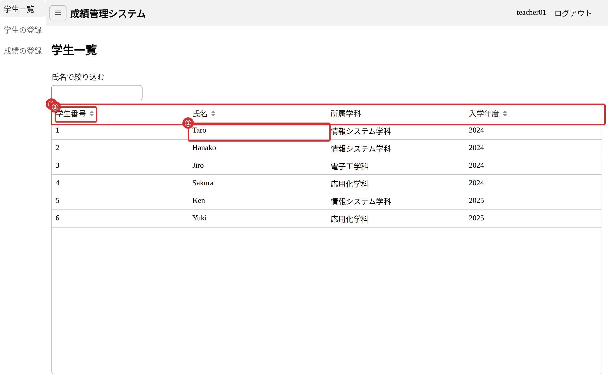
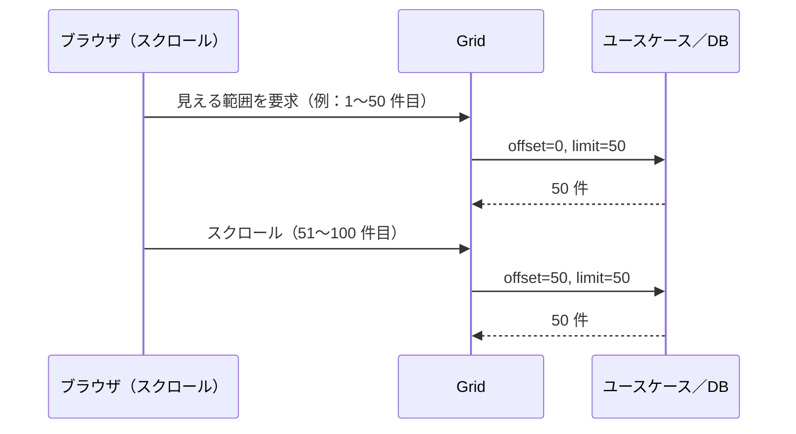
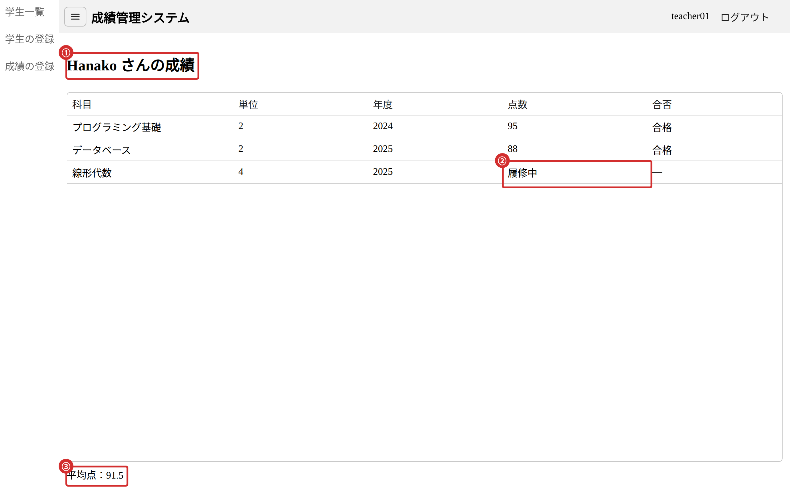

# 07. Grid で一覧を表示する

[📖 フロントエンドの目次](./00_はじめに.md#目次) ｜ [🏠 全体の目次](../README.md#目次)

[← 前へ：06 イベントと画面の仕組み](06_イベントと画面の仕組み.md) ｜ [次へ：08 フォームと Binder →](08_フォームとBinder.md)

## この章のゴール
- `Grid` で、データの一覧を表（テーブル）として表示できる
- 列の定義、並べ替え、行の選択を設定できる
- 全件を渡す方法と、**必要な分だけ読み込む**方法（遅延読み込み）の違いを説明できる
- 見やすい一覧にするための、設計の考え方が分かる

## 目次

1. [Grid とは](#1-grid-とは)
2. [一覧を表示する](#2-一覧を表示する)
3. [列の設定](#3-列の設定)
4. [行の選択](#4-行の選択)
5. [データの渡し方](#5-データの渡し方)
6. [絞り込みと更新](#6-絞り込みと更新)
7. [成績一覧の画面](#7-成績一覧の画面)
8. [よくあるミス](#8-よくあるミス)

---

## 1. Grid とは

**`Grid`** は、表形式でデータを表示する、Vaadin の代表的なコンポーネントです。並べ替え、行の選択、大量のデータの表示に対応しています。

| 要素 | 内容 |
|---|---|
| **行** | データ 1 件（Java のオブジェクト 1 つ） |
| **列** | オブジェクトの、どの項目を表示するか（`record` のアクセサなど） |
| **型パラメータ** | `Grid<成績明細>` のように、**行になるオブジェクトの型**を指定する |

## 2. 一覧を表示する

```java
var 一覧 = new Grid<成績明細>();
一覧.addColumn(成績明細::科目名).setHeader("科目");
一覧.addColumn(成績明細::単位数).setHeader("単位");
一覧.addColumn(成績明細::年度).setHeader("年度");
一覧.addColumn(成績明細::点数).setHeader("点数");

一覧.setItems(成績一覧.明細リスト());          // 表示するデータを渡す
```

`addColumn` に、**メソッド参照**（`成績明細::科目名`）を渡すだけです。`record` のアクセサと、相性が良い書き方です。



## 3. 列の設定

| 設定 | 書き方 | 内容 |
|---|---|---|
| 見出し | `.setHeader("科目")` | 列の題名 |
| 並べ替え | `.setSortable(true)` | 見出しをクリックして、並べ替えられる |
| 幅 | `.setAutoWidth(true)`、`.setFlexGrow(1)` | 内容に合わせる／余白を割り当てる |
| 固定 | `.setFrozen(true)` | 横にスクロールしても、左に固定する |
| 非表示・並び替え | `.setVisible(false)`、`setColumnReorderingAllowed(true)` | 利用者が、列を入れ替えられる |

### 表示の加工

数値や真偽値を、そのまま表示せず、**分かりやすい文字や部品**にしたいときは、`addColumn` に、**加工する関数**や、**部品を作る関数**（`ComponentRenderer`）を渡します。

```java
// 点数が null のとき（履修中）は「履修中」と表示する
一覧.addColumn(m -> m.点数() == null ? "履修中" : String.valueOf(m.点数()))
    .setHeader("点数");

// 合否を、色つきのバッジ（Span）で表示する
一覧.addComponentColumn(m -> {
    var バッジ = new Span(m.合格() ? "合格" : "不合格");
    バッジ.getElement().getThemeList().add(m.合格() ? "badge success" : "badge error");
    return バッジ;
}).setHeader("合否");
```

> [!TIP]
> **ユーザビリティの視点**：
> - **数値は右寄せ、文字は左寄せ**にします。桁がそろい、比べやすくなります
> - 状態（合格・不合格）は、**色だけで区別しない**でください。色の見分けにくい人や、白黒で印刷する場合を考え、**文字やアイコンも併用**します（アクセシビリティ。WCAG の「色だけに頼らない」）
> - 列は、**よく使うもの**を左に、**多すぎないよう**にします。全項目を出すより、重要な項目に絞り、詳細は、行を選んだときに見せます

## 4. 行の選択

```java
一覧.setSelectionMode(Grid.SelectionMode.SINGLE);              // 1 行だけ選べる（既定）
一覧.addSelectionListener(e ->                                  // 選ばれたら
    e.getFirstSelectedItem().ifPresent(m -> 詳細を表示する(m)));
```

| モード | 内容 |
|---|---|
| `SINGLE` | 1 行だけ選べる |
| `MULTI` | 複数の行を選べる（左にチェックボックスが付く） |
| `NONE` | 選べない（表示だけ） |

行の項目を**ダブルクリック**したときの処理は、`addItemDoubleClickListener` で登録します。

> [!NOTE]
> 選択の API の詳しい書き方は、公式ドキュメントの Grid のページ（<https://vaadin.com/docs/latest/components/grid>）で確認してください。

## 5. データの渡し方

`Grid` に、データを渡す方法は、2 つあります。

| 方法 | 書き方 | データの量 | 特徴 |
|---|---|---|---|
| **全件を渡す** | `grid.setItems(List<T>)` | **少ない**（数百件まで） | 簡単。全件が、サーバーのメモリに乗る |
| **遅延読み込み** | `grid.setItems(query -> ...)` | **多い** | 画面に見える範囲の分だけ、**必要になったとき**に取得する |

### 全件を渡す

```java
var データ = 学生一覧を取得する.実行する();       // ユースケースが返す List<学生>
一覧.setItems(データ);
```

成績管理の「学生一覧」や「科目一覧」は、件数が限られているので、この方法で十分です。

### 遅延読み込み

データが多いとき、**全件を取得すると、遅く、メモリも使います**。画面に見える範囲だけを、必要になったとき、取得する方法です。`query` に、「何件目から、何件、どの並び順で」が入っています。

```java
一覧.setItems(query -> 履歴を探す(
        query.getOffset(),                    // 何件目から
        query.getLimit(),                     // 何件
        query.getSortOrders())                // 並べ替えの指定
    .stream());                                // Stream で返す
```



> [!IMPORTANT]
> 遅延読み込みでは、**「どこから、何件」を指定して取得できる**ユースケースと、リポジトリが必要です（SQL の `LIMIT` / `OFFSET`、データベース編 10 章）。ユースケースが、全件を返してから、画面で切り出しても、意味がありません。また、全件の**件数**を返す処理も、必要になることがあります。

> [!NOTE]
> Spring Data を使う場合のために、ページ（`Pageable`）を使った書き方も、公式ドキュメントにあります（<https://vaadin.com/docs/latest/building-apps/forms-data/add-grid/paginated-data>）。この資料の題材は、JdbcClient を使うため、ここでは扱いません。

## 6. 絞り込みと更新

### 絞り込み（全件を渡した場合）

`setItems` は、**データビュー**を返し、これを使って、画面上で絞り込めます。

```java
var データビュー = 一覧.setItems(データ);
検索欄.addValueChangeListener(e ->
    データビュー.setFilter(s -> s.氏名().contains(e.getValue())));   // 氏名に含まれるものだけ
```

### 更新（データが変わったとき）

| 場面 | 方法 |
|---|---|
| 登録・削除の後、一覧を最新にしたい | 取得し直して、`setItems(...)` をやり直す |
| 遅延読み込みで、再取得させたい | `一覧.getDataProvider().refreshAll()` |

## 7. 成績一覧の画面

ユースケース「成績一覧を取得する」の結果（`成績一覧`）を、`Grid` と平均点で表示します。

```java
@Route("students/:studentId/transcript")
@PageTitle("成績一覧")
@PermitAll
public class 成績一覧ビュー extends VerticalLayout implements BeforeEnterObserver {

    private final 成績一覧を取得する 成績一覧を取得する;          // コンストラクタ注入（09 章）
    private final Grid<成績明細> 一覧 = new Grid<>();
    private final H3 見出し = new H3();
    private final Span 平均 = new Span();

    // …コンストラクタで列を定義して add する…

    @Override
    public void beforeEnter(BeforeEnterEvent event) {
        int 学生ID = /* URL パラメータから取得 */ 1;
        var 結果 = 成績一覧を取得する.実行する(学生ID);           // 4 層のユースケースを呼ぶ
        見出し.setText(結果.氏名() + " さんの成績");
        一覧.setItems(結果.明細リスト());
        平均.setText("平均点：" + 結果.平均点());
    }
}
```

> [!NOTE]
> **サンプル**：[`frontend/grades-vaadin/src/main/java/grades/presentation/成績一覧ビュー.java`](https://github.com/<ORG>/PRMN_SYSTEM_Sample/blob/main/frontend/grades-vaadin/src/main/java/grades/presentation/成績一覧ビュー.java)（作成予定）



> [!TIP]
> **ユーザビリティの視点**：一覧の画面では、**「誰の」「何の」一覧かを、見出しではっきり示します**。また、データが 0 件のときは、空の表を出すだけにせず、「まだ成績が登録されていません」のように、**状態と次の行動**を伝えます（ヒューリスティクスの「システム状態の視認性」）。

## 8. よくあるミス

| ミス | 原因・対処 |
|---|---|
| 列が 1 つも出ない | `addColumn` を呼んでいない。`new Grid<>(型.class)` で、列を自動作成することもできるが、**列の順序と見出しを、自分で決める**ほうが、おすすめ |
| 点数が `null` のまま表示されて、空欄になる | 意味のある `null`（履修中）は、加工して表示する |
| 数万件を `setItems(List)` に渡して、遅い・メモリが足りない | 遅延読み込みにして、DB で、必要な分だけ取得する |
| `Grid` の高さが 0 で、見えない | 親の高さが決まっていない（[04 章](04_レイアウト.md)）。`setHeight` か、`expand` |
| 並べ替えが効かない／画面のデータだけが並ぶ | 遅延読み込みでは、並べ替えを、**DB の `ORDER BY` で実行**する必要がある（`setSortProperty` と、`query.getSortOrders()` の利用） |
| 登録後、一覧が古いまま | `setItems` をやり直していない |
| 一覧に、利用者に見せてはいけない項目（パスワードのハッシュなど）が入っている | 画面に出すデータは、**表示用のデータ（DTO）**に絞る。ドメインのオブジェクトを、そのまま渡さない |

---

[← 前へ：06 イベントと画面の仕組み](06_イベントと画面の仕組み.md) ｜ [次へ：08 フォームと Binder →](08_フォームとBinder.md)

[📖 フロントエンドの目次](./00_はじめに.md#目次) ｜ [🏠 全体の目次](../README.md#目次)
