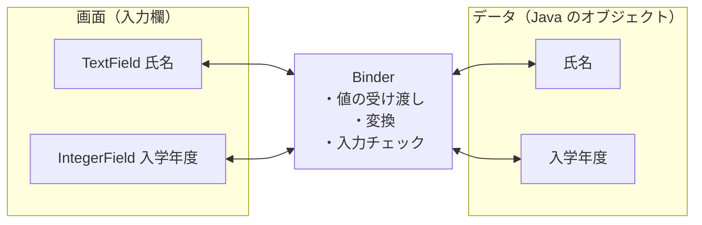
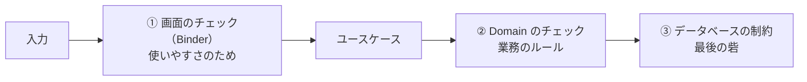

# 08. フォームと Binder

[📖 フロントエンドの目次](./00_はじめに.md#目次) ｜ [🏠 全体の目次](../README.md#目次)

[← 前へ：07 Grid で一覧を表示する](07_Gridで一覧を表示する.md) ｜ [次へ：09 4層とつなぐ →](09_4層とつなぐ.md)

## この章のゴール
- **Binder** で、入力欄と、Java のオブジェクトを結びつけられる
- 必須・長さ・範囲などの**入力チェック**を、画面に設定できる
- 型の変換（文字 ↔ 数値）が分かる
- **画面のチェック**と、**Domain 層のチェック**の役割の違いを説明できる

## 目次

1. [入力フォームの問題](#1-入力フォームの問題)
2. [Binder とは](#2-binder-とは)
3. [基本の書き方](#3-基本の書き方)
4. [入力チェック](#4-入力チェック)
5. [エラーの表示](#5-エラーの表示)
6. [画面のチェックと Domain のチェック](#6-画面のチェックと-domain-のチェック)
7. [Bean Validation を使う](#7-bean-validation-を使う)
8. [学生の登録フォーム](#8-学生の登録フォーム)
9. [よくあるミス](#9-よくあるミス)

---

## 1. 入力フォームの問題

入力フォームを、`getValue()` と `setValue()` だけで作ると、次の処理を、全部、自分で書くことになります。

| 処理 | 内容 |
|---|---|
| 値の取り出し | 入力欄ごとに `getValue()` して、オブジェクトに詰める |
| 値の設定 | 既存のデータを編集するとき、`setValue()` で、欄に入れる |
| 型の変換 | 文字 → 数値、など |
| 入力チェック | 必須、長さ、範囲。エラーの表示 |
| 変更の検知 | 保存のボタンを、変更があるときだけ有効にする |

これらを、まとめて引き受けるのが、**Binder** です。

## 2. Binder とは

**Binder** は、**入力欄（フィールド）と、データのオブジェクトの項目を、結びつける**仕組みです。



| 操作 | 内容 |
|---|---|
| `binder.forField(入力欄)…bind(...)` | 入力欄と、項目を結びつける |
| `binder.readBean(オブジェクト)` | オブジェクトの値を、**入力欄に表示**する（編集の開始） |
| `binder.writeBean(オブジェクト)` | 入力欄の値を、チェックして、**オブジェクトに書き込む** |

## 3. 基本の書き方

Binder に使う Java のオブジェクト（**Bean**）は、通常、**値を変更できる**クラス（getter / setter を持つクラス）です。ドメインの `record`（変更できない）は、そのままでは使えません。そこで、**画面の入力専用のクラス**（フォームの値を持つクラス）を作ります。

```java
/** 学生の登録フォームの入力値（Presentation 層の、入力専用のクラス） */
public class 学生登録フォーム {
    private String 氏名;
    private Integer 学科ID;
    private Integer 入学年度;
    // getter / setter …
}
```

```java
var binder = new Binder<>(学生登録フォーム.class);

binder.forField(氏名)
      .bind(学生登録フォーム::get氏名, 学生登録フォーム::set氏名);   // 入力欄 ↔ 項目

binder.forField(入学年度)
      .bind(学生登録フォーム::get入学年度, 学生登録フォーム::set入学年度);
```

```java
// 保存ボタンが押されたとき
var 入力 = new 学生登録フォーム();
try {
    binder.writeBean(入力);                       // チェックして、オブジェクトに書き込む
    学生を登録する.実行する(入力.get氏名(), 入力.get学科ID(), 入力.get入学年度());
} catch (ValidationException e) {
    // 入力チェックに失敗（エラーは、すでに欄に表示されている）
}
```

> [!NOTE]
> `writeBean` は、**入力チェックにすべて通ったときだけ**、オブジェクトに書き込みます。通らなければ、`ValidationException` が投げられ、**エラーが、各欄に表示**されます。

## 4. 入力チェック

`forField(...)` のあとに、チェックを、**順番に**つなげます。最初に失敗したチェックで、止まります。

```java
binder.forField(氏名)
      .asRequired("氏名を入力してください")                                  // 必須
      .withValidator(s -> s.length() <= 50, "氏名は50文字以内にしてください")  // 条件
      .bind(学生登録フォーム::get氏名, 学生登録フォーム::set氏名);

binder.forField(入学年度)
      .asRequired("入学年度を入力してください")
      .withValidator(new IntegerRangeValidator("2000〜2100 の範囲で入力してください", 2000, 2100))
      .bind(学生登録フォーム::get入学年度, 学生登録フォーム::set入学年度);
```

| チェック | 書き方 |
|---|---|
| 必須 | `asRequired("メッセージ")` |
| 自分で条件を書く | `withValidator(値 -> 条件, "メッセージ")` |
| 用意されたチェック | `StringLengthValidator`（長さ）、`IntegerRangeValidator`（範囲）、`EmailValidator`（メール） |
| 型の変換 | `withConverter(...)`（例：文字 → 整数の `StringToIntegerConverter`） |

> [!NOTE]
> `IntegerField` は、すでに整数の値（`Integer`）を持つので、文字 → 数値の変換は、不要です。`TextField` に数字を入力させる場合は、`StringToIntegerConverter` で変換します（変換できない文字が入ったときのエラーメッセージも、指定します）。

## 5. エラーの表示

| 方法 | 内容 |
|---|---|
| 各入力欄の下に、メッセージを出す（既定） | 入力欄ごとのエラーを、その欄に出す。最も分かりやすい |
| まとめて表示する（`setStatusLabel`） | フォームの上などに、1 つのラベルに出す |
| 状態を自分で処理する（`withValidationStatusHandler`） | 色の変更など、細かい制御 |

<!-- 📷 SS: ../images/frontend/app/app-08-01-validation-error.png -->
> 📷 **スクショ指定：`app-08-01-validation-error.png`**（自動撮影）
> - 画面：氏名を空欄、入学年度に 1999 を入力して「登録」を押した学生登録フォーム（欄が赤くなり、メッセージが出ている）
> - 強調：①氏名のエラーメッセージ、②入学年度のエラーメッセージ を赤枠で囲み、番号を振る

> [!TIP]
> **ユーザビリティの視点**：
> - エラーは、**間違えた欄の、すぐそば**に出します。「どこが間違っているか」を探させない（ヒューリスティクスの「**エラーの認識・診断・回復を助ける**」）
> - メッセージは、**責めずに、直し方を示す**（「入力が不正です」ではなく、「入学年度は 2000〜2100 の範囲で入力してください」）
> - エラーの確認を、**入力の途中ではなく**、欄を離れたとき、または送信のときに行います（入力中に赤くなると、焦らせてしまう）
> - 入力した内容は、**エラーのときも消さない**。やり直しを、最小限にします

## 6. 画面のチェックと Domain のチェック

入力チェックは、**画面（Binder）にも、Domain 層にも**、あります。役割が違います。

| | **画面のチェック**（Binder） | **Domain 層のチェック** |
|---|---|---|
| 目的 | 利用者に、**早く・分かりやすく**間違いを伝える | **業務のルールを、必ず守らせる** |
| 例 | 必須、文字数、数字の範囲 | 点数は 0〜100、入学年度は 2000 以上 |
| 守られるか | **利用者が回避できる**（画面を通さずに送れる） | **必ず守られる**（すべての入口を通る） |
| 置く場所 | Presentation 層 | Domain 層（と、データベースの制約） |



> [!CAUTION]
> **セキュリティの視点**：画面のチェックは、**セキュリティの対策ではありません**。ブラウザの開発者ツールや、画面を使わないリクエストで、回避できます。**Domain 層（と、データベースの制約）でも、必ず同じ検査を行います**（4 層編 02 章、データベース編 06 章）。画面のチェックは、「使いやすさのため」と考えてください。

> [!IMPORTANT]
> **業務のルールを、画面と Domain に二重に書くと、片方だけ直し忘れます**。ルールの**本体は、Domain 層**に置き、画面のチェックは、**分かりやすいメッセージのための、簡易版**にとどめます。Domain が投げる例外（`IllegalArgumentException`）のメッセージを、画面に表示する方法は、[09 章](09_4層とつなぐ.md) で扱います。

## 7. Bean Validation を使う

**Bean Validation** は、`@NotBlank`、`@Size`、`@Min` などの**注釈**で、データのクラスに、チェックを書く、Java の標準の仕組みです。`BeanValidationBinder` を使うと、注釈が、画面のチェックとしても、働きます。

```java
public class 学生登録フォーム {
    @NotBlank(message = "氏名を入力してください")
    @Size(max = 50, message = "氏名は50文字以内にしてください")
    private String 氏名;

    @NotNull(message = "入学年度を入力してください")
    @Min(value = 2000, message = "入学年度は2000以上にしてください")
    private Integer 入学年度;
}
```

```java
var binder = new BeanValidationBinder<>(学生登録フォーム.class);
binder.bindInstanceFields(this);                    // 同じ名前のフィールドを、まとめて結びつける
```

| 方法 | 利点 | 注意 |
|---|---|---|
| `Binder` ＋ 手で書く | 何が起きているか、分かりやすい | チェックが、画面のコードに散らばる |
| **`BeanValidationBinder`** | チェックを**注釈にまとめられる**。同じ注釈を、サーバー側のチェックにも使える | 依存関係（Hibernate Validator などの実装）が必要。注釈のメッセージを、日本語にする |

> [!NOTE]
> 「フォーム用のクラスに、Bean Validation の注釈を書く」のは、**Presentation 層の入力のチェック**です。Domain 層のルール（`学生` の `record` の中の検査）とは別です。依存関係や、注釈の import は、バージョンによって変わるので、公式ドキュメント（<https://vaadin.com/docs/latest/flow/binding-data/components-binder-beans>）で確認してください。

## 8. 学生の登録フォーム

学生を登録するフォームの全体の流れです。

```java
@Route("students/register")
@PageTitle("学生の登録")
@RolesAllowed("TEACHER")                          // 教員だけ（11 章）
public class 学生登録ビュー extends VerticalLayout {

    private final 学生を登録する 学生を登録する;               // ユースケース（09 章）
    private final Binder<学生登録フォーム> binder = new Binder<>(学生登録フォーム.class);

    public 学生登録ビュー(学生を登録する 学生を登録する) {
        this.学生を登録する = 学生を登録する;
        // 1. 部品（氏名、学科、入学年度、登録ボタン）を作って並べる
        // 2. binder で、入力欄と項目を結びつけ、チェックを設定する
        // 3. 登録ボタンで、binder.writeBean → ユースケースを呼ぶ → 通知
    }
}
```

> [!NOTE]
> **サンプル**：[`frontend/grades-vaadin/src/main/java/grades/presentation/学生登録ビュー.java`](https://github.com/<ORG>/PRMN_SYSTEM_Sample/blob/main/frontend/grades-vaadin/src/main/java/grades/presentation/学生登録ビュー.java)（作成予定）

<!-- 📷 SS: ../images/frontend/app/app-08-02-register-form.png -->
> 📷 **スクショ指定：`app-08-02-register-form.png`**（自動撮影）
> - 画面：学生の登録フォーム（氏名・所属学科・入学年度、「登録」ボタン）の、入力前の状態
> - 強調：①入力欄（ラベル、ヘルパーテキスト）、②主ボタン（登録）を赤枠で囲み、番号を振る

> [!TIP]
> **ユーザビリティの視点**：登録が**成功したとき**は、①成功を知らせ（`Notification`）、②**次の操作がしやすい状態**にします（フォームを空にして、続けて登録できる、または一覧に移動する）。登録が**終わったかどうか**が分からないフォームは、利用者に、二重に登録させてしまいます。

## 9. よくあるミス

| ミス | 原因・対処 |
|---|---|
| ドメインの `record` を、そのまま Binder に使おうとして、`setter` がなくて失敗する | `record` は変更できない。入力専用のクラス（フォーム用の Bean）を作る |
| `writeBean` の例外を、処理していない | `ValidationException` を `catch` する（エラー自体は、欄に出ている） |
| `bind` を呼んだのに、チェックが働かない | `forField(...)` に、チェックを付けたあとで、`bind` を呼ぶ順番になっているか確認する（`bind` が最後） |
| 画面のチェックだけで、安心している | 画面のチェックは回避できる。Domain とデータベースでも検査する |
| チェックのルールを、画面と Domain の両方に、別々に書いて、食い違う | ルールの本体は Domain。画面は、メッセージのための簡易版 |
| `IntegerField` の `null` を、確認せずに、`int` に代入して例外になる | 必須にする（`asRequired`）か、`null` の扱いを決める（点数の空欄＝履修中） |
| エラーのとき、入力した内容が消える | 画面を作り直していないか確認する。内容は残す |

---

[← 前へ：07 Grid で一覧を表示する](07_Gridで一覧を表示する.md) ｜ [次へ：09 4層とつなぐ →](09_4層とつなぐ.md)

[📖 フロントエンドの目次](./00_はじめに.md#目次) ｜ [🏠 全体の目次](../README.md#目次)
