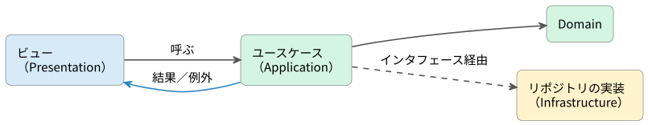
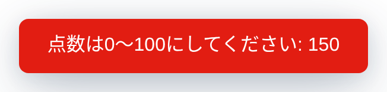
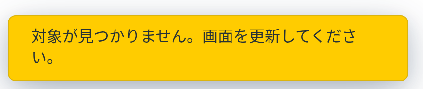
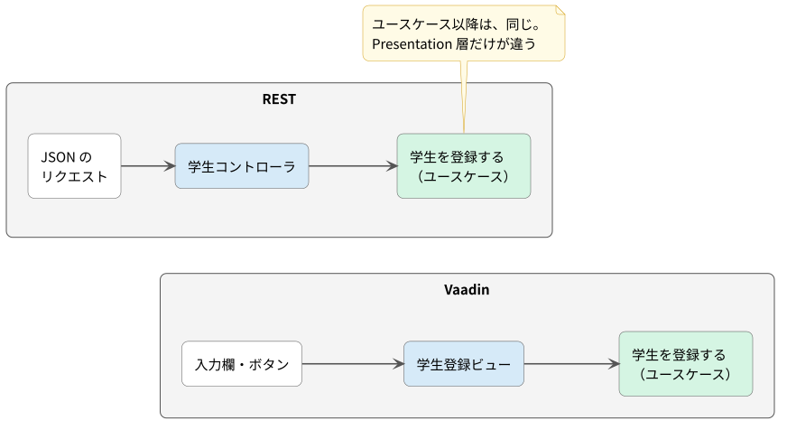
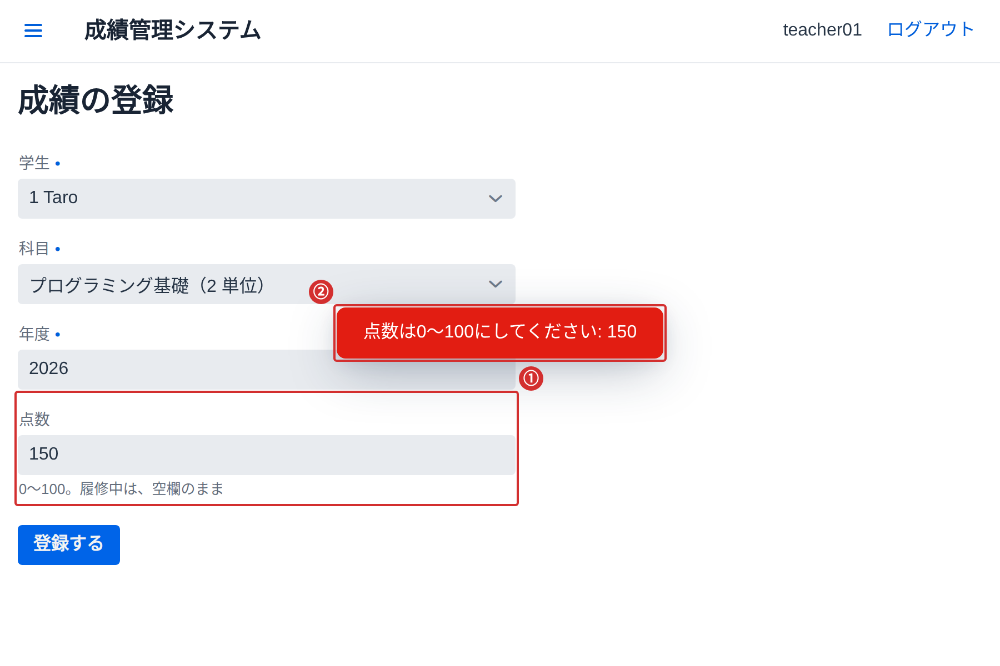

# 09. 4層とつなぐ

[📖 フロントエンドの目次](./00_はじめに.md#目次) ｜ [🏠 全体の目次](../README.md#目次)

[← 前へ：08 フォームと Binder](08_フォームとBinder.md) ｜ [次へ：10 ログインの基本 →](10_ログインの基本.md)

## この章のゴール
- ビューから、ユースケースを呼び出せる（コンストラクタ注入）
- ビューに**書いてよいこと・書いてはいけないこと**を説明できる
- ユースケースが投げる例外を、画面のメッセージに変えられる
- REST の Controller と、Vaadin のビューの対応が分かる

## 目次

1. [この章の位置づけ](#1-この章の位置づけ)
2. [ビューからユースケースを呼ぶ](#2-ビューからユースケースを呼ぶ)
3. [ビューに書くこと・書かないこと](#3-ビューに書くこと書かないこと)
4. [例外を画面のメッセージにする](#4-例外を画面のメッセージにする)
5. [REST の Controller との対応](#5-rest-の-controller-との対応)
6. [画面に出すデータ](#6-画面に出すデータ)
7. [成績の登録画面を作る](#7-成績の登録画面を作る)
8. [よくあるミス](#8-よくあるミス)

---

## 1. この章の位置づけ

ここまでで、画面の部品（ビュー、レイアウト、コンポーネント、Grid、Binder）が揃いました。この章では、画面を、**4 層アーキテクチャの Presentation 層として**、Application 層のユースケースにつなぎます。



## 2. ビューからユースケースを呼ぶ

ビューも、Spring が管理する部品（**Bean**）です。ユースケース（`@Service`）は、**コンストラクタ**で受け取ります（**コンストラクタ注入**。4 層編 03・07 章と同じ）。

```java
@Route("students/register")
@PageTitle("学生の登録")
@RolesAllowed("TEACHER")
public class 学生登録ビュー extends VerticalLayout {

    private final 学生を登録する 学生を登録する;

    public 学生登録ビュー(学生を登録する 学生を登録する) {          // Spring が渡してくれる
        this.学生を登録する = 学生を登録する;
        // …画面を組み立てる…
    }

    private void 登録する(学生登録フォーム 入力) {
        学生を登録する.実行する(入力.get氏名(), 入力.get学科().学科ID(), 入力.get入学年度());   // ユースケースを呼ぶ
    }
}
```

> [!NOTE]
> `@Route` を付けたビューは、Vaadin が、Spring のコンテナを使って作成します。そのため、**コンストラクタの引数に、ユースケースを書くだけ**で、注入されます。ビューは、アクセスのたびに作られる（[03 章](03_ビューとルーティング.md)）ので、`@Service` のように、フィールドに、利用者の情報を持たせても、他人には見えませんが、画面をまたいで残るものでもありません。

## 3. ビューに書くこと・書かないこと

4 層編 02 章の「Presentation 層」の責務を、Vaadin に当てはめます。

| 書く | 書かない |
|---|---|
| 入力欄・ボタンの配置 | **業務のルール**（点数の範囲、合格点、平均点の計算） |
| 入力値の**形式のチェック**（必須、数字か） | **SQL**、`Repository` の直接の利用、`JdbcClient` |
| ユースケースの**呼び出し**（引数の受け渡し） | **トランザクション**の制御（`@Transactional`。ユースケースの仕事） |
| 結果の**表示**（Grid、メッセージ） | 複数のユースケースの**手順の組み立て** |
| 例外を、**画面のメッセージ**に変える | 権限の**最終的な判断**（ユースケース側でも確認する。12 章） |

> [!IMPORTANT]
> ビューが `Repository` を直接呼ぶと、**業務のルールを通らずに、データを書き換えられる**ことになり、4 層に分けた意味がなくなります。**ビューから呼んでよいのは、ユースケース（Application 層）だけ**です（依存の向き：Presentation → Application → Domain）。

## 4. 例外を画面のメッセージにする

ユースケースや Domain は、問題があると、**例外**を投げます（画面の知識は持ちません）。ビューが、例外を捕まえて、**利用者に分かる文章**として表示します。

| 例外（サンプルの例） | 意味 | 画面での扱い |
|---|---|---|
| `IllegalArgumentException` | Domain の検査に違反（点数の範囲、氏名が空など） | メッセージを、入力欄の近くに表示（利用者が直せる） |
| `NoSuchElementException` | 学生・科目が見つからない | 「見つかりません」を表示（別の画面から戻ってきた場合など） |
| `DataIntegrityViolationException` など | データベースの制約違反（存在しない学科など） | 「登録できませんでした」（詳細は出さない） |
| その他の `RuntimeException` | 想定外の失敗 | 共通のエラー画面／通知（詳細は、ログにだけ書く） |

```java
private void 登録する(学生登録フォーム 入力) {
    try {
        var 学生 = 学生を登録する.実行する(入力.get氏名(), 入力.get学科().学科ID(), 入力.get入学年度());
        Notification.show("登録しました：" + 学生.氏名())
                .addThemeVariants(NotificationVariant.SUCCESS);
        binder.readBean(new 学生登録フォーム());                       // フォームを空に戻す
    } catch (IllegalArgumentException e) {
        Notification.show(e.getMessage(), 5000, Notification.Position.MIDDLE)       // Domain のメッセージ
                .addThemeVariants(NotificationVariant.ERROR);
    } catch (NoSuchElementException e) {
        Notification.show("対象が見つかりません。画面を更新してください。")
                .addThemeVariants(NotificationVariant.WARNING);
    }
}
```

#### それぞれの表示

上のコードの、**通知の部分だけ**を、取り出して動かした結果です（種類の色は、[05 章](05_基本コンポーネント.md#5-通知確認ダイアログ) の `NotificationVariant`）。

**登録できた**（成功）

<!-- snippet: usecase-success -->
```java
var 学生 = new 学生(7, "千歳 花子", 1, 2026);            // ユースケースが返した学生
Notification.show("登録しました：" + 学生.氏名())
        .addThemeVariants(NotificationVariant.SUCCESS);
```


**Domain のルールに違反した**（エラー）：例外のメッセージを、**そのまま**表示します。

<!-- snippet: usecase-domain-error -->
```java
var e = new IllegalArgumentException("点数は0〜100にしてください: 150");   // Domain が投げた例外
Notification.show(e.getMessage(), 5000, Notification.Position.MIDDLE)
        .addThemeVariants(NotificationVariant.ERROR);
```



**対象が見つからない**（警告）：利用者が直せる問題ではないので、**例外のメッセージではなく、画面用の文章**を表示します。

<!-- snippet: usecase-not-found -->
```java
var e = new java.util.NoSuchElementException("学生が見つかりません: 999");   // ユースケースが投げた例外
Notification.show("対象が見つかりません。画面を更新してください。")
        .addThemeVariants(NotificationVariant.WARNING);
```



### 共通のエラー処理

すべてのビューで、`try-catch` を書くのは大変です。想定外の例外は、**共通のエラー処理**に任せます。Vaadin は、**画面で処理されなかった例外を、一括して扱う仕組み**（エラーハンドラ）と、**エラー画面**（`HasErrorParameter`）を持っています。

| 場面 | 仕組み |
|---|---|
| 想定内（入力ミス、見つからない） | ビューで `try-catch` して、メッセージを出す |
| 想定外（バグ、障害） | 共通のエラー処理に任せ、利用者には「問題が発生しました」とだけ表示する |

> [!NOTE]
> 4 層編 07 章では、`@RestControllerAdvice` で、例外を HTTP の応答（404 / 400）に変えました。Vaadin では、それが、**ビューでの例外の処理**に変わります。同じ「**Presentation 層の仕事**」です。

> [!CAUTION]
> **セキュリティの視点**：想定外の例外のメッセージ（SQL のエラー、クラス名、スタックトレース）を、**そのまま画面に出してはいけません**。システムの内部の構造が、攻撃者に伝わります。画面には、「問題が発生しました。しばらくしてからやり直してください」とだけ表示し、**詳細はログに記録**します（[12 章](12_Webアプリの脅威と対策.md)）。

## 5. REST の Controller との対応

4 層編 07 章の `学生コントローラ`（REST）と、Vaadin のビューを、並べて比べます。

| 比べる点 | REST（`学生コントローラ`） | Vaadin（`学生登録ビュー`） |
|---|---|---|
| 入口 | `@PostMapping`（`POST /students`） | **ボタンのクリックのリスナー**（`@Route("students/register")` の画面） |
| 入力 | JSON を、`record`（`学生登録の入力`）で受け取る | **入力欄**の値を、Binder でフォームの Bean にする |
| ユースケースの呼び出し | `学生を登録する.実行する(…)` | **同じ** |
| 結果の返し方 | JSON（`学生の応答`） | **画面の更新**（通知、Grid） |
| エラーの扱い | `@RestControllerAdvice` で、HTTP の 400 / 404 | **`try-catch` と、メッセージの表示** |
| 誰が使うか | プログラム（外部のシステム、スマートフォンのアプリ） | **人** |



> [!TIP]
> 同じユースケースを、REST と Vaadin の両方から使えることが、「**層を分ける**」利点です。画面の仕組みを変えても、**業務のルールは、1 行も変わりません**。

## 6. 画面に出すデータ

ユースケースが返す、`学生`（ドメインの `record`）や、`成績一覧`（表示用のデータ）を、ビューは、そのまま使えます。ただし、次の点に注意します。

| 注意 | 内容 |
|---|---|
| **見せてはいけない項目** | 画面に出すデータに、パスワードのハッシュなど、利用者に見せてはいけない項目が、含まれていないか確認する。方針は、「`学生` のように秘密の項目がないドメインの `record` は、そのまま渡す。`users` のような型は、DTO にして必要な項目だけ渡す」 |
| **画面専用の形にしたい** | 「学生のコンボボックスに、`ID 氏名` と表示したい」などは、ビューの中で、`setItemLabelGenerator` で加工する（ユースケースを、画面の都合で変えない） |
| **ユースケースの戻り値が画面に合わない** | ユースケースの戻り値を、画面向けの形（`成績一覧` のような、表示用のデータ）にまとめるのは、**Application 層の仕事**。ビューの中で、複数のユースケースを組み合わせて加工しない |

> [!NOTE]
> 画面を出すために、「学生の一覧」「科目の一覧」が必要なので、サンプルの `学生一覧を取得する`、`科目一覧を取得する` は、**画面で選択肢を作るためのユースケース**として用意されています。「画面が必要としているデータは、ユースケースとして、Application 層が提供する」という考え方です。

## 7. 成績の登録画面を作る

最後に、「成績を登録する」画面を、これまでの章の内容をまとめて作ります。

| 部品 | 内容 | 章 |
|---|---|---|
| `ComboBox`（学生・科目） | 選択肢を、`学生一覧を取得する`、`科目一覧を取得する` で作る | 05 |
| `IntegerField`（年度・点数） | 点数は空欄＝履修中 | 05 |
| Binder | 必須・範囲のチェック | 08 |
| 登録ボタン | `成績を登録する.実行する(学生ID, 科目ID, 年度, 点数)` を呼ぶ | 09 |
| 通知とエラー | 成功のメッセージ、`IllegalArgumentException` のメッセージの表示 | 05・09 |



<!-- legend:screens/enrollment-error -->
| 番号 | 説明 |
|---|---|
| ① | 範囲外の点数（150）を入力した欄 |
| ② | Domain の検査のメッセージ（エラーの通知） |
<!-- /legend -->

> [!NOTE]
> **サンプル**：[`frontend/grades-vaadin/src/main/java/grades/presentation/成績登録ビュー.java`](https://github.com/YTS0418/PRMN_SYSTEM_Sample/blob/main/frontend/grades-vaadin/src/main/java/grades/presentation/成績登録ビュー.java)

> [!TIP]
> **ユーザビリティの視点**：ここまでの画面は、上流工程で整理した**ユースケースの流れ**（誰が、どの順番で、何をするか）に沿っているか、確認します。教員は、「成績を登録する」を**何度も続けて**行います。登録のたびに画面が変わると、手間が増えます。**学生と年度を、登録後も残し、科目と点数だけを、入れ直せる**ようにする、といった工夫は、利用者の作業（メンタルモデル）を聞き取ってこそ、見つかります（[上流工程 03 章](../上流工程/03_メンタルモデルを理解する.md)）。

## 8. よくあるミス

| ミス | 原因・対処 |
|---|---|
| ビューで `Repository` や `JdbcClient` を、直接使う | 層の違反。ユースケースを経由する |
| ビューの中に、点数の範囲など、業務のルールを書く | ルールの本体は、Domain 層。ビューは、メッセージの表示だけ |
| ユースケースの例外を、画面に、そのまま（クラス名つきで）出す | 想定内のメッセージだけを出し、想定外は、共通のエラー画面と、ログにする |
| ユースケースの中で、`Notification` や、`UI` を使う | ユースケースは、画面の知識を持たない。結果を返す／例外を投げるだけ |
| ユースケースを `new` して使う | Spring に任せる（コンストラクタ注入）。`new` すると、トランザクションなどが、効かない |
| 複数のユースケースを、ビューで順に呼んで、1 つの処理にする | トランザクションが、別々になる。1 つの処理は、**1 つのユースケース**にまとめる |
| `try-catch` で、例外を握りつぶして、何も表示しない | 利用者には、何が起きたか分からない。必ず、表示かログを残す |

---

[← 前へ：08 フォームと Binder](08_フォームとBinder.md) ｜ [次へ：10 ログインの基本 →](10_ログインの基本.md)

[📖 フロントエンドの目次](./00_はじめに.md#目次) ｜ [🏠 全体の目次](../README.md#目次)
