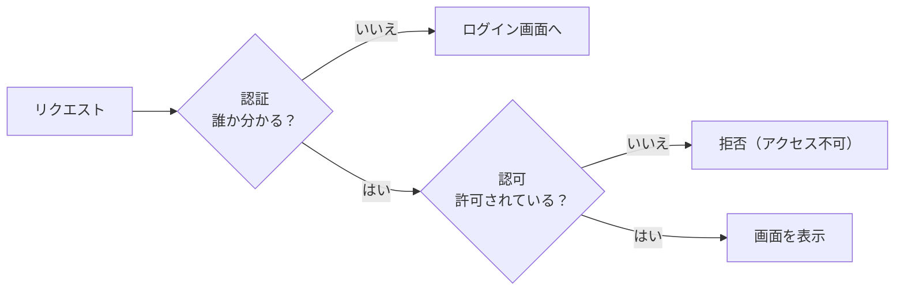
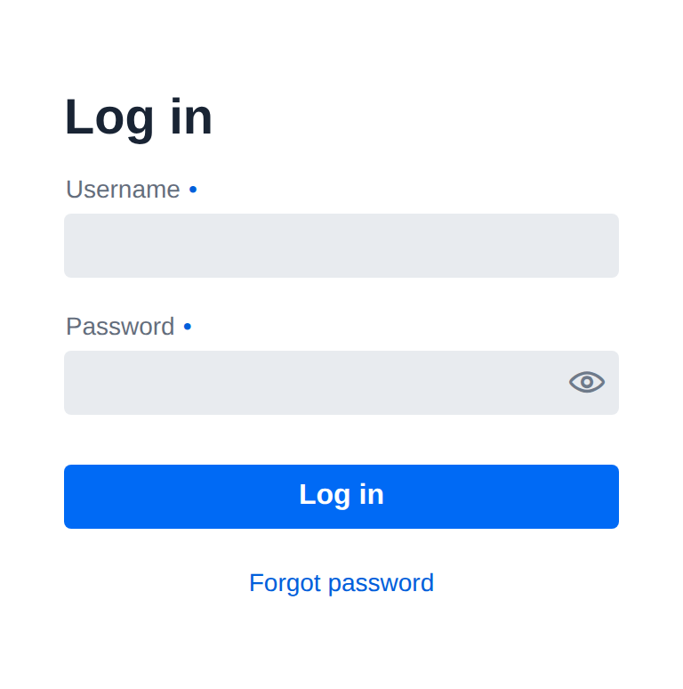
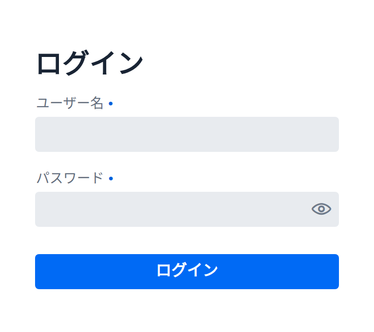
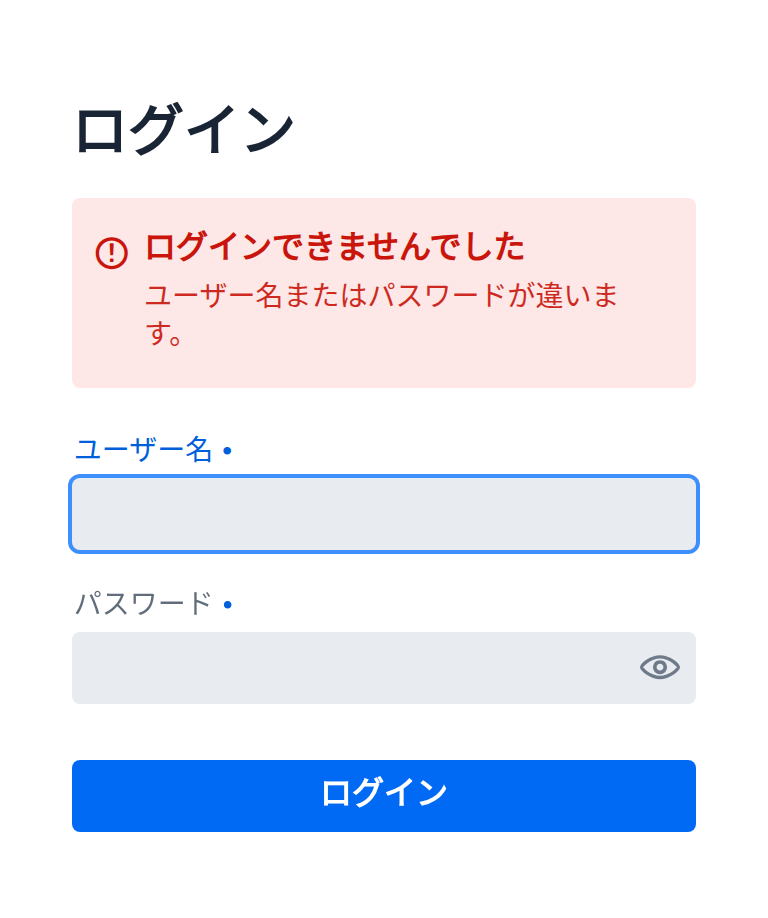
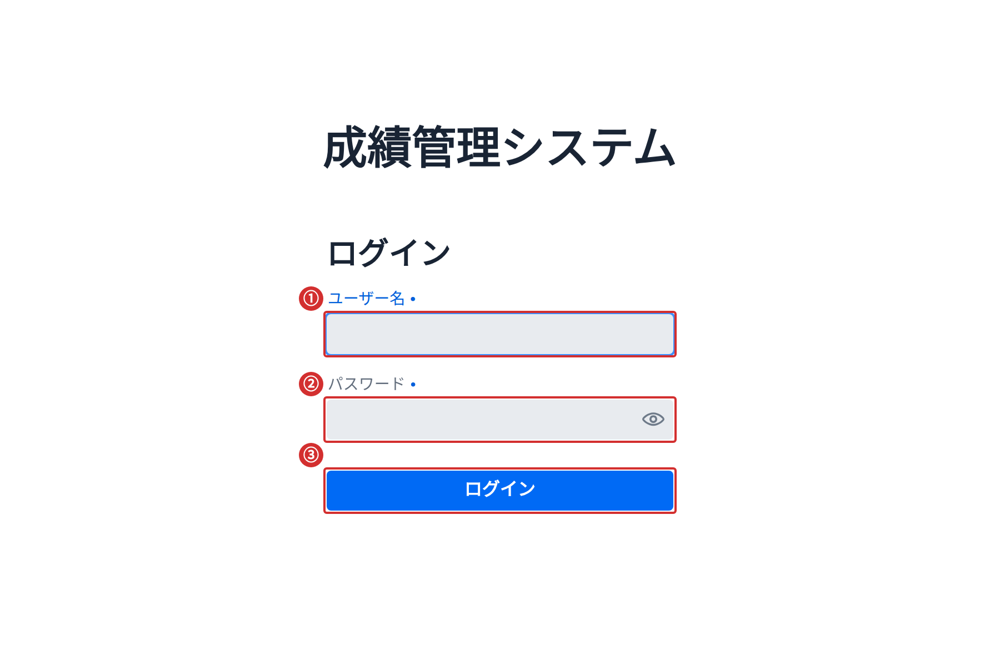
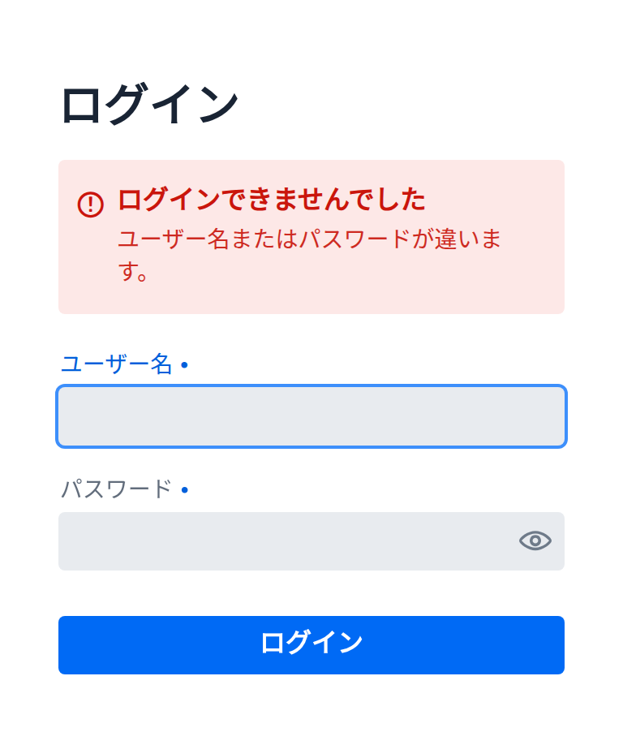
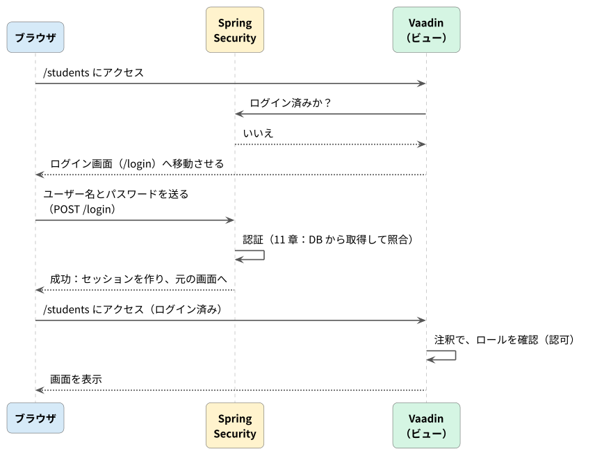

# 10. ログインの基本

[📖 フロントエンドの目次](./00_はじめに.md#目次) ｜ [🏠 全体の目次](../README.md#目次)

[← 前へ：09 4層とつなぐ](09_4層とつなぐ.md) ｜ [次へ：11 DB認証とロール →](11_DB認証とロール.md)

## この章のゴール
- **認証**と**認可**の違いを説明できる
- Spring Security と Vaadin の関係を説明できる
- ログイン画面を作り、ビューごとに、アクセスできる人を制限できる
- ログイン中のユーザーの取得と、ログアウトができる

## 目次

1. [認証と認可](#1-認証と認可)
2. [Vaadin のセキュリティの全体像](#2-vaadin-のセキュリティの全体像)
3. [依存関係と設定クラス](#3-依存関係と設定クラス)
4. [ログイン画面](#4-ログイン画面)
5. [アクセスを制限する注釈](#5-アクセスを制限する注釈)
6. [ログイン中のユーザーとログアウト](#6-ログイン中のユーザーとログアウト)
7. [ログインの流れ](#7-ログインの流れ)
8. [よくあるミス](#8-よくあるミス)

---

## 1. 認証と認可

ログインに関わる 2 つの言葉は、混同しやすいので、区別します。

| 用語 | 英語 | 問い | 例 |
|---|---|---|---|
| **認証** | Authentication | **あなたは誰か** | ユーザー名とパスワードで、本人と確かめる |
| **認可** | Authorization | **あなたは、これをしてよいか** | 教員だけが、成績を登録できる |



> [!IMPORTANT]
> **認証を通っても、認可が必要です。** ログインできた＝何でもできる、ではありません。学生は、**自分の成績だけ**見られ、教員は、**すべての学生の成績**を登録できる、といった区別が必要です（[11 章](11_DB認証とロール.md)）。

## 2. Vaadin のセキュリティの全体像

Vaadin は、**Spring Security** と連携して、ログインを実現します。役割は次のように分かれます。

| 担当 | 内容 |
|---|---|
| **Spring Security** | 認証（ユーザーの確認）、セッションの管理、CSRF の対策、パスワードのハッシュ化 |
| **Vaadin** | **ビューへのアクセスの制御**（注釈）、ログイン画面の部品、画面のコンポーネントとの連携 |
| **あなたのコード** | 設定クラス、ユーザーの取得方法（11 章）、アクセスの注釈、ログイン画面 |

> [!NOTE]
> **Spring Security** とは、Spring の、認証と認可のための標準的なフレームワークです。ログインの仕組みを自分で作ることは、**セキュリティの危険が大きいため、避けます**（パスワードの扱いなどに、多くの落とし穴があるため）。**実績のあるフレームワークを使う**のが、基本です。

## 3. 依存関係と設定クラス

### 依存関係

`pom.xml` に、Spring Security を追加します。

```xml
<dependency>
  <groupId>org.springframework.boot</groupId>
  <artifactId>spring-boot-starter-security</artifactId>
</dependency>
```

### 設定クラス

Vaadin 25 では、**`VaadinSecurityConfigurer`** を使って、Spring Security の設定に、Vaadin の設定を取り込みます。

```java
@Configuration
@EnableWebSecurity
class セキュリティ設定 {

    @Bean
    SecurityFilterChain filterChain(HttpSecurity http) throws Exception {
        http.with(VaadinSecurityConfigurer.vaadin(), configurer ->
            configurer.loginView(ログインビュー.class));          // ログイン画面を指定
        return http.build();
    }
}
```

| 設定 | 内容 |
|---|---|
| `SecurityFilterChain` | リクエストを、どう保護するかを決める Spring Security の設定 |
| `VaadinSecurityConfigurer.vaadin()` | Vaadin に必要な設定（画面の部品の通信、静的ファイルの許可、ログアウトなど）を、**まとめて**行う |
| `loginView(...)` | ログインが必要なときに、移動させる画面 |

> [!WARNING]
> **Vaadin 24 以前の記事では、`VaadinWebSecurity` を継承する書き方**が出てきます。Vaadin 25 の公式ドキュメント（<https://vaadin.com/docs/latest/building-apps/security/add-login>）では、`VaadinSecurityConfigurer` を使う書き方になっています。**古い記事のコードを、そのまま写さない**でください。

> [!NOTE]
> **サンプル**：[`frontend/grades-vaadin/src/main/java/grades/presentation/セキュリティ設定.java`](https://github.com/YTS0418/PRMN_SYSTEM_Sample/blob/main/frontend/grades-vaadin/src/main/java/grades/presentation/セキュリティ設定.java)

## 4. ログイン画面

ログイン画面は、Vaadin の **`LoginForm`**（ユーザー名とパスワードの入力欄、ログインのボタンを持つ部品）を使います。

```java
@Route(value = "login", autoLayout = false)          // 共通レイアウトを使わない
@PageTitle("ログイン")
@AnonymousAllowed                                     // ログインしていなくても見られる
public class ログインビュー extends VerticalLayout implements BeforeEnterObserver {

    private final LoginForm ログイン = new LoginForm();

    public ログインビュー() {
        ログイン.setAction("login");                    // Spring Security に、フォームを送る
        setSizeFull();
        setAlignItems(Alignment.CENTER);
        setJustifyContentMode(JustifyContentMode.CENTER);
        add(new H1("成績管理システム"), ログイン);
    }

    @Override
    public void beforeEnter(BeforeEnterEvent event) {
        // ログインに失敗して戻ってきたとき（URL に ?error がある）は、エラーを表示
        if (event.getLocation().getQueryParameters().getParameters().containsKey("error")) {
            ログイン.setError(true);
        }
    }
}
```

| 点 | 内容 |
|---|---|
| `setAction("login")` | ボタンを押すと、入力値を、**Spring Security の `/login`** に送る（ログインの処理は、Spring Security が行う） |
| `@AnonymousAllowed` | ログインしていない人にも、表示を許可する。ログイン画面は、必ず、これを付ける |
| `autoLayout = false` | 共通のレイアウト（メニュー）を、ログイン画面では使わない |
| `setError(true)` | 「ユーザー名またはパスワードが違います」を表示する |

`LoginForm` の文言は、既定では英語です。日本語にするには、`LoginI18n` で、文言を設定します（サンプルの `ログインビュー` を参照）。「パスワードを忘れた」のボタンは、再設定の機能がなければ、`setForgotPasswordButtonVisible(false)` で隠します。

`LoginForm` の文言は、**既定では英語**です（`Log in`、`Username`、`Password`、`Forgot password`）。

<!-- snippet: login-default -->
```java
var ログイン = new LoginForm();
```



日本語にするには、`LoginI18n` で文言を設定します。再設定の機能がなければ、「パスワードを忘れた」のボタンは、隠します。

<!-- snippet: login-japanese -->
```java
var ログイン = new LoginForm();
var 文言 = new LoginI18n();
var フォーム = new LoginI18n.Form();
フォーム.setTitle("ログイン");
フォーム.setUsername("ユーザー名");
フォーム.setPassword("パスワード");
フォーム.setSubmit("ログイン");
文言.setForm(フォーム);
ログイン.setI18n(文言);
ログイン.setForgotPasswordButtonVisible(false);
```



ログインに失敗したときは、`setError(true)` で、エラーを表示します。メッセージは、**ユーザー名とパスワードの、どちらが違うかを、教えない**書き方にします（12 章）。

<!-- snippet: login-error -->
```java
var ログイン = new LoginForm();
var 文言 = new LoginI18n();
var フォーム = new LoginI18n.Form();
フォーム.setTitle("ログイン");
フォーム.setUsername("ユーザー名");
フォーム.setPassword("パスワード");
フォーム.setSubmit("ログイン");
文言.setForm(フォーム);
var エラー = new LoginI18n.ErrorMessage();
エラー.setTitle("ログインできませんでした");
エラー.setMessage("ユーザー名またはパスワードが違います。");
文言.setErrorMessage(エラー);
ログイン.setI18n(文言);
ログイン.setForgotPasswordButtonVisible(false);
ログイン.setError(true);
```



実際のログイン画面（`ログインビュー`）は、次のようになります。



<!-- legend:screens/login -->
| 番号 | 説明 |
|---|---|
| ① | ユーザー名 |
| ② | パスワード |
| ③ | ログインのボタン |
<!-- /legend -->



> [!TIP]
> **ユーザビリティの視点**：ログインの画面は、**「ユーザー名」「パスワード」「ログイン」だけ**にします。余計な情報や、リンクが多いと、迷います。Vaadin の `LoginForm` は、ブラウザの**パスワードの保存機能**とも、うまく連携します。パスワードを、**利用者が安全に管理できる**ことは、使いやすさと、セキュリティの両方に役立ちます。

> [!CAUTION]
> **セキュリティの視点**：ログインの失敗のメッセージは、「**ユーザー名またはパスワードが違います**」と、**どちらが間違っているか分からない**ように書きます。「そのユーザー名は存在しません」と出すと、攻撃者が、**存在するユーザー名を探せます**（[12 章](12_Webアプリの脅威と対策.md)）。

## 5. アクセスを制限する注釈

ビューの**クラスに、注釈を付けて**、アクセスできる人を決めます。

| 注釈 | アクセスできる人 | 使う場面 |
|---|---|---|
| `@AnonymousAllowed` | **誰でも**（ログインの有無を問わない） | ログイン画面、公開のページ |
| `@PermitAll` | **ログインしている人なら、誰でも** | ログイン後の、共通の画面 |
| `@RolesAllowed("TEACHER")` | **指定したロール**を持つ人だけ | 教員だけの画面（11 章） |
| `@DenyAll` | **誰も** | 一時的な、アクセスの停止 |

```java
@Route("students/register")
@RolesAllowed("TEACHER")                    // 教員だけ
public class 学生登録ビュー extends VerticalLayout { … }
```

> [!IMPORTANT]
> **注釈のないビューは、既定でアクセスできません**（Vaadin 25）。**安全側に倒れている**ので、付け忘れても、「見えてはいけない画面が、見える」ことにはなりません（見えないだけです）。ただし、**`@AnonymousAllowed` を付けすぎないよう**にします。付けるのは、本当に、誰に見せてもよい画面だけです。

> [!WARNING]
> 注釈を**複数、同じビューに付けない**でください。優先順位（`@DenyAll` が最優先、次に `@AnonymousAllowed`、`@RolesAllowed`、`@PermitAll`）がありますが、**意図が分かりにくくなります**。1 つのビューに、注釈は 1 つにします。

> [!WARNING]
> **共通のレイアウト（`@Layout` を付けた `AppLayout`）にも、アクセスの注釈が必要です**（[03 章](03_ビューとルーティング.md)）。ログイン後の画面が、すべて「アクセスが拒否された」になるときは、レイアウトの注釈を疑います。ログイン済みなら誰でも使える外枠なので、`@PermitAll` を付けます。

**注釈で拒否されたとき**：ロールが足りない画面（学生が、教員用の `/students/register` を開いたとき）は、**開けません**。本番モードでは、次のような、**飾りのない文**だけが表示されます（開発モードでは、拒否の理由を含む、詳しい説明が出ます）。


> [!TIP]
> **ユーザビリティの視点**：この表示は、利用者に、**何が起きたのか、次に何をすればよいか**が、伝わりません（ヒューリスティクスの「エラーの認識・診断・回復を助ける」）。実際のアプリでは、**アクセスできない旨を説明する画面**（エラーのビュー）を用意し、ログイン画面や、トップへの**リンク**を置きます。

> [!NOTE]
> 注釈による制限は、**ビューに入れるかどうか**を決めます。**ビューの中で呼ぶ処理（ユースケース）の権限**は、別に確認します（[12 章](12_Webアプリの脅威と対策.md)）。

## 6. ログイン中のユーザーとログアウト

### ログイン中のユーザーを取得する

Vaadin は、Spring Security の認証の情報を扱うための部品（`AuthenticationContext`）を用意しています。ビューのコンストラクタに注入して使います。

```java
@Component
@UIScope
class ヘッダー {
    private final AuthenticationContext 認証;

    ヘッダー(AuthenticationContext 認証) { this.認証 = 認証; }

    String ユーザー名() {
        return 認証.getAuthenticatedUser(UserDetails.class)     // ログイン中の UserDetails
                   .map(UserDetails::getUsername).orElse("");
    }

    void ログアウト() {
        認証.logout();                                           // ログアウト（セッションを破棄）
    }
}
```

| 操作 | 内容 |
|---|---|
| `getAuthenticatedUser(UserDetails.class)` | ログイン中のユーザーを取得（ログインしていなければ、空） |
| `isAuthenticated()` | ログイン済みか |
| `hasAnyRole(...)` | 指定のロールを持つか。**ビューの表示の切り替え**に使う（ただし、制限の本体にしない） |
| `logout()` | ログアウト |

> [!NOTE]
> `AuthenticationContext` の細かい使い方（取得の方法、利用できる場所）は、Vaadin のバージョンで変わることがあります。公式ドキュメントの「Security」の章（<https://vaadin.com/docs/latest/building-apps/security>）で確認してください。


> [!TIP]
> **ユーザビリティの視点**：**「誰として、ログインしているか」を、常に表示**します（ヒューリスティクスの「システム状態の視認性」）。特に、**教員と学生の画面が違う**システムでは、「いま、どの権限で操作しているか」が分からないと、混乱します。ログアウトのボタンは、**いつも同じ場所**（右上）に置きます。共用の PC では、ログアウトを忘れると、**他の人が、あなたとして操作できてしまいます**。

## 7. ログインの流れ

ログインしていない状態で、保護された画面にアクセスしたときの流れです。



> [!NOTE]
> 認証に成功すると、**セッション**が作られ、ブラウザには、セッションを識別するための**Cookie**（`JSESSIONID`）が、渡されます。以降のリクエストで、この Cookie によって、ログイン済みであることを確認します。

## 8. よくあるミス

| ミス | 原因・対処 |
|---|---|
| どのビューを開いても「アクセスが拒否された」 | ビューに注釈が付いていない（Vaadin 25 の既定）。`@PermitAll` などを付ける |
| ログイン画面が、無限に、ログイン画面へ移動する | ログインビューに `@AnonymousAllowed` が付いていない |
| ログインのボタンを押しても、何も起きない | `setAction("login")` がない。または、`loginView` の設定がない |
| ログインしているのに、ログイン画面に戻される | 認可（ロール）が足りない。`@RolesAllowed` のロール名と、実際のロール名（11 章）が違う |
| Vaadin 24 の書き方（`VaadinWebSecurity`）をコピーして、コンパイルできない | Vaadin 25 は、`VaadinSecurityConfigurer`。公式ドキュメントで確認する |
| 注釈を、複数付けて、挙動が分からなくなる | 1 つのビューに、1 つの注釈 |
| ログイン後の全画面で「アクセスが拒否された」と出る | **レイアウトのクラスに、`@PermitAll` がない**（ビューだけに付けても足りない） |
| 画面を隠しただけで、制限したつもりになる | 注釈（サーバー側）で制限する（06 章、12 章） |
| 自分でログインの仕組み（パスワードの照合など）を作ってしまう | Spring Security を使う。自作は、危険 |

---

[← 前へ：09 4層とつなぐ](09_4層とつなぐ.md) ｜ [次へ：11 DB認証とロール →](11_DB認証とロール.md)

[📖 フロントエンドの目次](./00_はじめに.md#目次) ｜ [🏠 全体の目次](../README.md#目次)
