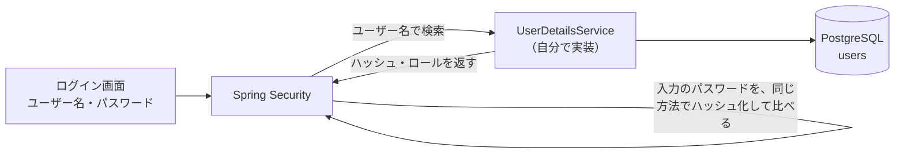
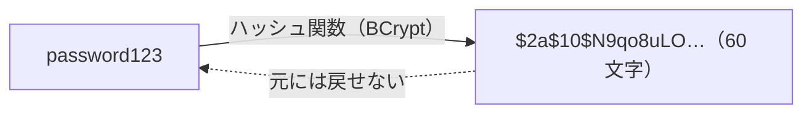
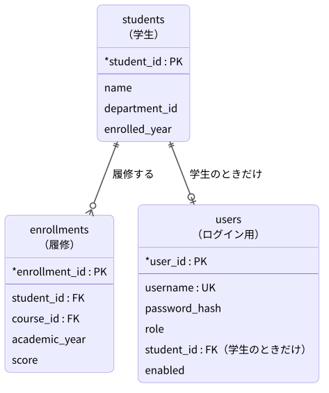
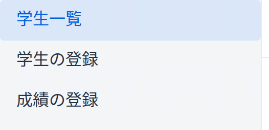

# 11. DB認証とロール

[📖 フロントエンドの目次](./00_はじめに.md#目次) ｜ [🏠 全体の目次](../README.md#目次)

[← 前へ：10 ログインの基本](10_ログインの基本.md) ｜ [次へ：12 Webアプリの脅威と対策 →](12_Webアプリの脅威と対策.md)

## この章のゴール
- ユーザー情報を、データベースに保存し、ログインに使える
- パスワードを、**ハッシュ化**して保存する理由と、BCrypt の使い方が分かる
- `UserDetailsService` を、JdbcClient で実装できる
- 教員・学生の**ロール**で、画面とメニューを、出し分けられる

## 目次

1. [この章で作るもの](#1-この章で作るもの)
2. [パスワードを保存する方法](#2-パスワードを保存する方法)
3. [テーブルの設計](#3-テーブルの設計)
4. [UserDetailsService を実装する](#4-userdetailsservice-を実装する)
5. [ロールと画面の制限](#5-ロールと画面の制限)
6. [4層のどこに置くか](#6-4層のどこに置くか)
7. [開発用の初期ユーザー](#7-開発用の初期ユーザー)
8. [よくあるミス](#8-よくあるミス)

---

## 1. この章で作るもの

[10 章](10_ログインの基本.md) の仕組みは、「誰が、ログインできるか」を決める部分（ユーザー情報の取得）が、まだ、ありません。この章では、**データベースに、ユーザー情報を保存**して、ログインに使います。



| ロール | 使う人 | できること |
|---|---|---|
| `TEACHER` | 教員 | 学生の登録、成績の登録、すべての学生の成績一覧の閲覧 |
| `STUDENT` | 学生 | **自分の**成績一覧の閲覧だけ |

> [!NOTE]
> **ロール**とは、利用者の**役割**（教員、学生、管理者）です。利用者 1 人 1 人に、権限を設定するのではなく、**ロールに権限を結びつけ、利用者にロールを割り当てる**ことで、管理しやすくします。

## 2. パスワードを保存する方法

| 方法 | 内容 | 安全か |
|---|---|---|
| **平文**で保存 | `password123` を、そのまま保存 | **絶対に避ける**。データベースが漏れると、全員のパスワードが分かる |
| 暗号化して保存 | 鍵で暗号化。鍵があれば、元に戻せる | 避ける。鍵が漏れると、全員分が戻される |
| **ハッシュ化**して保存 | 元に**戻せない**変換をして保存。ログイン時に、入力を同じ方法で変換して比べる | **この方法を使う** |

### ハッシュ化とは

**ハッシュ化**は、元のデータから、**固定長の文字列**を作り、そこから元のデータには**戻せない**処理です。



| 方法 | 内容 |
|---|---|
| **ソルト**（salt） | ハッシュ化のときに、**ランダムな値を混ぜる**。同じパスワードでも、ユーザーごとに、違う結果になる（事前に計算した表を使う攻撃を防ぐ） |
| **ストレッチング** | ハッシュ化を、**わざと遅く**する（繰り返す）。総当たり攻撃の試行の回数を減らす |
| **BCrypt** | ソルトとストレッチングを、組み込んだ、パスワード用のハッシュ関数。Spring Security の標準 |

> [!CAUTION]
> **セキュリティの視点**：SHA-256 や MD5 などの**一般のハッシュ関数を、そのままパスワードに使ってはいけません**。高速に計算できるため、総当たり攻撃に弱いからです。**パスワード専用**の関数（BCrypt、Argon2 など）を使います。自分でハッシュ化の処理を作らず、Spring Security の `PasswordEncoder` を使います。

```java
@Bean
PasswordEncoder passwordEncoder() {
    return PasswordEncoderFactories.createDelegatingPasswordEncoder();   // 既定は BCrypt
}
```

| 操作 | 書き方 |
|---|---|
| ハッシュ化する（登録・変更時） | `passwordEncoder.encode("入力されたパスワード")` |
| 照合する | Spring Security が、自動で行う（`matches`） |

> [!NOTE]
> `createDelegatingPasswordEncoder()` は、`{bcrypt}$2a$10$…` のように、**方式の名前を、ハッシュの先頭に付けて保存**します。将来、より強い方式に変更しても、古いユーザーのパスワードを、そのまま使えます。

### ハッシュの例

`encode` した結果は、**実行のたびに変わります**（ソルトが、ランダムに混ざるため）。**同じパスワードでも、結果が違っても、照合は成功します**。

```java
var ハッシュ = passwordEncoder.encode("grades-sample");
```

```text
{bcrypt}$2a$10$FyKawR/fKlrsGI9oLqvAbu/i1YjeyCA/W2vuDwWCqH1A.fMy40us2
```

| 部分 | 意味 |
|---|---|
| `{bcrypt}` | ハッシュの方式の名前（`createDelegatingPasswordEncoder` が付ける） |
| `$2a$10$` | BCrypt の版と、ストレッチングの回数（`10` は、2 の 10 乗回） |
| 残りの 53 文字 | ソルトと、ハッシュ（60 文字のうち） |

## 3. テーブルの設計

ユーザーのテーブルを、データベース編の考え方（正規化、制約）で設計します。

```sql
CREATE TABLE users (
    user_id       SERIAL       PRIMARY KEY,
    username      VARCHAR(50)  NOT NULL UNIQUE,         -- ログイン名（重複させない）
    password_hash VARCHAR(100) NOT NULL,                -- ハッシュ。平文は保存しない
    role          VARCHAR(20)  NOT NULL
                  CHECK (role IN ('TEACHER', 'STUDENT')),
    student_id    INTEGER      REFERENCES students (student_id),   -- 学生のときだけ。教員は NULL
    enabled       BOOLEAN      NOT NULL DEFAULT TRUE    -- アカウントの有効・無効
);
```

| 列 | 内容 | 理由 |
|---|---|---|
| `username` | `UNIQUE` | 同じ名前のログインを、許さない |
| `password_hash` | ハッシュ | **平文を保存しない**。列の名前でも明示する |
| `role` | `CHECK` | ロールの値を、データベースでも制限する（データベース編 06 章） |
| `student_id` | 外部キー | **ログインしているユーザーが、どの学生か**を結びつける。学生は、自分の成績だけ見られる（5 節、12 章） |
| `enabled` | 有効・無効 | 退学・休学など、**ユーザーを削除せずに、ログインを止める** |



> [!NOTE]
> 1 人が複数のロールを持つ場合は、`user_roles` という別のテーブルにします（データベース編 05 章の正規化）。この資料では、簡単のため、1 人 1 ロールにしています。**サンプル**：[`frontend/db/`](https://github.com/<ORG>/PRMN_SYSTEM_Sample/tree/main/frontend/db)（作成予定。`users` のテーブル定義を追加する）

### 登録されているユーザー

サンプルのデータを入れたあとの、`users` テーブルの中身です。`password_hash` は、長いので、省いています。

```sql
SELECT user_id, username, role, student_id, enabled FROM users ORDER BY user_id;
```

```text
 user_id | username  |  role   | student_id | enabled
---------+-----------+---------+------------+---------
       1 | teacher01 | TEACHER |            | t
       2 | student01 | STUDENT |          1 | t
       3 | student02 | STUDENT |          2 | t
(3 rows)
```

教員（`TEACHER`）は `student_id` が空、学生（`STUDENT`）は、どの学生かが入っています（3 節の `CHECK` 制約で、この組み合わせを守っています）。

## 4. UserDetailsService を実装する

Spring Security は、ユーザー名から、ユーザー情報（ハッシュ、ロール）を取得するときに、**`UserDetailsService`** を呼びます。この実装を、**JdbcClient**（データベース編 12 章）で、書きます。

```java
@Service
class DBユーザー実装 implements UserDetailsService {

    private final JdbcClient jdbc;

    DBユーザー実装(JdbcClient jdbc) { this.jdbc = jdbc; }

    @Override
    public UserDetails loadUserByUsername(String ユーザー名) throws UsernameNotFoundException {
        return jdbc.sql("""
                SELECT username, password_hash, role, enabled
                FROM users WHERE username = :name
                """)
            .param("name", ユーザー名)                               // プレースホルダ（SQL インジェクション対策）
            .query((rs, i) -> User.withUsername(rs.getString("username"))
                    .password(rs.getString("password_hash"))        // ハッシュ（照合は Spring Security）
                    .roles(rs.getString("role"))                    // "TEACHER" → ROLE_TEACHER
                    .disabled(!rs.getBoolean("enabled"))
                    .build())
            .optional()
            .orElseThrow(() -> new UsernameNotFoundException("ユーザーが見つかりません"));
    }
}
```

| 点 | 内容 |
|---|---|
| `:name` と `.param(...)` | **プレースホルダ**で SQL に値を渡す。文字列の連結で SQL を作らない（**SQL インジェクション**の対策。データベース編 12 章） |
| `.roles("TEACHER")` | ロールを設定する。内部では `ROLE_TEACHER` として扱われ、`@RolesAllowed("TEACHER")` と対応する |
| `.disabled(...)` | 無効なユーザーは、ログインできない |
| パスワードの照合 | **自分で書かない**。ハッシュを返すと、Spring Security が、入力と照合する |

> [!NOTE]
> サンプルでは、標準の `User` ではなく、**学生番号を足した `ログインユーザー`**（`User` を継承）を返します。ログイン中の学生が「どの学生か」を、12 章の権限の確認（`成績の権限`）で使うためです。

> [!NOTE]
> **サンプル**：[`frontend/grades-vaadin/src/main/java/grades/dataaccess/jdbc/DBユーザー実装.java`](https://github.com/<ORG>/PRMN_SYSTEM_Sample/blob/main/frontend/grades-vaadin/src/main/java/grades/dataaccess/jdbc/DBユーザー実装.java)（作成予定）

## 5. ロールと画面の制限

### 注釈で画面を制限する

```java
@Route("students/register")
@RolesAllowed("TEACHER")                          // 教員だけ
public class 学生登録ビュー { … }

@Route("students/:studentId/transcript")
@RolesAllowed({"TEACHER", "STUDENT"})             // 教員と学生（ただし、学生は自分の分だけ。12 章）
public class 成績一覧ビュー { … }
```

### メニューを出し分ける

ログイン中のロールに応じて、**使えない項目は、メニューに出さない**ようにします。

```java
if (認証.hasAnyRole("TEACHER")) {                  // 教員のときだけ
    メニュー.addItem(new SideNavItem("学生の登録", 学生登録ビュー.class));
    メニュー.addItem(new SideNavItem("成績の登録", 成績登録ビュー.class));
}
```




> [!CAUTION]
> **セキュリティの視点**：メニューの出し分けは、**使いやすさ**のためです。メニューに出さなくても、**URL を直接入力すれば、アクセスできてしまう**かもしれません。制限の本体は、**ビューの注釈**（と、ユースケース側の確認）です。メニューは、あくまで「使えない項目を、見せない」ための、補助です。

> [!TIP]
> **ユーザビリティの視点**：使えない項目を**隠す**か、**無効（グレー）にして見せる**かは、場面で判断します。**自分には関係のない機能**（学生にとっての、学生の登録）は、**隠す**ほうが、すっきりします。**条件が整えば使える機能**は、無効にして、**理由を、ヘルパーテキストなどで伝える**ほうが、親切です。

## 6. 4層のどこに置くか

ユーザー情報の取得と、ロールの扱いを、4 層のどこに置くかを整理します。

| 部品 | 層 | 理由 |
|---|---|---|
| ログイン画面、メニューの出し分け | **Presentation** | 画面 |
| `セキュリティ設定`、アクセスの注釈 | **Presentation** | Web の入口での、アクセス制御 |
| `UserDetailsService` の実装（`users` を読む） | **Infrastructure** | データベースへのアクセス |
| 「その人が、その成績を見てよいか」の判断 | **Application / Domain** | 業務のルール（12 章） |

> [!NOTE]
> ユーザー管理（ユーザーの登録、パスワードの変更）を、本格的に作る場合は、ユースケース（Application 層）と、ドメインのクラスとして設計します。この資料では、**ログインに必要な、最小の部分**に絞っています。

## 7. 開発用の初期ユーザー

動作確認のために、**開発用**のユーザーが必要です。パスワードは、**ハッシュ化した値**を、SQL に書きます。

```sql
-- 開発用のユーザー（パスワードは、講義用の仮のもの。ハッシュは BCrypt で生成した値）
INSERT INTO users (username, password_hash, role, student_id) VALUES
  ('teacher01', '{bcrypt}$2a$10$…', 'TEACHER', NULL),
  ('student01', '{bcrypt}$2a$10$…', 'STUDENT', 1);
```

> [!WARNING]
> 開発用のユーザーと、**仮のパスワードを、本番に持ち込んではいけません**。本番では、**初期ユーザーの作成・パスワードの設定を、別の手順で行い**、仮のユーザーは、作らない（または、削除する）ようにします。また、**パスワードやハッシュを、Git に入れる**ときは、それが**開発用の仮のものだけ**であることを、確認します（本物は、環境変数や、秘密情報の管理の仕組みで渡す。12 章）。

## 8. よくあるミス

| ミス | 原因・対処 |
|---|---|
| パスワードを平文で保存する | `PasswordEncoder` でハッシュ化して保存する |
| `There is no PasswordEncoder mapped for the id "null"` | 保存したハッシュに、`{bcrypt}` が付いていない（`createDelegatingPasswordEncoder` を使うとき）。付けて保存する |
| ログインしても `403` になる | `@RolesAllowed` のロール名と、`roles(...)` のロール名が一致していない（`ROLE_` の有無は、自動で補われる） |
| SQL を、文字列の連結で作る | SQL インジェクションの危険。プレースホルダ（`:name`）を使う |
| 「ユーザーがいない」と「パスワードが違う」で、別のメッセージを出す | ユーザー名の存在が、攻撃者に分かる。同じメッセージにする |
| 退学した学生のユーザーを `DELETE` する | 履歴との整合性が壊れる。`enabled = false` で、ログインを止める |
| 開発用の仮のユーザーを、本番に残す | 本番では作らない／削除する |
| メニューを隠しただけで、制限したつもりになる | 注釈（サーバー側）で制限する |

---

[← 前へ：10 ログインの基本](10_ログインの基本.md) ｜ [次へ：12 Webアプリの脅威と対策 →](12_Webアプリの脅威と対策.md)

[📖 フロントエンドの目次](./00_はじめに.md#目次) ｜ [🏠 全体の目次](../README.md#目次)
