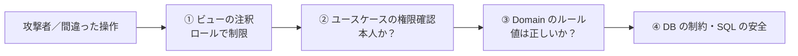
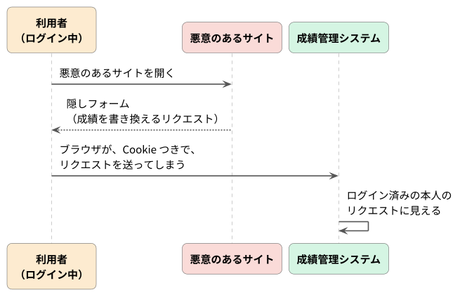

# 12. Webアプリの脅威と対策

[📖 フロントエンドの目次](./00_はじめに.md#目次) ｜ [🏠 全体の目次](../README.md#目次)

[← 前へ：11 DB認証とロール](11_DB認証とロール.md) ｜ [次へ：13 テーマとスタイル →](13_テーマとスタイル.md)

## この章のゴール
- ログインを実装しても、それだけでは**安全にならない**理由を説明できる
- **画面の制限だけに頼らず**、サーバー側（ユースケース）で権限を確認できる
- 代表的な脅威（XSS、CSRF、SQL インジェクション、総当たり攻撃など）と、Vaadin / Spring での対策を説明できる
- 情報を漏らさない、エラーとログの扱いが分かる

## 目次

1. [なぜログインだけでは足りないか](#1-なぜログインだけでは足りないか)
2. [権限の確認：ユースケース側でも行う](#2-権限の確認ユースケース側でも行う)
3. [XSS：入力された文字が実行される](#3-xss入力された文字が実行される)
4. [CSRF：なりすまして操作させられる](#4-csrfなりすまして操作させられる)
5. [SQL インジェクション](#5-sql-インジェクション)
6. [認証への攻撃：総当たりとセッション](#6-認証への攻撃総当たりとセッション)
7. [情報を漏らさない](#7-情報を漏らさない)
8. [通信と設定](#8-通信と設定)
9. [OWASP Top 10 との対応](#9-owasp-top-10-との対応)
10. [チェックリスト](#10-チェックリスト)
11. [よくあるミス](#11-よくあるミス)

---

## 1. なぜログインだけでは足りないか

ログイン（認証）は、**入口**を守る仕組みです。しかし、次のような問題は、ログインしても、防げません。

| 問題 | 例 |
|---|---|
| ログインした人が、**他人のデータ**を見る・変える | 学生 A が、URL の ID を変えて、学生 B の成績を見る |
| ログインした人が、**権限のない操作**をする | 学生が、画面を通さずに、成績の登録を呼び出す |
| 入力された文字が、**プログラムとして**実行される | 氏名の欄に書かれたスクリプトが、他の人の画面で動く |
| ログインしている人に、**意図しない操作**をさせる | 悪意のあるサイトを開いたら、成績が書き換わる |

> [!IMPORTANT]
> セキュリティは、**多層で**守ります（**多層防御**）。1 つの対策に頼らず、①ビュー（注釈）、②ユースケース（権限の確認）、③Domain（ルール）、④データベース（制約）、のそれぞれで、守ります。どれか 1 つが破られても、次の層で止められるようにします。



## 2. 権限の確認：ユースケース側でも行う

学生は、自分の成績だけを、見られるはずです。これを、**ビューの注釈（`@RolesAllowed`）だけ**で守ろうとすると、問題が起きます。

```java
@Route("students/:studentId/transcript")
@RolesAllowed({"TEACHER", "STUDENT"})            // 学生も、このビューは開ける
public class 成績一覧ビュー { … }
```

学生 A（ID=1）が、URL を `/students/2/transcript` に変えると、ビューは開けます。**「ロールが合っている」だけで、「他人のデータかどうか」は、判断できていない**からです。

> [!CAUTION]
> **セキュリティの視点**：この問題は、**壊れたアクセス制御**（Broken Access Control）といい、Web アプリの脆弱性で**最も多い**とされています（OWASP Top 10 の 1 位）。特に、**他人の ID を指定して、他人のデータを見る・変える**ものを、**IDOR**（Insecure Direct Object Reference）と呼びます。

### 対策：ユースケース（Application 層）で確認する

「**この人が、この学生の成績を、見てよいか**」は、業務の判断です。**ユースケース**の側で、確認します。

```java
@Service
public class 成績一覧を取得する {

    @PreAuthorize("hasRole('TEACHER') or @成績の権限.本人である(authentication, #学生ID)")
    @Transactional(readOnly = true)
    public 成績一覧 実行する(int 学生ID) { … }
}
```

| 要素 | 内容 |
|---|---|
| `@PreAuthorize` | **メソッドを呼ぶ前に**、条件を確認する（Spring Security の**メソッドセキュリティ**）。条件を満たさないと、`AccessDeniedException` |
| `hasRole('TEACHER')` | 教員なら、すべての学生を見てよい |
| `@成績の権限.本人である(…)` | 学生なら、**ログイン中のユーザーの `student_id`** と、引数の `学生ID` が一致するときだけ |
| `@EnableMethodSecurity` | 設定クラスに付けて、メソッドセキュリティを有効にする |

```java
@Component("成績の権限")
class 成績の権限 {
    boolean 本人である(Authentication 認証, int 学生ID) {
        // ログイン中のユーザーの student_id（users テーブル）と、学生ID を比べる
        return /* … */ true;
    }
}
```

> [!NOTE]
> **サンプル**：[`frontend/grades-vaadin/src/main/java/grades/usecase/成績一覧を取得する.java`](https://github.com/<ORG>/PRMN_SYSTEM_Sample/blob/main/frontend/grades-vaadin/src/main/java/grades/usecase/成績一覧を取得する.java)（作成予定）

| どこで確認するか | 守れるか | 理由 |
|---|---|---|
| ビューの表示・非表示だけ | **守れない** | サーバーには、リクエストが届く |
| ビューの注釈（ロール） | **ロールまでは守れる** | 「他人のデータか」は判断できない |
| **ユースケースでの確認** | **守れる** | 画面を通らない入口（REST など）からも、同じ確認が働く |

> [!IMPORTANT]
> **権限の確認は、ビューだけでなく、ユースケースで行います。** REST の入口を作る、バッチから呼ぶ、といった場合も、ユースケースで確認していれば、漏れません。これも、4 層に分けた利点です。ただし、`@PreAuthorize` は、**Spring Security の機能**なので、Application 層が、Spring に依存します。純粋に、Domain 層には、書きません。

### 確認の漏れを、見つける

| 確認 | 内容 |
|---|---|
| すべてのユースケースに、権限の確認があるか | 一覧にして確認する（ユースケース × ロールの表を、上流工程で作る） |
| 他人の ID を、実際に指定してみたか | 学生でログインして、他の学生の ID の URL を開き、**拒否される**ことを、テストで確認する（[A1](A1_画面のテスト.md)） |

## 3. XSS：入力された文字が実行される

**XSS**（クロスサイトスクリプティング）は、利用者が入力した文字に、**悪意のあるスクリプト**（JavaScript）が含まれていて、他の人の画面で、**実行されてしまう**攻撃です。

```
氏名に「<script>…情報を盗む処理…</script>」と入力して登録
　　↓
教員が、学生一覧を開くと、その氏名が HTML として解釈され、スクリプトが、教員のブラウザで動く
```

### Vaadin の既定の安全さ

Vaadin のコンポーネントは、文字を**そのままの文字として**表示し、**HTML として解釈しません**。

| 書き方 | 扱い | 安全か |
|---|---|---|
| `new Span(氏名)`、`span.setText(氏名)` | **文字**として表示 | **安全** |
| `grid.addColumn(学生::氏名)` | 文字として表示 | **安全** |
| `new Html("<b>" + 氏名 + "</b>")` | **HTML として解釈** | **危険**（氏名に、スクリプトが入る） |
| `element.setProperty("innerHTML", 氏名)` | HTML として解釈 | **危険** |

> [!CAUTION]
> **セキュリティの視点**：`Html` や `innerHTML` に、**利用者が入力した文字を、そのまま渡してはいけません**。どうしても、HTML を使うときは、入力を、HTML として**安全に処理**（サニタイズ）するライブラリを使います。また、データベースに保存された文字も、利用者が入力したものなので、**同じ扱い**です。

## 4. CSRF：なりすまして操作させられる

**CSRF**（クロスサイト・リクエスト・フォージェリ）は、ログインしている利用者のブラウザを、**悪意のあるサイトから操って**、本人が意図していない操作をさせる攻撃です。



### 対策

| 対策 | 内容 |
|---|---|
| **CSRF トークン** | リクエストに、**サーバーが発行した、推測できない値**を含めさせ、確認する |
| **Vaadin の組み込み対策** | Vaadin は、画面とサーバーの通信に、**CSRF トークンを、自動で使います**。画面を Vaadin で作る限り、特別な設定は不要 |
| **Cookie の `SameSite` 属性** | 別のサイトからのリクエストに、Cookie を送らせない |

> [!WARNING]
> **CSRF の保護を、無効にしないでください**（`csrf.disable()`）。「動かないから」と、無効にしている記事がありますが、**本当に必要な理由**（外部システムが呼ぶ REST の API など）がない限り、**有効のまま**にします。REST の API を、同じアプリに追加するときは、保護の方法を、別に検討します。

## 5. SQL インジェクション

**SQL インジェクション**は、入力に、SQL の一部を混ぜて、**意図しない SQL を実行させる**攻撃です。

```java
// 危険：文字列を連結して SQL を作る
jdbc.sql("SELECT * FROM students WHERE name = '" + 氏名 + "'");      // 氏名に「' OR '1'='1」

// 安全：プレースホルダ
jdbc.sql("SELECT * FROM students WHERE name = :name").param("name", 氏名);
```

> [!CAUTION]
> **セキュリティの視点**：SQL に値を渡すときは、**必ずプレースホルダ**（`:name` や `?`）を使います（データベース編 12 章）。文字列の連結で、SQL を作ってはいけません。

## 6. 認証への攻撃：総当たりとセッション

| 脅威 | 内容 | 対策 |
|---|---|---|
| **総当たり攻撃**（ブルートフォース） | パスワードを、片端から試す | ①**パスワードの強度**を要求する、②**失敗の回数で、一時的にロック**（またはログインの間隔を空ける）、③BCrypt（わざと遅い）、④**二要素認証**（A3） |
| **パスワードリスト攻撃** | 他のサイトで漏れた ID とパスワードの組を、試す | パスワードの**使い回しを避ける**よう案内する、二要素認証 |
| **セッション固定攻撃** | 攻撃者が用意したセッション ID を、被害者に使わせる | **ログイン成功時に、セッション ID を、作り直す**。Spring Security が、既定で行う |
| **セッションの乗っ取り** | Cookie を盗む | Cookie に `HttpOnly`（JavaScript から読めない）、`Secure`（HTTPS のみ）を付ける。**HTTPS** を使う |
| **放置された端末** | ログアウトし忘れ | **一定時間で、セッションを切る**（タイムアウト）。共用の PC では、ログアウト |

```properties
# セッションの期限と Cookie の設定（application.properties）
server.servlet.session.timeout=30m
server.servlet.session.cookie.http-only=true
server.servlet.session.cookie.secure=true
server.servlet.session.cookie.same-site=lax
```

> [!TIP]
> **ユーザビリティの視点**：セキュリティの対策は、**使いにくさ**を生むことがあります。たとえば、パスワードに、複雑な条件を課したり、頻繁に、期限切れにすると、利用者は、付箋に書いたり、簡単な変形で、使い回したりします（**かえって、安全でなくなる**）。**「長いパスワード（パスフレーズ）を許す」「パスワードの貼り付けを許す（パスワードマネージャを使える）」**といった、**使いやすくて、安全**な方向を、選びます。

## 7. 情報を漏らさない

| 漏れるもの | 例 | 対策 |
|---|---|---|
| **エラーの詳細** | スタックトレース、SQL のエラー、クラス名 | 画面には、「問題が発生しました」だけ。詳細は、**ログ**に記録（本番では、詳細を画面に出さない設定） |
| **ユーザー名の存在** | 「そのユーザーは、存在しません」 | ログインの失敗は、**同じメッセージ** |
| **パスワード** | ログに、パスワードを出力 | **ログに、パスワードや、個人情報を出さない**。`toString()` に、含めない |
| **秘密情報** | DB のパスワード、API キーを、ソースコードや、Git に入れる | **環境変数**、秘密情報の管理の仕組み。`application.properties` には、`${DB_PASSWORD}` のように書く（4 層編 07 章） |
| **内部の構造** | URL や、画面の文言から分かる、内部の仕組み | 不要な情報を、出さない |

> [!CAUTION]
> **セキュリティの視点**：**Git に、一度でも、秘密情報（パスワード、トークン）をコミットしたら、削除しても、履歴に残ります**。リポジトリが公開されたり、共有されたりすると、漏れます。発覚したら、**そのパスワードやトークンを、すぐに無効にして、作り直し**ます（Git 資料 03 章の、取り消しの方法だけでは、足りません）。

## 8. 通信と設定

| 項目 | 内容 |
|---|---|
| **HTTPS** | 通信を暗号化する。ログインの情報（パスワード）が、盗み見られるのを防ぐ。**本番では必須**（A2） |
| **セキュリティヘッダー** | `Content-Security-Policy`、`X-Frame-Options` など。Spring Security が、既定で、いくつか付ける |
| **ファイルのアップロード** | 種類・大きさ・名前の確認（A4） |
| **依存関係の更新** | Vaadin や Spring の**パッチバージョン**を、速やかに更新する。脆弱性の修正が含まれる |
| **開発モードの無効化** | 本番は、本番モードで起動する（[02 章](02_環境構築とプロジェクト作成.md)、A2） |

> [!WARNING]
> **LTS でも、パッチの更新を怠ると、脆弱性が残ります**。使っているライブラリの、**セキュリティの情報**（Vaadin の公式の通知、Spring のセキュリティアドバイザリ）を、定期的に確認します。

## 9. OWASP Top 10 との対応

**OWASP Top 10** は、Web アプリの、代表的な脆弱性を、まとめたものです。この資料との対応を、示します（項目の名称と順位は、版によって変わるため、最新の公式（<https://owasp.org/Top10/>）で確認してください）。

| 分類（概要） | この資料での対策 |
|---|---|
| **壊れたアクセス制御** | ビューの注釈（10 章）＋**ユースケースでの権限の確認（2 節）**。IDOR |
| **暗号化の失敗** | パスワードを**ハッシュ**（11 章）、HTTPS（8 節） |
| **インジェクション** | **プレースホルダ**（5 節）、XSS を防ぐ**文字としての表示**（3 節） |
| **安全でない設計** | 多層防御、4 層（Domain とデータベースでの検査） |
| **セキュリティの設定ミス** | 本番モード、エラーの詳細を出さない、仮のユーザーを残さない |
| **脆弱で古い部品** | LTS ＋ **パッチの更新**（01 章、8 節） |
| **認証の失敗** | BCrypt、総当たりへの対策、セッション管理（6 節） |
| **ログと監視の不足** | ログインの失敗、権限のエラーを、**ログに記録**する |

## 10. チェックリスト

Web アプリを**公開する前**に、確認します。

- [ ] すべてのビューに、**アクセスの注釈**が付いている（`@AnonymousAllowed` は、本当に必要なものだけ）
- [ ] **ユースケースで、権限（本人か、ロールか）を確認**している。他人の ID を指定して、**拒否される**ことを確かめた
- [ ] パスワードを、**ハッシュ化**して保存している。**ログに出していない**
- [ ] SQL は、**プレースホルダ**を使っている
- [ ] 利用者の入力を、`Html` や `innerHTML` に、渡していない
- [ ] CSRF の保護を、**無効にしていない**
- [ ] **HTTPS** で、公開している。Cookie に、`Secure`、`HttpOnly` が付いている
- [ ] セッションのタイムアウトを、設定している
- [ ] エラーの詳細を、**画面に出していない**（ログには、記録している）
- [ ] 秘密情報を、**Git に入れていない**（環境変数などで渡している）
- [ ] 開発用のユーザー・仮のパスワードを、**本番に持ち込んでいない**
- [ ] **本番モード**でビルドしている
- [ ] Vaadin・Spring の、**最新のパッチ**に、更新している

## 11. よくあるミス

| ミス | 原因・対処 |
|---|---|
| ビューの注釈だけで、他人のデータも、守ったつもりになる | ユースケースで、本人かを確認する（2 節） |
| ボタンを隠して、権限を制御したつもりになる | サーバー側（注釈・ユースケース）で制限する |
| `Html` に、ユーザー入力を、そのまま渡す | XSS。文字として表示するか、サニタイズする |
| 「動かないから」と、CSRF の保護を無効にする | 原因を調べる。無効にしない |
| SQL を、文字列の連結で作る | プレースホルダを使う |
| エラーのスタックトレースを、画面に表示する | 画面には、簡単なメッセージ。詳細はログ |
| ログに、パスワードや、個人情報を出力する | 出さない |
| 本番を、開発モードで動かす | 本番ビルドを使う（A2） |
| セキュリティの対策を、公開の直前に、まとめて行おうとする | 設計の段階から、考える。後から、直すのは大変 |

---

[← 前へ：11 DB認証とロール](11_DB認証とロール.md) ｜ [次へ：13 テーマとスタイル →](13_テーマとスタイル.md)

[📖 フロントエンドの目次](./00_はじめに.md#目次) ｜ [🏠 全体の目次](../README.md#目次)
