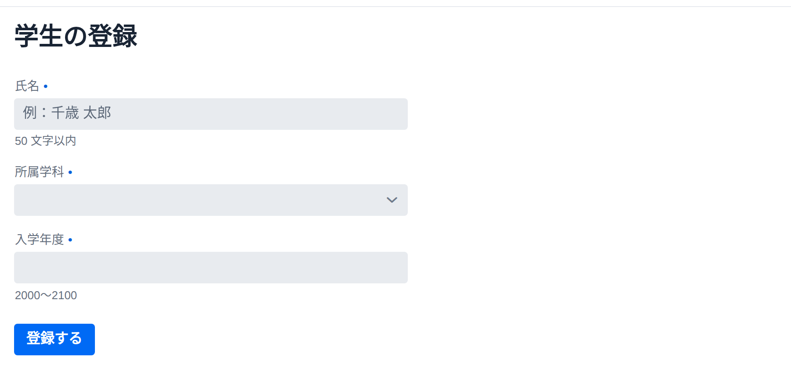
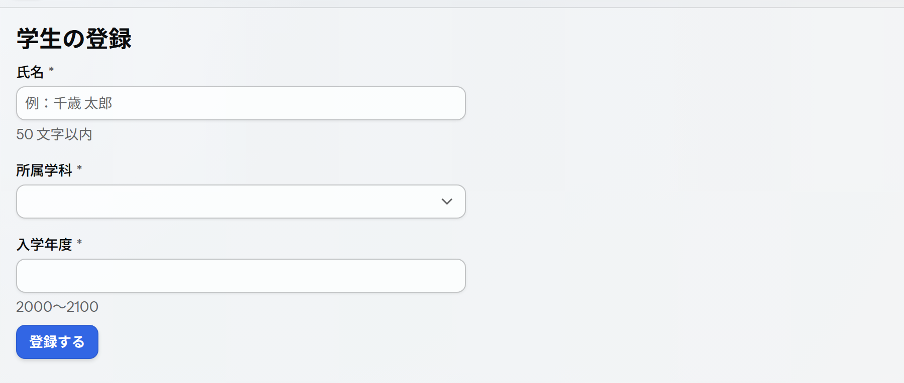
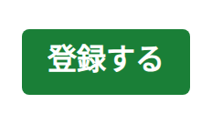
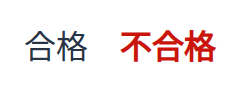
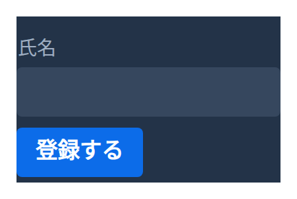

# 13. テーマとスタイル

[📖 フロントエンドの目次](./00_はじめに.md#目次) ｜ [🏠 全体の目次](../README.md#目次)

[← 前へ：12 Webアプリの脅威と対策](12_Webアプリの脅威と対策.md) ｜ [次へ：A1 画面のテスト →](A1_画面のテスト.md)

## この章のゴール
- **テーマ**（アプリ全体の見た目）の役割と、選び方が分かる
- CSS で、見た目を調整する方法（変数、クラス名）が分かる
- ダークモードや、色の設定で、気をつけることが分かる
- 見た目を決めるときの、使いやすさ（ユーザビリティ、アクセシビリティ）の考え方を説明できる

## 目次

1. [見た目をどこで決めるか](#1-見た目をどこで決めるか)
2. [テーマ](#2-テーマ)
3. [CSS で調整する](#3-css-で調整する)
4. [ダークモード](#4-ダークモード)
5. [使いやすい画面の考え方](#5-使いやすい画面の考え方)
6. [アクセシビリティ](#6-アクセシビリティ)
7. [よくあるミス](#7-よくあるミス)

---

## 1. 見た目をどこで決めるか

Vaadin のコンポーネントは、既定の見た目を持っています。見た目を変えたいときの方法は、**範囲の広さ**で、使い分けます。

| 範囲 | 方法 | 例 |
|---|---|---|
| **アプリ全体** | **テーマ**を選ぶ | 全体の雰囲気（角の丸み、色の組み合わせ） |
| 全体の細かい調整 | テーマの**変数**を、CSS で上書き | 主の色、文字の大きさ |
| 特定の部品・画面 | **CSS のクラス名**を付けて、CSS を書く | 成績の「不合格」を赤く |
| 1 つの部品の、一時的な調整 | `getStyle().set(…)`（インラインのスタイル） | 例外的な調整（多用しない） |

> [!TIP]
> **ユーザビリティの視点**：見た目を**変えすぎない**ほうが、使いやすくなります。コンポーネントの既定の見た目は、多くの人が使う、**標準的な操作の見た目**（ボタンは、ボタンに見える）に、そろえてあります。「かっこよさ」のために、標準から外れると、**何が操作できるか、分かりにくくなります**（ヒューリスティクスの「一貫性と標準」、アフォーダンス）。

## 2. テーマ

**テーマ**は、コンポーネント全体の見た目（色、余白、角の丸み、文字）を、まとめて決めるものです。Vaadin には、複数のテーマがあります。

| テーマ | 内容 |
|---|---|
| **Aura** | Vaadin 25 の公式ドキュメントで、**既定のテーマ**とされているもの（執筆時点で、公式の説明を確認） |
| **Lumo** | Vaadin 24 までの標準だったテーマ。`@StyleSheet(Lumo.STYLESHEET)` で指定できる。**コンパクト**版もある |

> [!NOTE]
> 既定のテーマと、その指定の方法は、Vaadin のバージョンで、変わっています。**この資料の執筆時点（25.3 系）の公式ドキュメント**に基づきます。実際の挙動は、使うバージョンで確認してください（<https://vaadin.com/docs/latest/styling>）。

### テーマを指定する

テーマは、**起動クラス（`AppShellConfigurator` を実装したクラス）に、`@StyleSheet` を付けて**指定します。

```java
@SpringBootApplication
@StyleSheet(Lumo.STYLESHEET)                       // Lumo を使う（Aura なら Aura.STYLESHEET）
@StyleSheet("styles.css")                          // 自分の CSS（テーマの後に読み込む）
public class Application implements AppShellConfigurator {
    public static void main(String[] args) { SpringApplication.run(Application.class, args); }
}
```

| 点 | 内容 |
|---|---|
| 順番 | テーマを**先**に、自分の CSS を**後**に書く（後のもので、上書きできる） |
| 指定しない場合 | 公式の説明では、既定のテーマが読み込まれる。ただし、サンプルで `@StyleSheet` を付けずに試すと、`Notification` の種類（成功・エラーなど）の色が、**反映されなかった**。**テーマは、必ず、明示的に指定する** |
| `styles.css` の場所 | `src/main/resources/META-INF/resources/styles.css`（Spring Boot のプロジェクト） |

> [!NOTE]
> `@StyleSheet` は、`com.vaadin.flow.component.dependency.StyleSheet` です。Lumo は、`com.vaadin.flow.theme.lumo.Lumo` を import します（サンプルで、コンパイルして確かめました）。下の画像は、同じ画面（学生の登録）を、Lumo と Aura で表示したものです。**ボタンの色、入力欄の枠、角の丸み**が、かなり違います。

> [!WARNING]
> **Vaadin 24 以前の記事**に出てくる、`@Theme("my-theme")` や、`theme.json`、`frontend/themes/` のフォルダは、Vaadin 25 では、考え方が変わっています。`@Theme` は、非推奨になっています（使える場合もあります）。**古い記事の方法を、そのまま使わない**でください。





## 3. CSS で調整する

### テーマの変数を上書きする

テーマの色や大きさは、**CSS 変数**（`--lumo-primary-color` のような名前）で、定義されています。変数を上書きすると、その範囲の見た目が、まとめて変わります。**全体**を変えるときは、`styles.css` に書きます。

```css
/* styles.css */
html {
    --lumo-primary-color: #1a5fb4;              /* 主の色 */
    --lumo-font-size-m: 1rem;                   /* 標準の文字の大きさ */
}
```

**1 つの部品だけ**を変えるときは、その部品の `style` に、変数を書きます。

<!-- snippet: theme-variable -->
```java
var 登録 = new Button("登録する");
登録.addThemeVariants(ButtonVariant.PRIMARY);
登録.getStyle().set("--lumo-primary-color", "#1a7f37");      // この部品だけ、主の色を緑にする
```



> [!NOTE]
> 変数の名前は、**テーマごとに違います**（Lumo は `--lumo-…`、Aura は `--aura-…`）。使えるものは、テーマの公式ドキュメントに載っています。

### クラス名を付けて、CSS を書く

特定の部品だけを調整するときは、**クラス名**を付けて、`styles.css` に、スタイルを書きます。

<!-- snippet: theme-class -->
```java
var 合格 = new Span("合格");
var 不合格 = new Span("不合格");
不合格.addClassName("grade-failed");                 // styles.css の .grade-failed で、色を付ける
```

```css
/* styles.css */
.grade-failed {
    color: var(--lumo-error-text-color);     /* 色は、直接書かず、テーマの変数を使う */
    font-weight: 600;
}
```



> [!TIP]
> **CSS のクラス名は、半角の英数字**（`fail`、`grade-failed`）にします。日本語も使えますが、ツールとの相性や、共有のしやすさから、避けるのが無難です。サンプルのコードは、クラス名・メソッド名を日本語にしていますが、**CSS のクラス名は、別**です。

### 気をつけること

| 注意 | 内容 |
|---|---|
| 色を**直接**書かない | `#ff0000` ではなく、テーマの変数（`var(--lumo-error-color)`）を使う。ダークモードや、テーマの変更に、追従できる |
| `!important` を多用しない | 他の指定を、強制的に上書きする。後で、直しにくい |
| Vaadin の部品の**内部の構造**に、依存しない | 内部の HTML の構造は、バージョンで変わる。公式に用意された、**スタイルの調整の仕組み**（変数、`::part`）を使う |

## 4. ダークモード

**ダークモード**は、暗い背景で表示する設定です。目の疲れや、環境に合わせて、利用者が選びます。Lumo では、要素に `theme="dark"` を付けると、**その範囲が、ダークモード**になります（画面全体なら、`html` 要素に付けます）。

<!-- snippet: theme-dark -->
```java
var 氏名 = new TextField("氏名");
var 登録 = new Button("登録する");
登録.addThemeVariants(ButtonVariant.PRIMARY);
var 画面 = new VerticalLayout(氏名, 登録);
画面.getElement().setAttribute("theme", "dark");            // この範囲だけ、ダークモード（Lumo）
```



| 方法 | 内容 |
|---|---|
| **OS の設定に合わせる** | ブラウザの `prefers-color-scheme` に従い、自動で切り替える |
| 利用者が選べる | 画面に、切り替えのボタンを置く |

> [!TIP]
> **ユーザビリティの視点**：ダークモードは、**あると嬉しい**機能ですが、**後から入れるのが大変**です。色を直接指定せず、**テーマの変数**を使っていれば、対応は、比較的、簡単です。作る前に、**本当に必要か**（誰が、どんな場面で使うか）を、上流工程で確認します。

## 5. 使いやすい画面の考え方

この資料の各章で、「ユーザビリティの視点」として紹介した内容を、**まとめます**。画面を設計するとき、また、見た目を決めるときの、判断の基準になります。

### ニールセンの 10 ヒューリスティクス

ヤコブ・ニールセンが、まとめた、**使いやすい画面のための、10 の原則**です。

| 原則 | 内容 | この資料での例 |
|---|---|---|
| 1. **システム状態の視認性** | いま何が起きているかを、知らせる | 処理中の表示、ログイン中のユーザー名（06・10 章） |
| 2. 実世界との一致 | 利用者の言葉を使う | 「履修中」「単位」（上流工程のメンタルモデル） |
| 3. ユーザーに主導権と自由を | 取り消し・やり直しができる | 「元に戻す」、キャンセルのボタン（05 章） |
| 4. **一貫性と標準** | 同じものは、同じ見た目・位置に | メニューの位置、ボタンの色の使い分け（03・05 章） |
| 5. **エラーの防止** | エラーを起こしにくい設計 | 数値は `IntegerField`、確認ダイアログ（05 章） |
| 6. 想起よりも再認 | 思い出さずに、見て選べる | ラジオボタン、絞り込めるコンボボックス（05 章） |
| 7. 柔軟性と効率性 | 初心者にも、熟練者にも | キーボードでの操作、続けて登録（09 章） |
| 8. 美的で最小限のデザイン | 必要な情報だけ | 列を絞った一覧、ログインの画面（07・10 章） |
| 9. **エラーの認識・診断・回復を助ける** | 分かりやすい言葉で、直し方を示す | 入力欄のそばに、メッセージ（08 章） |
| 10. ヘルプとドキュメント | 必要なときに、助けを出せる | ヘルパーテキスト（05 章） |

### そのほかの考え方

| 考え方 | 内容 |
|---|---|
| **アフォーダンス** | 見た目が、操作の方法を伝える（ボタンは、押せそうに見える） |
| **ゲシュタルトの法則**（近接・類似） | 近いもの、似たものは、まとまりに見える（04 章の余白） |
| **フィッツの法則** | 目標が、**大きく、近い**ほど、操作しやすい。主要なボタンは、押しやすい大きさに |
| **ヒックの法則** | 選択肢が多いほど、選ぶのに時間がかかる。選択肢を、絞る |
| **ミラーの法則**（7±2） | 人が、一度に扱える情報の量には、限りがある。一度に見せる量を、絞る |

> [!NOTE]
> これらは、**理論や経験則**です。「この法則に従えば、必ず良くなる」というものではありません。**実際の利用者**に、使ってもらって、確かめることが、最も確実です（ユーザビリティテスト）。利用者の理解（メンタルモデル）と、画面が合っているかは、[上流工程 03 章](../上流工程/03_メンタルモデルを理解する.md) の方法で、確認できます。

## 6. アクセシビリティ

**アクセシビリティ**は、**さまざまな人が、画面を使える**ようにすることです。視覚、聴覚、運動の障害がある人だけでなく、**画面が見にくい環境**（明るい屋外）や、**一時的な怪我**など、すべての人に関わります。

| 観点 | 内容 | 具体的な対応 |
|---|---|---|
| **色** | 色だけに、頼らない | 合否を、色＋文字（「合格」「不合格」）で示す（07 章） |
| **コントラスト** | 文字と背景の、明るさの差 | 薄い灰色の文字を避ける。WCAG では、通常の文字で、**4.5:1 以上**が目安 |
| **文字の大きさ** | 拡大しても、崩れない | 文字の大きさは、`rem` など相対的な単位で |
| **キーボードの操作** | マウスなしで、操作できる | Tab キーで移動でき、フォーカスが見える。Vaadin の部品は、標準で対応 |
| **スクリーンリーダー** | 画面の内容を、音声で読み上げる | 入力欄に、**ラベル**を付ける。アイコンだけのボタンに、**名前**（`setAriaLabel`）を付ける |

> [!NOTE]
> **WCAG**（Web Content Accessibility Guidelines）は、W3C が定めた、Web のアクセシビリティの国際的な指針です。Vaadin のコンポーネントは、アクセシビリティを考えて作られていますが、**使い方次第で、損なわれます**（ラベルのない入力欄、色だけの区別など）。

> [!TIP]
> **ユーザビリティの視点**：アクセシビリティは、**特別な対応ではなく、使いやすさの土台**です。キーボードで操作できる、ラベルが明確、コントラストが高い、といったことは、**すべての人にとって**、使いやすい画面になります。

## 7. よくあるミス

| ミス | 原因・対処 |
|---|---|
| 古い記事の `@Theme` や `theme.json` を使って、動かない | Vaadin 25 は、`@StyleSheet` で指定する。公式ドキュメントで確認する |
| 自分の CSS が、効かない | テーマよりも、**後**に読み込んでいるか確認する。内部の構造に依存した書き方を、していないか |
| 色を `#` の直接指定で書いて、ダークモードで読めない | テーマの変数を使う |
| `!important` だらけになる | 変数の上書きや、クラス名の付け方で、解決する |
| 色だけで、状態（合格・不合格）を示す | 文字やアイコンも、併用する |
| 薄い文字・小さい文字で、おしゃれにする | コントラストと、読みやすさを優先する |
| 全画面で、見た目や位置が違う | 一貫性。レイアウトと、テーマで、そろえる |
| 独自の見た目にこだわって、標準から外れる | 標準の見た目のほうが、迷わない |

---

[← 前へ：12 Webアプリの脅威と対策](12_Webアプリの脅威と対策.md) ｜ [次へ：A1 画面のテスト →](A1_画面のテスト.md)

[📖 フロントエンドの目次](./00_はじめに.md#目次) ｜ [🏠 全体の目次](../README.md#目次)
