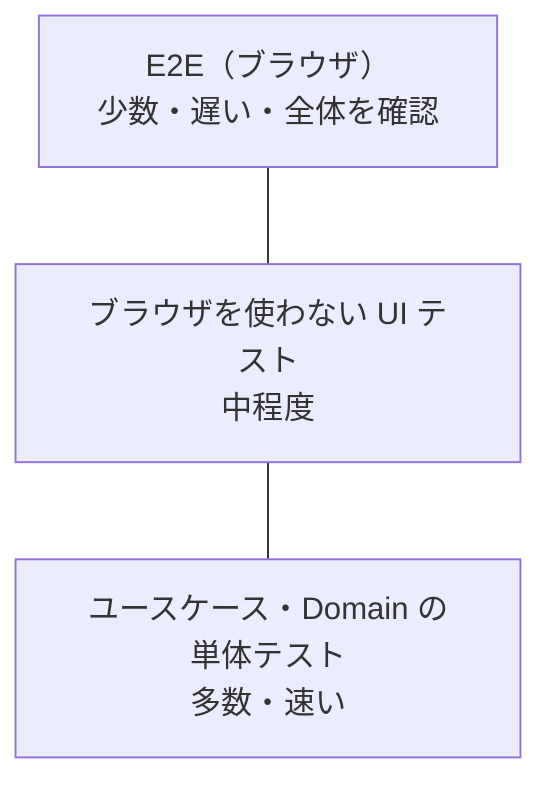

# A1. 画面のテスト

[📖 フロントエンドの目次](./00_はじめに.md#目次) ｜ [🏠 全体の目次](../README.md#目次)

[← 前へ：13 テーマとスタイル](13_テーマとスタイル.md) ｜ [次へ：A2 本番ビルドとデプロイ →](A2_本番ビルドとデプロイ.md)

## この章のゴール
- 画面のテストの種類（ブラウザを使う・使わない）を、使い分けられる
- 何をテストすべきか（特に、**権限**）を説明できる

## 目次

1. [画面をテストする理由](#1-画面をテストする理由)
2. [テストの種類](#2-テストの種類)
3. [ブラウザを使わないテスト](#3-ブラウザを使わないテスト)
4. [E2E テスト](#4-e2e-テスト)
5. [他の学生の成績を、見られないことのテスト](#5-他の学生の成績を見られないことのテスト)
6. [何をテストするか](#6-何をテストするか)
7. [よくあるミス](#7-よくあるミス)

---

## 1. 画面をテストする理由

画面は、変更が多く、「直したつもりで、別の画面が壊れた」が起きやすい部分です。**自動のテスト**があれば、変更のたびに、手で確認しなくても、問題に気づけます。特に、**権限の制御**（誰が、どの画面と処理を使えるか）は、間違うと被害が大きいので、テストで守ります（[12 章](12_Webアプリの脅威と対策.md)）。

## 2. テストの種類

| 種類 | 内容 | 速さ | 確認できること |
|---|---|---|---|
| **ユースケースの単体テスト** | ビューを使わず、ユースケースを直接テスト | 速い | 業務のルール、**権限（`@PreAuthorize`）** |
| **ブラウザを使わない UI テスト**（Browserless） | ブラウザを起動せず、Java の中で、コンポーネントを操作する | 速い | 画面の構成、入力チェック、ボタンの処理 |
| **E2E テスト**（ブラウザ） | 実際のブラウザを、自動で操作する（Playwright など） | 遅い | 画面全体の動き、ログインからの一連の流れ |



> [!TIP]
> **テストの割合**：速くて壊れにくいテスト（下）を**多く**、遅くて壊れやすいテスト（上）を**少なく**します（テストピラミッド）。業務のルールは、画面を使わずに、ユースケースや Domain でテストするほうが、確実で、速いです。**層を分ける**ことで、テストしやすくなる、という利点もあります。

## 3. ブラウザを使わないテスト

Vaadin の公式ドキュメントには、**ブラウザなしで、Java のテストの中で、ビューを操作する**方法（Browserless Testing）があります（<https://vaadin.com/docs/latest/flow/testing/browserless>）。コンポーネントを探して、値を入れ、ボタンを押し、結果を確認します。

```text
イメージ：学生登録ビューで、氏名を空にして登録を押すと、エラーが出る
  1. テストの中で、学生登録ビューを開く
  2. 氏名の欄を空にしたまま、「登録」ボタンを押す
  3. エラーの表示が出ていることを確認する
（具体的な書き方は、公式ドキュメントで確認する。サンプルにはこの種のテストはない）
```

> [!NOTE]
> 旧版の資料にある「UI Unit Testing」は、現在は、Browserless Testing に統合・移行する方向です（公式ドキュメントに、移行の案内がある）。具体的な API は、使うバージョンの公式ドキュメントで確認してください。

## 4. E2E テスト

実際のブラウザを、**Playwright** などで自動操作して、ログインから画面の遷移、登録までを、通しで確認します。

| 道具 | 内容 |
|---|---|
| **Playwright** | ブラウザ（Chromium など）を、プログラムから操作する。Vaadin の公式ドキュメントにも、手順がある（<https://vaadin.com/docs/latest/flow/testing/playwright>） |
| Selenium / TestBench | 従来からの道具。Vaadin 専用の機能が付く TestBench は、**有料** |

> [!NOTE]
> **この資料の画像**も、Playwright で、サンプルを操作して、自動で撮影する方針です（[撮影リスト](../images/frontend/撮影リスト.md)）。画像の撮影用のスクリプトと、E2E テストは、**同じ道具**（ブラウザの自動操作）を使います。

## 5. 他の学生の成績を、見られないことのテスト

次のテストは、**学生番号 1 の学生**として、**学生番号 2 の成績**を取得しようとして、**拒否される**ことを確かめます（ユースケースの `@PreAuthorize`）。データベースも、ブラウザも、使いません。

<!-- snippet: test-idor -->
```java
ログインする("STUDENT", 1);                                           // 学生番号 1 の学生として、ログインする
assertThrows(AccessDeniedException.class, () -> 成績一覧を取得する.実行する(2));   // 学生番号 2 の成績は、見られない
```

実行すると、次のように表示されます（サンプルの `権限のテスト` の 5 件）。

```bash
./mvnw test
```

```text
[INFO] Running grades.usecase.権限のテスト
[INFO] Tests run: 5, Failures: 0, Errors: 0, Skipped: 0, Time elapsed: 3.046 s -- in grades.usecase.権限のテスト
[INFO] Tests run: 5, Failures: 0, Errors: 0, Skipped: 0
[INFO] BUILD SUCCESS
```

> [!NOTE]
> テストのクラス名が、日本語の「〜テスト」のときは、Maven の既定では、見つかりません。`pom.xml` の `maven-surefire-plugin` に、`<include>**/*テスト.java</include>` を指定します（サンプルの `pom.xml` を参照）。

## 6. 何をテストするか

画面のテストで、優先して確認することです。

| 優先 | テストの内容 | 種類 |
|---|---|---|
| **高** | **権限**：学生が、教員用の画面に入れない／**他の学生の成績を、見られない** | ユースケースの単体テスト、E2E |
| **高** | ログイン：正しい情報で入れる、間違うと入れない、ログアウトできる | E2E |
| 高 | 入力：正しい入力で登録できる、範囲外の点数で、エラーが出る | UI テスト、ユースケース |
| 中 | 一覧：登録した成績が、一覧に出る | E2E |
| 低 | 見た目（色、余白） | 目で確認（テストにしにくい） |

> [!CAUTION]
> **セキュリティの視点**：**権限のテストは、必ず書きます。** 「他の学生の ID を指定して、**拒否される**こと」を、自動のテストにしておけば、後の変更で、うっかり、制限が外れたときに、すぐ気づけます。

## 7. よくあるミス

| ミス | 原因・対処 |
|---|---|
| すべてを E2E テストで確認しようとして、遅く、壊れやすくなる | 業務のルールは、ユースケース・Domain の単体テストへ。E2E は、主要な流れだけ |
| 画面の細かい見た目を、テストで固定する | 少しの変更で壊れる。構造や動作を、確認する |
| 権限のテストを書かない | 最も大事なテスト。必ず書く |
| テスト用のデータが、本番のデータベースを、使ってしまう | テスト用のデータベースを、使う |
| テストが、実行の順番に、依存する | 各テストで、必要なデータを、用意する |

---

[← 前へ：13 テーマとスタイル](13_テーマとスタイル.md) ｜ [次へ：A2 本番ビルドとデプロイ →](A2_本番ビルドとデプロイ.md)

[📖 フロントエンドの目次](./00_はじめに.md#目次) ｜ [🏠 全体の目次](../README.md#目次)
