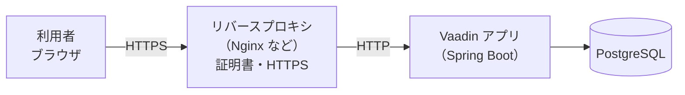

# A2. 本番ビルドとデプロイ

[📖 フロントエンドの目次](./00_はじめに.md#目次) ｜ [🏠 全体の目次](../README.md#目次)

[← 前へ：A1 画面のテスト](A1_画面のテスト.md) ｜ [次へ：A3 発展的な認証 →](A3_発展的な認証.md)

## この章のゴール
- 開発用と本番用のビルドの違いを説明できる
- 本番用の jar を作り、起動できる
- 設定を、環境ごとに分け、秘密情報を安全に渡せる
- 公開するときの、最低限の注意点が分かる

## 目次

1. [本番ビルドとは](#1-本番ビルドとは)
2. [ビルドして起動する](#2-ビルドして起動する)
3. [設定を分ける](#3-設定を分ける)
4. [公開するときの構成](#4-公開するときの構成)
5. [公開前の確認](#5-公開前の確認)
6. [よくあるミス](#6-よくあるミス)

---

## 1. 本番ビルドとは

[02 章](02_環境構築とプロジェクト作成.md) で説明したとおり、Vaadin には、**開発モード**と**本番モード**があります。本番モードでは、ビルドのときに、画面用のファイルを、**最適化**（まとめて、小さく）します。

| | 開発モード | 本番モード |
|---|---|---|
| 画面用のファイル | 起動時に作る（遅い） | **ビルド時に、最適化済み** |
| 開発者向けの機能 | あり | **なし** |
| 用途 | 開発中 | **公開** |

## 2. ビルドして起動する

本番用のビルドには、`pom.xml` の `vaadin-maven-plugin`（[02 章 5 節](02_環境構築とプロジェクト作成.md#5-pomxml-の要点)）が使われます。Vaadin Start で作ったプロジェクトには、**本番用のビルドの設定（プロファイル）**が、含まれています。

```bash
./mvnw clean package -Pproduction
```

| 部分 | 意味 |
|---|---|
| `clean package` | 過去のビルドを消して、jar にまとめる |
| `-Pproduction` | `production` という**プロファイル**を使う（本番用の設定。プロファイルの名前は、プロジェクトの `pom.xml` で確認する） |

できた jar（`target/` の下）を、Java で起動します。

```bash
java -jar target/grades-0.0.1-SNAPSHOT.jar
```

> [!TIP]
> サンプルリポジトリの `frontend/grades-vaadin/` では、`./mvnw -Pproduction clean package -DskipTests` で本番用の jar を作れます。この jar を起動すると、ログに `Vaadin is running in production mode` と出て、開発用の部品（`vaadin-dev`）が jar に入っていないことを確認しています。

> [!NOTE]
> 本番ビルドの、具体的なプロファイル名や、追加で必要な設定は、**Vaadin Start が作る `pom.xml`** と、公式ドキュメントの「Production Build」の記述に従ってください（<https://vaadin.com/docs/latest/flow/production>）。

> [!CAUTION]
> **セキュリティの視点**：本番では、必ず、**本番モードのビルド**を使います。開発モードで公開すると、**開発者向けの機能が有効**になり、動作も遅くなります。

## 3. 設定を分ける

開発と本番で、**設定が違う**ものがあります（データベースの接続先、ログの量など）。Spring Boot の**プロファイル**で、設定ファイルを分けられます。

| ファイル | 内容 |
|---|---|
| `application.properties` | 共通の設定 |
| `application-dev.properties` | 開発用（`spring.profiles.active=dev` のとき） |
| `application-prod.properties` | 本番用（`spring.profiles.active=prod` のとき） |

```bash
java -jar app.jar --spring.profiles.active=prod
```

### 秘密情報は、ファイルに書かない

| 渡し方 | 内容 |
|---|---|
| **環境変数** | `DB_PASSWORD` など。`application.properties` には、`${DB_PASSWORD}` と書く（4 層編 07 章） |
| 秘密情報の管理サービス | クラウドの Secrets 機能など。本格的な運用で使う |
| **Git には入れない** | `.gitignore` で、秘密情報のファイルを除外する |

> [!CAUTION]
> **セキュリティの視点**：**本番の接続情報やパスワードを、Git に入れてはいけません**（[12 章](12_Webアプリの脅威と対策.md)）。

## 4. 公開するときの構成

アプリを、インターネット（または学内ネットワーク）に公開するときの、一般的な構成です。



| 要素 | 内容 |
|---|---|
| **HTTPS** | 通信の暗号化。**必須**。証明書が必要（Let's Encrypt など） |
| **リバースプロキシ** | 利用者のリクエストを受け、アプリに渡す。HTTPS の処理を担当することが多い |
| アプリ | jar を、`java -jar` で起動する（または、Docker のコンテナ） |
| データベース | アプリからだけ、接続できるようにする（**外部に公開しない**） |

> [!WARNING]
> Vaadin は、**セッションを、サーバーのメモリで管理**します。サーバーを複数台にして、負荷を分散するときは、**同じ利用者が、同じサーバーに、つながり続ける**（スティッキーセッション）設定、または、セッションの共有が、必要です。1 台のサーバーで足りる規模なら、気にしなくて構いません。

> [!NOTE]
> Docker の使い方や、CI/CD は、開発環境・品質編（作成予定）で扱います。

## 5. 公開前の確認

- [ ] **本番モード**でビルドした jar を、使っている
- [ ] **HTTPS** で、公開する
- [ ] 秘密情報は、環境変数（など）で渡している。Git には入っていない
- [ ] 開発用のユーザー・仮のパスワードが、本番に**ない**
- [ ] データベースは、アプリからだけ、接続できる
- [ ] [12 章のチェックリスト](12_Webアプリの脅威と対策.md#10-チェックリスト) を、確認した
- [ ] Vaadin・Spring の**最新のパッチ**に、更新している

## 6. よくあるミス

| ミス | 原因・対処 |
|---|---|
| 開発モードのまま、起動して公開する | 本番用のビルド（`-Pproduction`）の jar を使う |
| 本番用のビルドで、画面が表示されない | 画面用のファイルの作成に失敗している。ビルドのログを確認する。公式の「Production Build」の手順に従う |
| 本番のパスワードを、設定ファイルに書いて、Git に入れる | 環境変数で渡す |
| HTTP のまま、公開する | ログインの情報が、盗み見られる。HTTPS にする |
| データベースのポート（5432）を、インターネットに公開する | アプリからだけ、つなげるようにする |
| サーバーを複数台にして、ログインが、切れる | セッションの扱い（スティッキーセッション）を、設定する |

---

[← 前へ：A1 画面のテスト](A1_画面のテスト.md) ｜ [次へ：A3 発展的な認証 →](A3_発展的な認証.md)

[📖 フロントエンドの目次](./00_はじめに.md#目次) ｜ [🏠 全体の目次](../README.md#目次)
