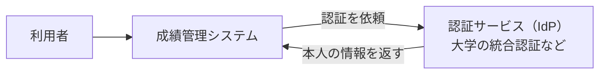
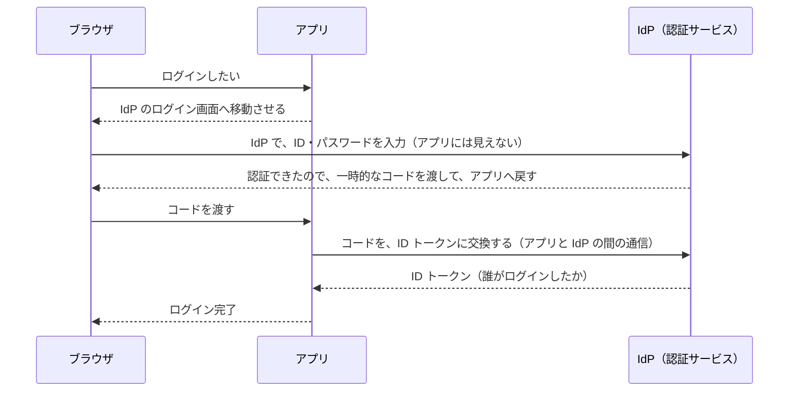

# A3. 発展的な認証

[📖 フロントエンドの目次](./00_はじめに.md#目次) ｜ [🏠 全体の目次](../README.md#目次)

[← 前へ：A2 本番ビルドとデプロイ](A2_本番ビルドとデプロイ.md) ｜ [次へ：A4 発展的な機能 →](A4_発展的な機能.md)

## この章のゴール
- 自前の ID・パスワードによる認証と、**外部の認証**（SSO）の違いを説明できる
- OAuth 2.0 と OpenID Connect の役割を、概要として説明できる
- 二要素認証、ログイン状態の保持（Remember-me）の注意点が分かる

> [!NOTE]
> この章は、**概要の紹介**です。実装の手順は、公式ドキュメント（Spring Security、Vaadin）と、利用する認証サービスの手順に従ってください。

## 目次

1. [なぜ外部の認証を使うのか](#1-なぜ外部の認証を使うのか)
2. [OAuth 2.0 と OpenID Connect](#2-oauth-20-と-openid-connect)
3. [Spring Security での使い方](#3-spring-security-での使い方)
4. [二要素認証](#4-二要素認証)
5. [Remember-me](#5-remember-me)
6. [認証方式の選び方](#6-認証方式の選び方)
7. [よくあるミス](#7-よくあるミス)

---

## 1. なぜ外部の認証を使うのか

11 章では、**自分のデータベースに、パスワードのハッシュを保存**して認証しました。この方法には、次の負担があります。

| 負担 | 内容 |
|---|---|
| パスワードの**保管の責任** | 漏れたときの、被害と責任 |
| パスワードの再設定、ロックなどの**機能の実装** | 作るものが、増える |
| 利用者の**パスワードが増える** | 使い回しの原因 |

**外部の認証サービス**（大学の統合認証、Google、Microsoft など）に、**認証を任せる**と、これらを減らせます。利用者は、**1 組の ID とパスワード**で、複数のシステムを使えます（**SSO**：シングルサインオン）。

## 2. OAuth 2.0 と OpenID Connect

| 用語 | 内容 |
|---|---|
| **OAuth 2.0** | **権限の委譲**の仕組み。「このアプリに、自分の情報へのアクセスを許可する」 |
| **OpenID Connect（OIDC）** | OAuth 2.0 の上に作られた、**認証**の仕組み。「ログインしたのは誰か」を、アプリに伝える |
| **IdP**（Identity Provider） | 認証を担当するサービス（大学の統合認証など） |
| **ID トークン** | OIDC で、IdP が発行する、ログインした人の情報（名前、メールなど）の入った証明書 |

> [!NOTE]
> OAuth 2.0 は、「認証」のための仕組みではなく、**認可（権限の委譲）**のための仕組みです。「OAuth でログイン」と、よく言われますが、**認証の部分は、OIDC が担当**しています。

### ログインの流れ（概要）

> [!IMPORTANT]
> 利用者の**パスワードは、IdP にだけ**入力され、**アプリには届きません**。アプリがパスワードを保管しないので、漏えいのリスクと、責任を、減らせます。

## 3. Spring Security での使い方

Spring Security は、OAuth 2.0 / OIDC のログイン（**OAuth 2.0 Client**）の機能を持っています。Vaadin では、ログイン画面で、「◯◯でログイン」の**リンク**を置き、IdP のログインに移動させます。

| 設定する内容 | 内容 |
|---|---|
| 依存関係 | `spring-boot-starter-oauth2-client` |
| IdP の情報 | クライアント ID、クライアントシークレット、IdP の URL（`application.properties`） |
| ログイン後の**ロール** | IdP から受け取った情報（グループなど）を、アプリのロール（`TEACHER` / `STUDENT`）に**対応づける** |

> [!NOTE]
> Vaadin 公式ドキュメントに、OAuth 2.0 / OIDC を使う手順があります。詳細は、公式ドキュメントの Security の章（<https://vaadin.com/docs/latest/building-apps/security>）で、最新の内容を確認してください。

> [!CAUTION]
> **セキュリティの視点**：**クライアントシークレットは、パスワードと同じ秘密情報**です。Git に入れず、環境変数などで渡します（12 章）。また、IdP から受け取った情報を、**そのまま信頼せず**、アプリのロールへの対応づけ（誰を教員にするか）は、**慎重に**設定します。

## 4. 二要素認証

**二要素認証**（2FA）は、パスワード（**知っているもの**）に加えて、**もう 1 つの要素**を確認する方法です。パスワードが漏れても、不正にログインされにくくなります。

| 要素 | 例 |
|---|---|
| 知識（知っているもの） | パスワード、PIN |
| **所持**（持っているもの） | スマートフォンの**認証アプリ**（TOTP のワンタイムパスワード）、セキュリティキー |
| 生体（自分自身） | 指紋、顔 |

| 方式 | 内容 | 安全性 |
|---|---|---|
| 認証アプリ（TOTP） | 30 秒ごとに変わる 6 桁の数字 | 高い |
| セキュリティキー／パスキー（**WebAuthn**） | 機器に保存した鍵で認証。フィッシングにも強い | **最も高い** |
| SMS | 携帯電話に、番号を送る | 低め（SIM の乗っ取りの危険がある） |

> [!TIP]
> **自前で作らず、IdP の機能を使う**のが、おすすめです。多くの IdP（大学の統合認証、Google など）は、二要素認証に対応しているので、**外部の認証と組み合わせる**と、アプリに実装しなくても、二要素認証を使えます。

> [!TIP]
> **ユーザビリティの視点**：二要素認証は、安全性が上がる反面、**操作が増えます**。**重要な操作**（成績の登録など、権限の強いロール）にだけ、求める、「**信頼する端末では、一定期間、省略する**」などの工夫で、使いやすさを保ちます。

## 5. Remember-me

**Remember-me** は、ブラウザを閉じても、**ログインの状態を、一定期間、保つ**機能です。毎回、ログインしなくて済みますが、リスクがあります。

| 観点 | 内容 |
|---|---|
| 便利 | 利用者が、頻繁に、ログインしなくて済む |
| **リスク** | 共用の PC や、盗まれた端末で、他の人が、ログインした状態になる |
| 対策 | 期間を短くする、**重要な操作の前に、再度パスワードを求める**、共用の PC では使わないよう案内する |

> [!CAUTION]
> **セキュリティの視点**：成績のように、**個人情報を扱うシステム**では、Remember-me の期間を、**短く**します（または、使わない）。Spring Security の Remember-me は、トークンを、Cookie に保存する仕組みです。設定を誤ると、**ログイン状態を、盗まれやすく**なります。

## 6. 認証方式の選び方

| 状況 | 方式 |
|---|---|
| 学習・小規模、利用者が少ない | **自前の DB 認証**（11 章）。BCrypt を使う |
| 大学・組織の統合認証がある | **OIDC（SSO）**。パスワードを、アプリで持たない |
| 重要なデータを扱う | 外部認証＋**二要素認証** |
| 外部の利用者（一般公開） | 外部の IdP（Google など）を使うか、専門の認証サービスを使う |

> [!IMPORTANT]
> **「認証」を自分で作るのは、できるだけ避けます**。安全に作るには、多くの知識が必要です。学習のために、11 章で作りましたが、**実際の運用では、実績のあるサービスや、フレームワークの機能**を、使います。

## 7. よくあるミス

| ミス | 原因・対処 |
|---|---|
| OAuth 2.0 を、「認証の仕組み」だと思っている | 認証は OIDC。OAuth は認可（権限の委譲） |
| クライアントシークレットを、Git に入れる | 環境変数などで渡す |
| IdP から受け取った情報を、確認せずに、ロールを付ける | 対応づけを、明確に決める。想定外の人に、教員の権限を与えない |
| 二要素認証を、SMS だけにする | 認証アプリや、パスキーのほうが、安全 |
| Remember-me の期間を、長くしすぎる | 個人情報を扱うなら、短くする |
| 認証を、自前で、一から作る | 実績のあるフレームワークと、サービスを使う |

---

[← 前へ：A2 本番ビルドとデプロイ](A2_本番ビルドとデプロイ.md) ｜ [次へ：A4 発展的な機能 →](A4_発展的な機能.md)

[📖 フロントエンドの目次](./00_はじめに.md#目次) ｜ [🏠 全体の目次](../README.md#目次)
