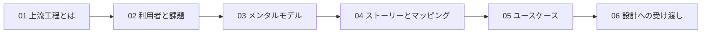
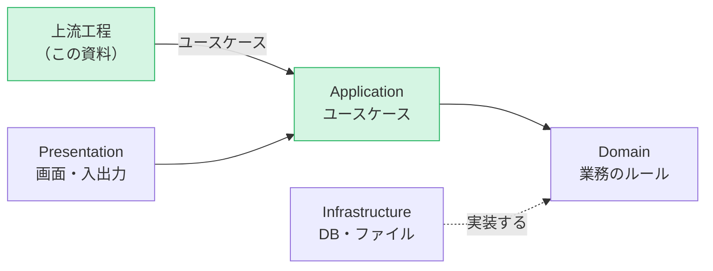

# 上流工程 — はじめに

[📖 上流工程の目次](./00_はじめに.md#目次) ｜ [🏠 全体の目次](../README.md#目次)

システムを作るとき、最初にやるべきことは、コードを書くことではありません。**「誰の、どんな困りごとを、どう解決するのか」を明らかにする**ことです。この資料では、利用者の要求を聞き取り、**ユースケース**という形に整理するまでの**上流工程**を学びます。題材は、他の資料と同じ**成績管理システム**です。

## 目次

1. [この資料について](#1-この資料について)
2. [章の構成](#2-章の構成)
3. [前提知識](#3-前提知識)
4. [4層の中での位置づけ](#4-4層の中での位置づけ)
5. [題材：成績管理システム](#5-題材成績管理システム)
6. [各章の書き方](#6-各章の書き方)

---

## 1. この資料について

- 対象：システム開発の経験がなくても読めます。特定のプログラミング言語の知識は**不要**です
- この資料の範囲：**利用者の要求を聞く → 整理する → ユースケースにする**まで。ユースケースを受け取って、**どう作るか**を決める部分は、ドメイン設計・実装編（作成予定）で扱います
- ゴール：
  - 上流工程が、後の設計や実装にどう影響するかを説明できる
  - 利用者（アクター）の目的と、困りごとを整理できる
  - **メンタルモデル**（利用者の頭の中にある業務の捉え方）を、聞き取りで明らかにできる
  - **ユーザーストーリー**を書き、**ユーザーストーリーマッピング**で全体像を描ける
  - **ユースケース**を、基本フロー・代替フロー・受け入れ基準を含めて記述できる

> 💡 この資料は、一般的な考え方を中心にまとめています。今後、研究で得られた知見を、追加の章として加える予定です。

## 2. 章の構成

| 章 | タイトル | 内容 |
|---|---|---|
| 01 | [上流工程とは](01_上流工程とは.md) | 上流工程の目的、要求と要件の違い、後の工程への影響 |
| 02 | [利用者と課題を知る](02_利用者と課題を知る.md) | ステークホルダー、アクター、ペルソナ、課題の整理 |
| 03 | [メンタルモデルを理解する](03_メンタルモデルを理解する.md) | 利用者の頭の中の捉え方、聞き取りの方法、実装モデルとの違い |
| 04 | [ユーザーストーリーとマッピング](04_ユーザーストーリーとマッピング.md) | ユーザーストーリー、ユーザーストーリーマッピング、優先順位 |
| 05 | [ユースケースに落とし込む](05_ユースケースに落とし込む.md) | ユースケース図、ユースケース記述、受け入れ基準 |
| 06 | [設計への受け渡し](06_設計への受け渡し.md) | 要件の抜け漏れの確認、非機能要件、他の資料へのつながり |

01 章で全体像をつかみ、02〜05 章で**「聞く → 整理する → 形にする」**を順に進め、06 章で**次の工程への受け渡し**を確認します。

## 3. 前提知識

- **必須**：なし
- **推奨**：[4層アーキテクチャ編 01〜02 章](../4層アーキテクチャ/00_はじめに.md)（ユースケースが 4 層のどこに対応するかが分かります）

## 4. 4層の中での位置づけ

この資料は、4 層のうち **Application 層**に至るまでの**入口**にあたります。Application 層は「ユーザーがやりたいこと（ユースケース）」を手順として実現する層です。上流工程で整理したユースケースが、そのまま Application 層の処理の一覧になります。

| この資料の章 | 4層との関係 |
|---|---|
| 02〜04 | どの利用者が、何をしたいのかを明らかにする。画面（Presentation）や保存（Infrastructure）のことは、まだ考えない |
| 05 | ユースケースを決める。Application 層の処理の一覧と、画面の入口の一覧になる |
| 06 | ユースケースの中の「もの」とルールを、Domain 層や Infrastructure 層の設計に引き継ぐ |

## 5. 題材：成績管理システム

他の資料と同じ、大学の成績管理システムを題材にします。ただし、この資料では、**利用者を増やして**考えます。

| 利用者（アクター） | どんな人か |
|---|---|
| 学生 | 履修した科目と点数を確認したい |
| 教員 | 担当する科目の点数を入力したい |
| 教務 | 学生や科目の情報を登録・管理したい |

> 📌 他の資料（4層アーキテクチャ編、データベース編）が扱う 3 つの機能（**学生を登録する / 成績を登録する / 学生の成績一覧を表示する**）は、この資料で整理するユースケースの一部です。05 章で、対応を確認します。

## 6. 各章の書き方

各章は次の順で進みます。

1. **この章のゴール**：何ができるようになるか
2. **説明、図、表**：考え方と、成績管理での例
3. **よくあるミス**

---

[次へ：01 上流工程とは →](01_上流工程とは.md)

[📖 上流工程の目次](./00_はじめに.md#目次) ｜ [🏠 全体の目次](../README.md#目次)
