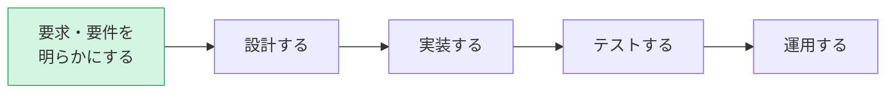
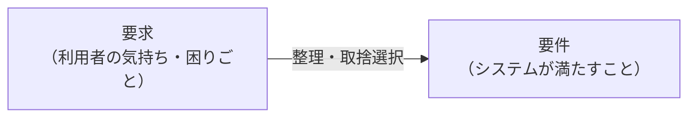
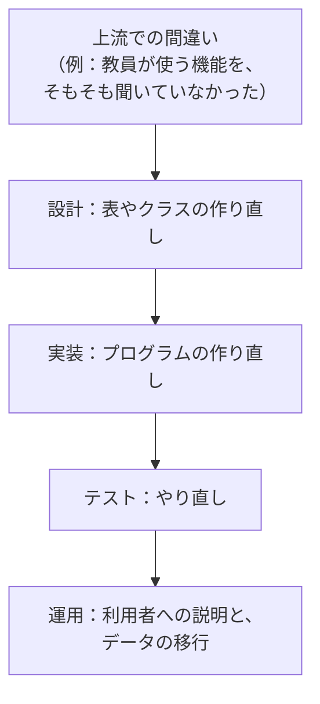

# 01. 上流工程とは

[📖 上流工程の目次](./00_はじめに.md#目次) ｜ [🏠 全体の目次](../README.md#目次)

[次へ：02 利用者と課題を知る →](02_利用者と課題を知る.md)

## この章のゴール
- 上流工程で何を決めるのかを説明できる
- **要求**と**要件**の違いを説明できる
- 上流工程のやり直しが、なぜ後の工程で大きな負担になるのかを説明できる

## 目次

1. [システム開発の流れ](#1-システム開発の流れ)
2. [上流工程で決めること](#2-上流工程で決めること)
3. [要求と要件](#3-要求と要件)
4. [なぜ上流が大切か](#4-なぜ上流が大切か)
5. [この資料で使う道具](#5-この資料で使う道具)
6. [よくあるミス](#6-よくあるミス)

---

## 1. システム開発の流れ

システム開発は、大きく次の工程に分かれます。

| 工程 | やること | 呼び方 |
|---|---|---|
| 要求・要件を明らかにする | 誰が、何のために、何をしたいかを決める | **上流工程**（要件定義） |
| 設計する | どう作るかを決める | 中流工程（基本設計・詳細設計） |
| 実装する | プログラムを書く | 下流工程 |
| テストする | 意図どおりに動くか確かめる | 下流工程 |
| 運用する | 使い続け、直し続ける | 運用・保守 |

川の流れにたとえて、前の工程を**上流**、後ろの工程を**下流**と呼びます。この資料が扱うのは、いちばん上流の**要求・要件を明らかにする**工程です。

> [!NOTE]
> 実際の開発は、この順に一度だけ進むとは限りません。作りながら要求が変わることもあり、工程を行き来します。ただし、「何を作るのか」を最初に考える作業は、どの進め方でも必要です。

## 2. 上流工程で決めること

上流工程で決めるのは、「**何を作るか**」であって、「**どう作るか**」ではありません。

| 決めること | 決めないこと |
|---|---|
| 誰が使うのか | どのプログラミング言語を使うか |
| その人は何に困っているのか | データベースの表をどう作るか |
| システムで何ができれば解決するのか | 画面の見た目の細部 |
| 何を優先して作るのか | クラスをどう分けるか |

「どう作るか」を先に決めてしまうと、**本来の目的に合わないものを、立派に作ってしまう**おそれがあります。

## 3. 要求と要件

似た言葉ですが、意味が違います。

| 言葉 | 意味 | 成績管理での例 |
|---|---|---|
| **要求** | 利用者が**こうしたい・こうなってほしい**と思っていること | 「成績を入力する作業が大変。もっと楽にしたい」 |
| **要件** | 要求を踏まえて、**システムが満たすと決めたこと** | 「教員は、担当科目の学生の点数を、一覧から一度に入力できる」 |

- 要求は、**あいまいで、矛盾することもあります**。教員は「簡単に入力したい」、教務は「間違いは絶対に防ぎたい」というように、立場によって変わります
- 要件は、**確認できる形**にします。「使いやすい」では確認できません。「一覧から一度に入力できる」なら確認できます
- すべての要求を、要件にするわけではありません。**費用・期間・優先順位**を考え、取捨選択します（04 章）

## 4. なぜ上流が大切か

上流工程の誤りは、**後の工程ほど直すのに大きな手間がかかります**。

| 工程 | 間違いに気づいたときの直し方 |
|---|---|
| 上流（要件） | 文章や図を直す |
| 設計 | 図を直し、関係する設計も直す |
| 実装 | プログラムを直す。他の部分にも影響する |
| 運用 | 使われているデータや操作方法まで影響する |

たとえば、「教員が点数を入力する」機能を作り忘れていたことが、完成後に分かったとします。点数を入力する画面だけでなく、**誰が入力してよいか（権限）、入力の履歴、データベースの表**まで、作り直しになるかもしれません。

> [!TIP]
> だからといって、上流で完璧を目指す必要はありません。**分かっていないことを、分かっていないと認識しておく**ことが大切です。分からない点を早めに見つけ、確認することが、上流工程の仕事です。

## 5. この資料で使う道具

次の章から、上流工程で使う道具を順に学びます。

| 章 | 道具 | 何のための道具か |
|---|---|---|
| 02 | ステークホルダー、アクター、ペルソナ | **誰のため**のシステムかを明らかにする |
| 03 | メンタルモデルの聞き取り | 利用者が**業務をどう捉えているか**を明らかにする |
| 04 | ユーザーストーリー、ユーザーストーリーマッピング | 利用者の**目的と、作る順序**を整理する |
| 05 | ユースケース | システムが**提供する機能**を、手順として決める |
| 06 | チェックリスト、非機能要件 | **抜け漏れ**を確認し、次の工程に渡す |

## 6. よくあるミス

| ミス | 原因・対処 |
|---|---|
| いきなり画面やデータベースを考え始める | まず「誰が何のために使うか」を決める。画面や表は、その後に決める |
| 「使いやすいシステム」のような要件を書く | 確認できる形で書く。「〇〇が、〇〇できる」と、動作で書く |
| 依頼した人の意見だけで決める | 実際に使う人や、運用する人にも話を聞く（02 章） |
| 一度決めたら変えてはいけないと考える | 分かったことが増えたら、見直す。変えた理由を残しておく |

---

[← 前へ：00 はじめに](00_はじめに.md) ｜ [次へ：02 利用者と課題を知る →](02_利用者と課題を知る.md)

[📖 上流工程の目次](./00_はじめに.md#目次) ｜ [🏠 全体の目次](../README.md#目次)
