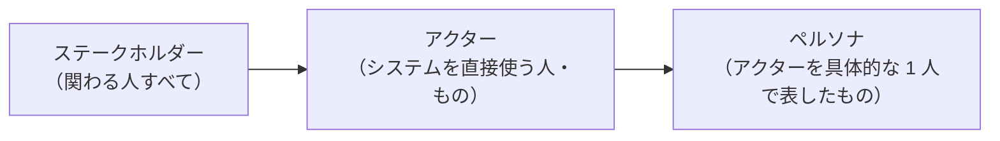

# 02. 利用者と課題を知る

[📖 上流工程の目次](./00_はじめに.md#目次) ｜ [🏠 全体の目次](../README.md#目次)

[← 前へ：01 上流工程とは](01_上流工程とは.md) ｜ [次へ：03 メンタルモデルを理解する →](03_メンタルモデルを理解する.md)

## この章のゴール
- **ステークホルダー**と**アクター**の違いを説明できる
- システムに関わる人を洗い出し、アクターを決められる
- **ペルソナ**を使って、利用者の目的と困りごとを具体的に書ける
- 課題を「現状 → 困りごと → 望む状態」で整理できる

## 目次

1. [誰のためのシステムか](#1-誰のためのシステムか)
2. [ステークホルダー](#2-ステークホルダー)
3. [アクター](#3-アクター)
4. [ペルソナ](#4-ペルソナ)
5. [課題の整理](#5-課題の整理)
6. [よくあるミス](#6-よくあるミス)

---

## 1. 誰のためのシステムか

システムは、誰かの困りごとを解決するために作ります。そのため、最初に**関わる人を洗い出し**、その人たちが**何をしたいのか**を明らかにします。

## 2. ステークホルダー

**ステークホルダー**とは、システムに**利害関係のある人すべて**です。システムを使わない人も含みます。

| ステークホルダー | システムとの関わり | 使うか |
|---|---|---|
| 学生 | 自分の成績を確認する | 使う |
| 教員 | 担当科目の点数を入力する | 使う |
| 教務担当者 | 学生や科目の情報を管理する | 使う |
| 大学の管理者 | 費用を負担する。成績の信頼性に責任を持つ | 使わない |
| 保護者 | 成績の結果を知りたい（学生を通して） | 使わない |
| システムの運用担当者 | システムを動かし続ける | 使う（管理用） |

洗い出すときのコツは、次の問いを順に考えることです。

- このシステムを**使う**のは誰か
- このシステムの**結果を受け取る**のは誰か
- このシステムを**作る・直す・動かす**のは誰か
- このシステムに**お金を出す**のは誰か
- このシステムで**困る人**（変更で不利になる人）は誰か

> 💡 ステークホルダーを見落とすと、完成してから「実は、〇〇さんの承認が必要だった」と分かることがあります。

## 3. アクター

**アクター**とは、システムを**直接使う（システムとやり取りする）人や外部のもの**です。ステークホルダーのうち、システムの操作や、システムとのやり取りがある相手を選びます。

| ステークホルダー | アクターか | 理由 |
|---|---|---|
| 学生 | ○ | 成績を確認するためにシステムを操作する |
| 教員 | ○ | 点数を入力するためにシステムを操作する |
| 教務担当者 | ○ | 学生や科目の情報を登録する |
| 大学の管理者 | ✕ | システムを直接操作しない（報告を受ける立場） |
| 保護者 | ✕ | システムを直接操作しない |

- アクターは、**人の名前ではなく、役割**で決めます。「山田先生」ではなく「教員」です
- 同じ人が、複数の役割を持つことがあります。教員が自分の成績を見る場合は、「学生」の役割です
- 人以外もアクターになります。たとえば、成績を外部のシステムに送る場合、その**外部システム**もアクターです

### この資料でのアクター

| アクター | 目的 |
|---|---|
| 学生 | 自分の履修と成績を確認する |
| 教員 | 担当する科目の点数を記録する |
| 教務 | 学生・科目などの基本情報を整える |

## 4. ペルソナ

**ペルソナ**とは、アクターを**具体的な 1 人の人物**として描いたものです。「学生」とだけ書くと、人によって思い浮かべる姿が違います。具体的な 1 人にすると、チームで同じ人を思い浮かべられます。

### 書く項目

| 項目 | 内容 |
|---|---|
| 名前・年齢・役割 | 実在しない、架空の人物にする |
| 日常 | 普段の生活や仕事の様子 |
| 目的 | システムを使って達成したいこと |
| 困りごと | 今のやり方で困っていること |
| 道具・環境 | よく使う機器や、得意・不得意 |

### 例：教員のペルソナ

> **佐藤 健さん（45 歳、情報システム学科の教員）**
>
> - 日常：講義、研究、会議で忙しい。成績の入力は、期末のごく短い期間に集中してやる
> - 目的：担当科目の点数を、**間違えずに、短時間で**入力したい
> - 困りごと：今は表計算ソフトから、教務の形式に写し直している。写し間違いが心配で、何度も見直している
> - 道具・環境：研究室の PC を使う。新しいシステムの操作を覚える時間は、あまりない

ペルソナがあると、「この機能は、佐藤さんにとって必要か」「この画面は、忙しい佐藤さんに分かりやすいか」と判断できます。

> [!WARNING]
> ペルソナは、**想像で作った人物ではなく、聞き取りや観察で分かった事実**をもとに作ります。事実がなければ、作り話になってしまいます。聞き取りの方法は、次の 03 章で扱います。

## 5. 課題の整理

アクターごとに、**現状・困りごと・望む状態**を整理します。

| アクター | 現状 | 困りごと | 望む状態 |
|---|---|---|---|
| 学生 | 成績は、期末に紙で受け取る | いつ分かるのか、履修中の点数がどうなっているのか分からない | 自分の成績を、いつでも確認できる |
| 教員 | 表計算ソフトで集計し、教務に提出する | 写し間違いが心配。提出の手間がかかる | システムに直接入力でき、入力の間違いに気づける |
| 教務 | 紙と表計算ソフトで、学生情報を管理している | 同じ情報を何か所にも書く。最新の情報がどれか分からない | 学生・科目の情報が、1 か所にまとまっている |

この表の「**困りごと**」と「**望む状態**」が、次の章以降で整理する**要求**の元になります。

## 6. よくあるミス

| ミス | 原因・対処 |
|---|---|
| アクターを「システム管理者」と「一般ユーザー」の 2 つだけにする | 立場によって目的が違う。役割ごとに分けて考える |
| 依頼した人だけをアクターにする | 実際に使う人に話を聞く。依頼者の想像と、現場の実態は違うことがある |
| アクターを個人名で書く | アクターは役割（教員）で書く。個人（山田先生）にすると、他の人の視点が抜ける |
| ペルソナを、理想の人物像として作る | 聞き取りで分かった事実をもとに、現実の利用者を描く |
| 困りごとを「システムがない」と書く | 「システムがない」は解決策。**今の作業で何が大変か**を書く |

---

[← 前へ：01 上流工程とは](01_上流工程とは.md) ｜ [次へ：03 メンタルモデルを理解する →](03_メンタルモデルを理解する.md)

[📖 上流工程の目次](./00_はじめに.md#目次) ｜ [🏠 全体の目次](../README.md#目次)
