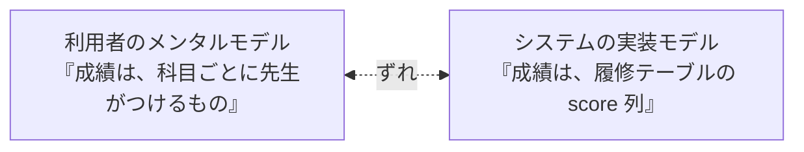
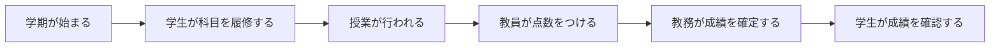

# 03. メンタルモデルを理解する

[📖 上流工程の目次](./00_はじめに.md#目次) ｜ [🏠 全体の目次](../README.md#目次)

[← 前へ：02 利用者と課題を知る](02_利用者と課題を知る.md) ｜ [次へ：04 ユーザーストーリーとマッピング →](04_ユーザーストーリーとマッピング.md)

## この章のゴール
- **メンタルモデル**とは何かを説明できる
- 利用者のメンタルモデルと、開発者の**実装モデル**がずれると何が起きるかを説明できる
- 聞き取りで、利用者の言葉と手順を引き出せる
- 聞き取った内容を、**用語集**と**業務の流れ**にまとめられる

## 目次

1. [メンタルモデルとは](#1-メンタルモデルとは)
2. [ずれが起きると](#2-ずれが起きると)
3. [メンタルモデルを聞き出す](#3-メンタルモデルを聞き出す)
4. [聞き取った内容をまとめる](#4-聞き取った内容をまとめる)
5. [成績管理での例](#5-成績管理での例)
6. [よくあるミス](#6-よくあるミス)

---

## 1. メンタルモデルとは

**メンタルモデル**とは、利用者が頭の中に持っている、**「この仕事は、こう進むものだ」「この道具は、こう動くものだ」という捉え方**です。利用者が正しいと信じていれば、実際の仕組みと違っていても、メンタルモデルとして成り立ちます。

たとえば、エレベーターのボタンを何度も押す人は、「たくさん押せば早く来る」という、実際とは違うメンタルモデルを持っているのかもしれません。

| 用語 | 誰の頭の中か | 内容 |
|---|---|---|
| **メンタルモデル** | 利用者 | 業務や道具を、どう捉えているか |
| **実装モデル** | 開発者・システム | システムの中身が、実際にどう動くか |

## 2. ずれが起きると

システムの作りが、利用者のメンタルモデルとずれていると、**使いにくい**と感じられます。

| ずれの例 | 利用者の捉え方 | システムの作り | 起きること |
|---|---|---|---|
| 用語のずれ | 「成績」＝**科目の点数**（60 点以上で合格） | 「成績」＝**平均点** | 画面の「成績」を見て、混乱する |
| 手順のずれ | 点数は、科目ごとにまとめて入力する | 学生ごとに 1 件ずつ入力する | 入力に何倍も時間がかかる |
| 範囲のずれ | 再履修したら、**以前の点数は残らない** | 履修は、年度ごとに残る | 以前の点数が見えて、驚く |
| 状態のずれ | 「履修中」のときは、点数は空 | 点数は必ず入る前提 | 空の点数でエラーになる |

メンタルモデルは、**利用者に聞かないと分かりません**。開発者の想像で決めると、ほぼ確実にずれます。

> [!TIP]
> ずれは、必ず直す必要があるわけではありません。**ずれがあることを知ったうえで、システムをどちらに合わせるかを決める**ことが大切です。たとえば、「再履修の履歴は残す」と決めたなら、画面に「過去の履修」と表示して、ずれを小さくします。

## 3. メンタルモデルを聞き出す

### 聞き取りの方法

| 方法 | やり方 | 分かること |
|---|---|---|
| **インタビュー** | 利用者に、普段の仕事を話してもらう | 手順、用語、困りごと |
| **観察** | 実際の作業を、見せてもらう | 話に出てこない、無意識の手順 |
| **資料の確認** | 今使っている帳票、表計算ソフト、マニュアルを見る | 管理している項目、決まり |

> [!TIP]
> 「どんなシステムが欲しいですか」とは**聞かない**ようにします。利用者は、システムの専門家ではありません。「普段、どうやって成績を出していますか」と、**今の仕事**を聞きます。

### 質問の例

| 知りたいこと | 質問の例 |
|---|---|
| 手順 | 「成績を出すまでに、どんな作業をしますか。最初から順に教えてください」 |
| 用語 | 「『履修』と『登録』は、同じ意味ですか」 |
| 例外 | 「点数が空のままになることは、ありますか。どんなときですか」 |
| 困りごと | 「その作業で、いちばん時間がかかるのはどこですか」 |
| 決まり | 「この点数は、あとから直せますか。誰が直せますか」 |

### 聞くときのコツ

- **相手の言葉をそのまま書き留める**：言い換えない。「履修」と言ったら「履修」と書く
- **「なぜ」を重ねる**：「なぜ、そうするのですか」と聞くと、背後の決まりが分かる
- **例を出してもらう**：「具体的には、どんな場合ですか」と聞く
- **例外を聞く**：普通の場合より、**例外**に業務の本質が出る

## 4. 聞き取った内容をまとめる

聞き取りの結果は、次の 2 つにまとめます。

### ① 用語集

利用者が使う言葉を、**意味とともに**整理します。この用語集は、後の工程で、**画面の文言・クラス名・テーブル名**を決めるときの元になります。

| 用語 | 意味 | 使い分け・注意 |
|---|---|---|
| 履修 | 学生が、ある年度に、ある科目を受けること | 「登録」とは言わない |
| 再履修 | 不合格などで、同じ科目を別の年度に受けること | 以前の履修も記録に残る |
| 点数 | 履修ごとの得点（0〜100） | 履修中は未入力 |
| 合格 | 点数が 60 点以上であること | 点数から決まる |
| 単位 | 合格すると得られる数 | 科目ごとに 1〜4 |

> [!TIP]
> 同じ言葉を、**全員が同じ意味で使う**ことが目標です。これを**ユビキタス言語**（誰もが共通で使う言葉）といいます。ドメイン設計・実装編（作成予定）で、この言葉がコードの名前になります。

### ② 業務の流れ

利用者の仕事を、**時間の順**に書き出します。

流れの中で、**誰が、何を、いつ**するのかを確認します。

## 5. 成績管理での例

教員への聞き取りの例です。

| 聞き取り（教員の言葉） | 分かったこと |
|---|---|
| 「期末に、受講者全員の点数を、まとめて入れます」 | 点数は**科目単位でまとめて**入力したい |
| 「欠席が多い学生は、点数を入れない（空のまま）ことがあります」 | **点数が空**の状態が、正式にある |
| 「入力を間違えたら、期限までは自分で直したいです」 | **期限までは**、点数を**修正**できる |
| 「成績が確定したあとは、教務にお願いして直してもらいます」 | 確定後は、**教務だけ**が修正できる |

この聞き取りから、次のことが分かります。

- 点数の入力は、**科目ごとにまとめて**行えるようにする必要がある
- 点数の状態には、「未入力」「入力済み」「確定済み」があるかもしれない
- 修正の権限は、**確定の前後で変わる**

これらは、「点数を入力できればよい」という想像からは、出てこない情報です。

## 6. よくあるミス

| ミス | 原因・対処 |
|---|---|
| 「どんな機能が欲しいですか」と聞く | 利用者は、機能を知らない。**今の仕事のやり方**を聞く |
| 聞き取った言葉を、専門用語に言い換える | 利用者の言葉のまま記録する。言い換えは、ずれの元 |
| 普通の場合だけを聞く | **例外**（空の点数、再履修、取り消し）を必ず聞く |
| 一人にしか聞かない | 立場によって捉え方が違う。教員と教務で、同じ言葉の意味が違うこともある |
| 聞き取りの結果を、記録しない | 用語集と業務の流れにまとめ、チームで共有する |

---

[← 前へ：02 利用者と課題を知る](02_利用者と課題を知る.md) ｜ [次へ：04 ユーザーストーリーとマッピング →](04_ユーザーストーリーとマッピング.md)

[📖 上流工程の目次](./00_はじめに.md#目次) ｜ [🏠 全体の目次](../README.md#目次)
