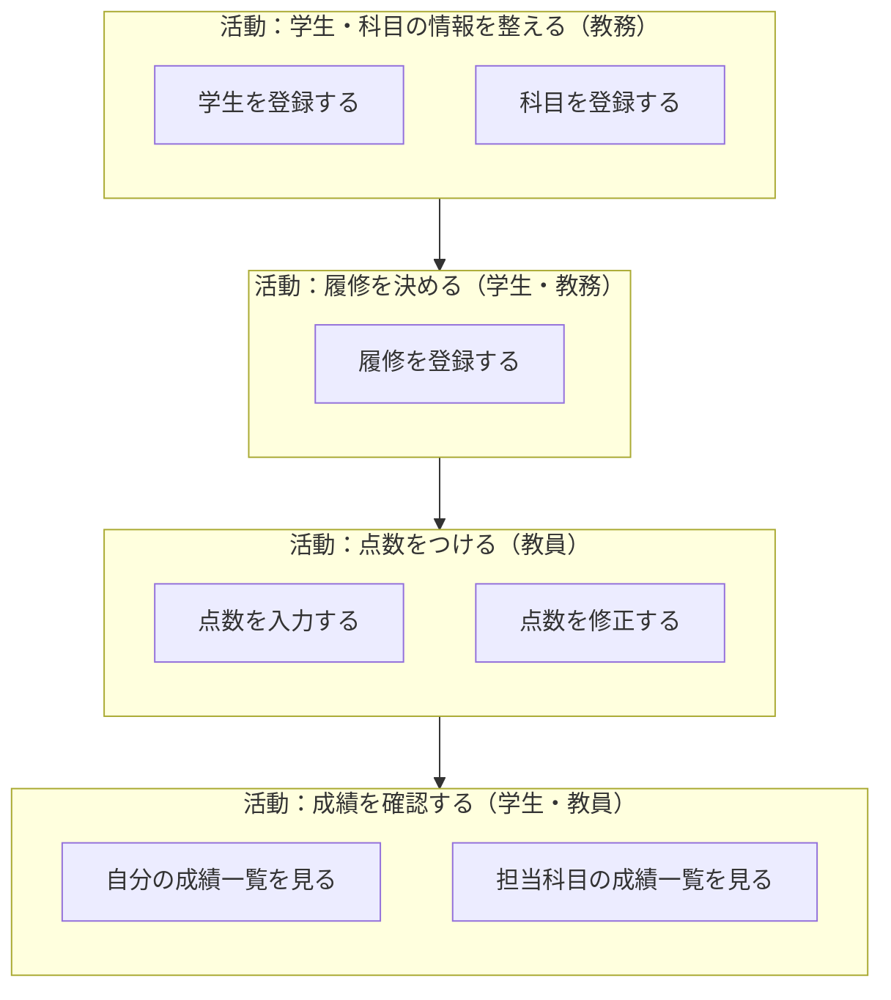

# 04. ユーザーストーリーとマッピング

[📖 上流工程の目次](./00_はじめに.md#目次) ｜ [🏠 全体の目次](../README.md#目次)

[← 前へ：03 メンタルモデルを理解する](03_メンタルモデルを理解する.md) ｜ [次へ：05 ユースケースに落とし込む →](05_ユースケースに落とし込む.md)

## この章のゴール
- **ユーザーストーリー**を、決まった形で書ける
- **ユーザーストーリーマッピング**で、全体像と作る順序を描ける
- 優先順位をつけて、最初に作る範囲（最小限の範囲）を決められる

## 目次

1. [ユーザーストーリーとは](#1-ユーザーストーリーとは)
2. [ユーザーストーリーの書き方](#2-ユーザーストーリーの書き方)
3. [ユーザーストーリーマッピング](#3-ユーザーストーリーマッピング)
4. [優先順位をつけて範囲を切る](#4-優先順位をつけて範囲を切る)
5. [成績管理のマップ](#5-成績管理のマップ)
6. [よくあるミス](#6-よくあるミス)

---

## 1. ユーザーストーリーとは

**ユーザーストーリー**とは、利用者の目的を、**利用者の言葉で、短く**表したものです。「システムが何をするか」ではなく、「**利用者が、何のために、何をしたいか**」を書きます。

| 機能の書き方（システム側） | ユーザーストーリー（利用者側） |
|---|---|
| 点数登録機能を提供する | 教員として、期末に担当科目の点数をまとめて入力したい。なぜなら、提出の手間を減らしたいから |

機能の書き方だと、「何のためか」が抜けます。目的が分かると、**別のもっと良い方法**を考えられます。

## 2. ユーザーストーリーの書き方

### 基本の形

> **〇〇（アクター）として、△△（したいこと）をしたい。なぜなら、□□（目的・理由）だから。**

| 部分 | 意味 | 例 |
|---|---|---|
| アクター | 誰が | 教員 |
| したいこと | 何をしたいか | 担当科目の点数を、まとめて入力 |
| 目的・理由 | なぜ、したいか | 提出の手間を減らしたい |

### 成績管理の例

| アクター | ストーリー |
|---|---|
| 学生 | 学生として、自分の履修した科目と点数を一覧で見たい。なぜなら、単位が足りているか確認したいから |
| 教員 | 教員として、担当科目の学生ごとの点数を入力したい。なぜなら、成績を教務に提出する必要があるから |
| 教員 | 教員として、入力した点数を期限まで修正したい。なぜなら、入力ミスに気づくことがあるから |
| 教務 | 教務として、新しい学生を登録したい。なぜなら、入学時に学生の情報を整える必要があるから |

### 良いストーリーの条件

ストーリーが良いかを確認する目安として、**INVEST** という頭文字があります。

| 頭文字 | 意味 | 確認すること |
|---|---|---|
| **I**ndependent | 独立している | 他のストーリーと、順序を入れ替えられるか |
| **N**egotiable | 交渉できる | 細かいやり方は、話し合って決められるか |
| **V**aluable | 価値がある | 利用者にとって、価値があるか |
| **E**stimable | 見積もれる | 作るのにどれくらいかかるか、見当がつくか |
| **S**mall | 小さい | 短い期間で作れる大きさか |
| **T**estable | 確認できる | できたかどうか、確認できるか |

大きすぎるストーリー（例：「成績を管理したい」）は、**小さく分けます**。

## 3. ユーザーストーリーマッピング

ストーリーが増えると、一覧では**全体像**が見えなくなります。そこで、ストーリーを**利用者の行動の流れに沿って並べる**のが、**ユーザーストーリーマッピング**です。

### マップの構造

```text
        ← 利用者の行動の流れ（時間の順）→

  【活動】   学生の情報を整える │ 点数をつける      │ 成績を確認する
              ↓                  ↓                   ↓
  【ステップ】 学生を登録 │ 科目を登録 │ 点数を入力 │ 点数を修正 │ 自分の成績を見る
              ↓            ↓            ↓            ↓            ↓
  【ストーリー】
   ↑ 優先度が高い    ○            ○            ○            ○            ○
   │              ○                           ○            ○
   │              ○                           ○
   ↓ 優先度が低い
```

| 段 | 意味 | 成績管理での例 |
|---|---|---|
| **活動** | 利用者が目的のためにする、大きなまとまり | 点数をつける |
| **ステップ** | 活動の中の、具体的な行動（時間の順に並べる） | 点数を入力する、点数を修正する |
| **ストーリー** | ステップを実現する、具体的な機能 | 一覧から点数を入力する、CSV を取り込む |

- 横方向は**利用者の行動の流れ**（左から右へ、時間の順）
- 縦方向は**優先度**（上が高い、下が低い）

### 作り方

1. **利用者の行動を書き出す**：付箋に、1 つずつ書く（03 章で聞き取った業務の流れが元になる）
2. **時間の順に並べる**：左から右へ
3. **似たものをまとめる**：まとまりに名前をつけて「活動」とする
4. **各ステップの下に、ストーリーを並べる**：思いついた方法を、縦に並べる
5. **優先度の順に、縦に並び替える**

> [!TIP]
> マッピングの利点は、**全体の流れの中で、どこが抜けているか**が見えることです。一覧にすると見えない、「流れの途切れ」が見つかります。たとえば、「点数を入力する」はあるのに、「科目を登録する」がなければ、点数を入れる対象の科目が存在しません。

## 4. 優先順位をつけて範囲を切る

すべてのストーリーを、一度には作れません。マップの**横線**で区切り、最初に作る範囲を決めます。

```text
  【最初に作る範囲（リリース 1）】
  ──────────────────────────────────
   ○ 学生を登録     ○ 科目を登録      ○ 点数を入力       ○ 自分の成績を見る
  ──────────────────────────────────
  【次に作る範囲（リリース 2）】
   ○ 学生を修正      ○ 点数を修正      ○ 科目別の統計を見る
  ──────────────────────────────────
  【余裕があれば】
   ○ CSV の取り込み
```

最初に作る範囲は、**最低限、利用者の目的が最初から最後まで通る**ようにします。部分的に機能が少なくても、流れが通れば、使って確かめられます。

### 優先順位の決め方

| 観点 | 問い |
|---|---|
| 価値 | 利用者の困りごとを、どれだけ解決するか |
| 必須か | これがないと、流れが通らないか |
| 手間 | 作るのにどれくらいかかるか |
| 不確かさ | 分かっていないことが多いか（早めに作って確かめたい） |

## 5. 成績管理のマップ



このマップから、次のことが分かります。

- 流れは「情報を整える → 履修を決める → 点数をつける → 成績を確認する」の順
- 他の資料で扱う 3 つの機能は、このマップの一部（**学生を登録する**、**点数を入力する**、**自分の成績一覧を見る**に相当）
- 「履修を登録する」は、学生と科目の両方が必要なので、その前に両方を登録する必要がある

> [!NOTE]
> このマップのステップが、次の 05 章で**ユースケース**になります。

## 6. よくあるミス

| ミス | 原因・対処 |
|---|---|
| 「〇〇機能を作る」とだけ書く | 利用者の目的（なぜ）を書く。目的が分かれば、より良い方法を選べる |
| ストーリーが大きすぎる | 「成績を管理したい」は大きすぎる。小さく分けて、1 つずつ確認できる大きさにする |
| 優先度が全部「高」になる | すべてが高いと、決められない。**最初の範囲に入れるのは何か**を、問いで絞る |
| 開発者だけでマップを作る | 利用者や、依頼者と一緒に作る。欠けている流れは、利用者が気づく |
| 一度作ったマップを変えない | 分かったことが増えたら、並べ直す。マップは変わり続けるもの |

---

[← 前へ：03 メンタルモデルを理解する](03_メンタルモデルを理解する.md) ｜ [次へ：05 ユースケースに落とし込む →](05_ユースケースに落とし込む.md)

[📖 上流工程の目次](./00_はじめに.md#目次) ｜ [🏠 全体の目次](../README.md#目次)
