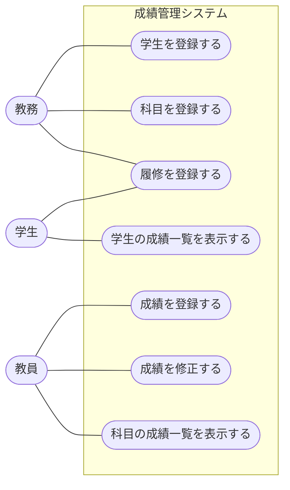

# 05. ユースケースに落とし込む

[📖 上流工程の目次](./00_はじめに.md#目次) ｜ [🏠 全体の目次](../README.md#目次)

[← 前へ：04 ユーザーストーリーとマッピング](04_ユーザーストーリーとマッピング.md) ｜ [次へ：06 設計への受け渡し →](06_設計への受け渡し.md)

## この章のゴール
- **ユースケース**とは何か、ユーザーストーリーとの違いを説明できる
- ユースケースの一覧と、アクターとの関係を図に描ける
- ユースケースを、**基本フロー・代替フロー**の形式で記述できる
- **受け入れ基準**を、Given-When-Then の形で書ける

## 目次

1. [ユースケースとは](#1-ユースケースとは)
2. [ユースケースの見つけ方](#2-ユースケースの見つけ方)
3. [ユースケース図](#3-ユースケース図)
4. [ユースケース記述](#4-ユースケース記述)
5. [受け入れ基準](#5-受け入れ基準)
6. [他の資料のユースケースとの対応](#6-他の資料のユースケースとの対応)
7. [よくあるミス](#7-よくあるミス)

---

## 1. ユースケースとは

**ユースケース**とは、アクターが**システムを使って目的を達成するまでの、一連のやり取り**です。04 章のステップを、システムとのやり取りとして、**手順まで含めて**具体的に決めたものです。

| | ユーザーストーリー（04 章） | ユースケース（この章） |
|---|---|---|
| 書くこと | 利用者の**目的と理由** | システムと利用者の**やり取りの手順** |
| 詳しさ | 短い（1〜2 文） | 詳しい（手順、例外、条件） |
| 使う場面 | 全体像、優先順位を決める | 設計や実装に渡す |

ユースケースは、**4 層の Application 層**の処理と対応します。1 つのユースケースが、Application 層の 1 つの処理（メソッド）になります。

## 2. ユースケースの見つけ方

04 章のマップの**ステップ**が、そのままユースケースの候補です。

| ステップ | ユースケース名 | アクター |
|---|---|---|
| 学生を登録する | 学生を登録する | 教務 |
| 科目を登録する | 科目を登録する | 教務 |
| 履修を登録する | 履修を登録する | 学生、教務 |
| 点数を入力する | 成績を登録する | 教員 |
| 点数を修正する | 成績を修正する | 教員 |
| 自分の成績一覧を見る | 学生の成績一覧を表示する | 学生 |
| 担当科目の成績一覧を見る | 科目の成績一覧を表示する | 教員 |

### 名前の付け方

ユースケースの名前は、「**〇〇を△△する**」という、動詞を含む形にします。「成績管理」のような名詞だけの名前や、「データベースに保存する」のような技術の言葉は、避けます。

## 3. ユースケース図

アクターと、ユースケースの関係を図にしたものが**ユースケース図**です。システムの**機能の一覧と、誰が使うか**が 1 枚で分かります。

- 枠（システムの境界）の**外**にアクター、**内**にユースケースを置く
- 線は「アクターが、そのユースケースを使う」ことを表す
- 図は、**詳細を書かない**。詳細は、次の「ユースケース記述」に書く

> [!NOTE]
> UML のユースケース図は、本来は人型の記号と楕円で描きます。ここでは、GitHub で描ける mermaid の図で、同じ関係を表しています。

## 4. ユースケース記述

ユースケースごとに、**手順を文章で書く**のが**ユースケース記述**です。次の項目を書きます。

| 項目 | 内容 |
|---|---|
| 名前 | ユースケースの名前 |
| アクター | 誰が行うか |
| 目的 | 何のために行うか |
| 事前条件 | 始める前に、成り立っていること |
| 事後条件 | 成功したあとに、成り立っていること |
| 基本フロー | すべてうまくいく場合の手順 |
| 代替フロー | 例外や、別の場合の手順 |

### 例：成績を登録する

| 項目 | 内容 |
|---|---|
| 名前 | 成績を登録する |
| アクター | 教員 |
| 目的 | 担当科目を履修した学生の点数を記録し、教務に提出できる状態にする |
| 事前条件 | 学生と科目が登録されている。その学生が、その科目を履修している |
| 事後条件 | その履修に、点数が記録されている |

**基本フロー**

1. 教員が、科目、学生、年度を指定する
2. 教員が、点数を入力する
3. システムは、点数が 0〜100 の範囲であることを確かめる
4. システムは、その履修の点数を記録する
5. システムは、記録できたことを教員に伝える

**代替フロー**

| 番号 | 条件 | 手順 |
|---|---|---|
| 3a | 点数が 0〜100 の範囲外 | システムはエラーを伝え、基本フローの 2 に戻る |
| 1a | 指定した学生が登録されていない | システムはエラーを伝えて終了する |
| 1b | 指定した学生が、その科目を履修していない | システムはエラーを伝えて終了する |
| 4a | すでに点数が記録されている | 点数を上書きするか、教員に確認する（成績を修正する、を参照） |

### 書くときのコツ

- **主語を明確にする**：「教員が」「システムは」と、誰の動作かを毎回書く
- **画面の細部を書かない**：「ボタンを押す」ではなく「点数を入力する」と書く。画面の形は、設計で決める
- **技術の言葉を書かない**：「データベースに保存する」ではなく「記録する」と書く
- **例外を書く**：代替フローが、後の設計で「エラー処理」になる。ここで書いておくと、漏れない

## 5. 受け入れ基準

**受け入れ基準**とは、「このユースケースが、**できた**と言える条件」です。作る側と依頼する側が、同じ基準で確認するために書きます。

### Given-When-Then

次の 3 つの部分で書く形式が、よく使われます。

| 部分 | 意味 |
|---|---|
| **Given**（前提） | どんな状況から始まるか |
| **When**（操作） | 何をするか |
| **Then**（結果） | 何が起きるべきか |

### 例：成績を登録する

| # | Given（前提） | When（操作） | Then（結果） |
|---|---|---|---|
| 1 | 学生 Taro が「データベース」を 2025 年度に履修している | 教員が点数 85 を入力する | 点数 85 が記録される |
| 2 | 同上 | 教員が点数 101 を入力する | エラーが伝えられ、点数は記録されない |
| 3 | 同上 | 教員が点数 -1 を入力する | エラーが伝えられ、点数は記録されない |
| 4 | 学生 Jiro が、その科目を履修していない | 教員が点数を入力する | エラーが伝えられ、点数は記録されない |
| 5 | 点数が、まだ記録されていない | 教員が点数 0 を入力する | 点数 0 が記録される（「未入力」と区別される） |

> [!TIP]
> 5 は、境界の値（0 点）です。**0 点と未入力は違う**ことを、基準として決めておきます。03 章で聞き取った、「点数が空の状態が正式にある」という情報が、ここで効いています。

受け入れ基準は、**後のテスト**の元になります。テストについては、開発環境・品質編（作成予定）で扱います。

## 6. 他の資料のユースケースとの対応

4層アーキテクチャ編とデータベース編では、このユースケースのうち、3 つを題材にしています。

| 他の資料の機能 | この資料のユースケース |
|---|---|
| 学生を登録する | 学生を登録する |
| 成績を登録する | 成績を登録する |
| 学生の成績一覧を表示する | 学生の成績一覧を表示する |

この資料の他のユースケース（科目を登録する、履修を登録する、成績を修正する、科目の成績一覧を表示する）は、題材を広げたときの候補です。

## 7. よくあるミス

| ミス | 原因・対処 |
|---|---|
| 画面の操作を、細かく書く | ユースケースは「やり取りの意味」を書く。ボタンや入力欄は、設計で決める |
| 例外（代替フロー）を書かない | 正常な場合しか書かないと、エラー処理が抜ける。「もし〇〇だったら」を必ず考える |
| ユースケースが大きすぎる | 「成績を管理する」は大きすぎる。目的が 1 つに絞れる大きさにする |
| アクターが決まっていない | 誰が行うのかを決める。誰が行うかで、権限や画面が変わる |
| 受け入れ基準が「正しく動くこと」 | 確認できる形で書く。具体的な値（85、101、-1）を使った例にする |

---

[← 前へ：04 ユーザーストーリーとマッピング](04_ユーザーストーリーとマッピング.md) ｜ [次へ：06 設計への受け渡し →](06_設計への受け渡し.md)

[📖 上流工程の目次](./00_はじめに.md#目次) ｜ [🏠 全体の目次](../README.md#目次)
