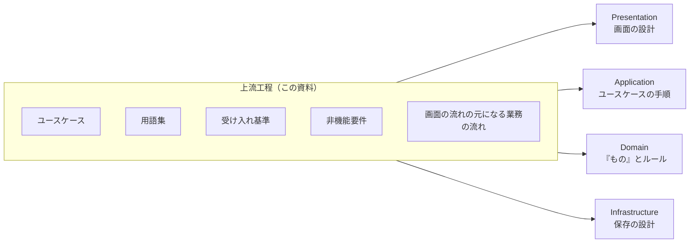

# 06. 設計への受け渡し

[📖 上流工程の目次](./00_はじめに.md#目次) ｜ [🏠 全体の目次](../README.md#目次)

[← 前へ：05 ユースケースに落とし込む](05_ユースケースに落とし込む.md)

## この章のゴール
- 上流工程の成果物に、**抜け漏れがないか**確認できる
- **機能要件**と**非機能要件**の違いを説明できる
- 上流工程の成果物が、4 層のどの設計に引き継がれるかを説明できる

## 目次

1. [上流工程の成果物](#1-上流工程の成果物)
2. [抜け漏れの確認](#2-抜け漏れの確認)
3. [機能要件と非機能要件](#3-機能要件と非機能要件)
4. [どの設計に引き継がれるか](#4-どの設計に引き継がれるか)
5. [要件の変更への備え](#5-要件の変更への備え)
6. [よくあるミス](#6-よくあるミス)

---

## 1. 上流工程の成果物

ここまでの章で作ったものが、上流工程の**成果物**です。

| 章 | 成果物 | 内容 |
|---|---|---|
| 02 | アクター一覧、ペルソナ、課題の整理 | 誰のために、何を解決するか |
| 03 | 用語集、業務の流れ | 利用者の言葉と、仕事の順序 |
| 04 | ユーザーストーリー、ストーリーマップ | 目的と、作る順序 |
| 05 | ユースケース図、ユースケース記述、受け入れ基準 | システムが提供する機能と、その手順 |

## 2. 抜け漏れの確認

次の工程に渡す前に、成果物の間でつじつまが合っているか確認します。

| 確認すること | 見るところ |
|---|---|
| すべてのアクターに、ユースケースがあるか | アクター一覧 ↔ ユースケース図 |
| すべてのユースケースに、アクターがいるか | ユースケース図（アクターのいないユースケースは、誰も使わない） |
| 利用者の困りごとが、どれかのユースケースで解決されるか | 課題の整理 ↔ ユースケース |
| 作る順序に矛盾がないか | ストーリーマップ（登録する前に、使う機能が先に来ていないか） |
| 用語が統一されているか | 用語集 ↔ ユースケース記述（同じものを、別の名前で呼んでいないか） |
| 例外が書かれているか | ユースケース記述の代替フロー |
| 確認できる形になっているか | 受け入れ基準（具体的な値があるか） |

> 💡 このような、成果物同士の対応を追えるようにすることを、**トレーサビリティ**（追跡可能性）といいます。「この機能は、誰のどの困りごとのためか」を、たどれるようにしておくと、変更のときに影響を調べられます。

## 3. 機能要件と非機能要件

要件には、2 種類あります。ここまでのユースケースは、**機能要件**です。

| 種類 | 意味 | 成績管理での例 |
|---|---|---|
| **機能要件** | システムが**何をするか** | 教員が点数を入力できる |
| **非機能要件** | システムが**どの程度の品質で動くか** | 期末の集中する時期でも、入力が遅くならない |

### 非機能要件の例

| 観点 | 問い | 成績管理での例 |
|---|---|---|
| 性能 | どのくらいの速さが必要か | 100 人分の成績一覧が、数秒で表示される |
| 使いやすさ | 誰が、どんな環境で使うか | 初めて使う教員が、説明なしで入力できる |
| セキュリティ | 誰に何を見せてよいか | 学生は、自分の成績だけを見られる |
| 信頼性 | 止まっても大丈夫か、データを失ってよいか | 点数のデータが消えない。入力の途中で止まっても、整合性が保たれる |
| 保守性 | 後から変更しやすいか | 成績の評価ルールが変わっても、直しやすい |

> [!WARNING]
> 非機能要件は、聞き漏らしやすいので、意識して聞きます。利用者は、当たり前だと思って話してくれません。「学生同士で、他人の成績が見えてはいけませんよね？」のように、具体的に確認します。

> 🔒 **セキュリティの視点**：セキュリティの聞き取りでは、「誰に何を見せてよいか」に加えて、次の点も確認します。
> - **扱う個人情報の範囲**：本当に必要な情報か（持たない情報は漏れない）
> - **操作の記録**：誰がいつ点数を変えたかを、後から確かめる必要があるか
> - **データを失ったとき**：どこまで戻せればよいか（バックアップの頻度や保管場所）
>
> 世の中でどんな被害が起きているかは、IPA が毎年まとめる「情報セキュリティ10大脅威」で知ることができます（[IPA「情報セキュリティ10大脅威 2026」](https://www.ipa.go.jp/security/10threats/10threats2026.html)、閲覧日：2026-11-08）。

非機能要件も、**確認できる形**で書きます。「速い」ではなく、「数秒で表示される」と書きます。

## 4. どの設計に引き継がれるか

上流工程の成果物は、次の工程で、4 層それぞれの設計の**入力**になります。

| 成果物 | 引き継ぎ先 | どう使うか |
|---|---|---|
| ユースケース（一覧） | **Application 層** | 1 つのユースケースが、1 つの処理になる |
| ユースケース記述（基本フロー、代替フロー） | **Application 層** / **Domain 層** | 手順は Application 層、ルール（点数は 0〜100）は Domain 層になる |
| 用語集 | **Domain 層**、**Infrastructure 層** | クラス名、テーブル名の元になる |
| 受け入れ基準 | テスト | 完成の確認と、自動テストの元になる |
| 業務の流れ、ユースケース | **Presentation 層** | 画面の種類と、画面の移り変わりの元になる |
| 非機能要件 | 全体の設計 | 性能、権限、データの扱い方を決める |
| ユースケースで出てきた「もの」（学生、科目、履修） | **Domain 層**、**Infrastructure 層** | ドメインモデル、データベースの ER 図の元になる |

つまり、ユースケース記述に出てくる**名詞**（学生、科目、履修、点数）が、「もの」の候補で、**動詞**（登録する、表示する）がユースケースの処理の候補になります。

### 各資料の入口

| 次に進む先 | 受け取るもの | 資料 |
|---|---|---|
| 層ごとの役割 | ユースケースが、どの層のどこに対応するか | [4層アーキテクチャ編](../4層アーキテクチャ/00_はじめに.md) |
| ドメイン設計 | ユースケースと用語集から、「もの」とルールを整理する | ドメイン設計・実装編（作成予定） |
| データベース設計 | 要件から、保存するデータを整理する | [データベース編](../データベース/02_データベース設計の流れ.md) |
| 画面設計 | ユースケースと業務の流れから、画面を決める | フロントエンド編（作成予定） |
| テスト | 受け入れ基準から、テストを作る | 開発環境・品質編（作成予定） |

## 5. 要件の変更への備え

開発の途中で、要件が変わることはよくあります。変わること自体は、悪くありません。**変わったときに、影響を追えるか**が大切です。

| 備え | 内容 |
|---|---|
| 変更の理由を残す | 「なぜ変えたのか」を記録する |
| 成果物同士の対応を残す | どのストーリーが、どのユースケースになったか |
| 決めていないことを明記する | 「未定」「要確認」を、そのまま書いておく |
| 小さく作って確認する | 最初に作る範囲（04 章）を作り、利用者に見てもらう |

## 6. よくあるミス

| ミス | 原因・対処 |
|---|---|
| 機能要件だけで、非機能要件を聞かない | 性能、権限、データの扱いを、意識して確認する |
| 成果物同士で、用語がばらばら | 用語集を作り、全員が同じ言葉を使う |
| 「未定」を、決まったことのように書く | 分からないことは、分からないと書く。後で確認できる |
| 受け入れ基準を、完成後に書く | ユースケースを決めるときに、一緒に書く。後だと、基準が実装に引きずられる |
| 次の工程に、文書だけを渡して終わる | 文書の意図を、設計する人に説明する。疑問は、早く解消する |

---

[← 前へ：05 ユースケースに落とし込む](05_ユースケースに落とし込む.md)

[📖 上流工程の目次](./00_はじめに.md#目次) ｜ [🏠 全体の目次](../README.md#目次)
