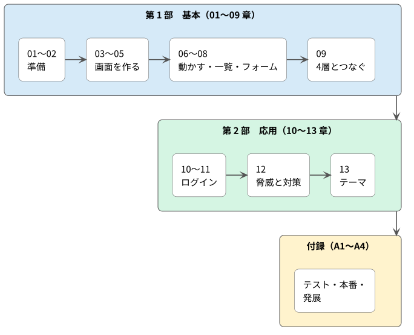

# 資料作成ルール

このリポジトリの資料（Lecture）と、サンプルコード（[Sample](https://github.com/YTS0418/PRMN_SYSTEM_Sample)）の README を書くときの決まりです。人が読むためのルールで、Claude Code など AI に作業を頼むときも、この文書に従ってもらいます。

Markdown の記法そのものは、[マークダウンチートシート](マークダウンチートシート.md)を見てください。

## 目次

1. [図の種類と、使う形式](#1-図の種類と使う形式)
2. [置き場所と、ファイル名](#2-置き場所とファイル名)
3. [色](#3-色)
4. [PlantUML の図を作る](#4-plantuml-の図を作る)
5. [章への貼り方](#5-章への貼り方)
6. [スクリーンショット](#6-スクリーンショット)
7. [章とリンク](#7-章とリンク)

---

## 1. 図の種類と、使う形式

図は、**後から直しやすい形**で残します。画像（PNG）だけを置かず、**元データか、SVG** を置きます。

| 図の種類 | 使う形式 | 保存するもの |
|---|---|---|
| 厳密な UML 図（クラス図、ユースケース図、ER 図、状態遷移図など） | **PlantUML** | `.puml` と、書き出した `.svg`（**両方**） |
| 手で描く図（付箋、概念図、イラストなど） | **SVG** | `.svg` と、元データ（`.excalidraw` / `.drawio`） |
| 色で強調・区別したい図（層ごとの色分け、良い例と悪い例の対比など） | **SVG**（PlantUML または手描き） | 上の 2 行と同じ |
| 章立ての図（各フォルダの `00_はじめに.md` にある、章の流れ） | **SVG** | 上の 2 行と同じ |
| Git のブランチ図、短い流れ図、シーケンス図 | **Mermaid** | 章の中に、コードブロックで書く |
| スクリーンショット、写真、ロゴなど、すでにある画像 | 形式は問わない（PNG でよい） | 画像のみ |

迷ったときの目安：

- **Mermaid は、色を付け分けられません**（すべて同じ色になります）。色で意味を伝えたい図は、SVG にします
- 画像だけの PNG は、**文字を直せません**。描いた図は、PNG にしません
- Mermaid で描いた図が、長くなったり読みにくくなったりしたら、SVG にします

> [!NOTE]
> 「厳密な UML 図」とは、記法（矢印の種類、多重度、アクターなど）に意味がある図のことです。Mermaid の `classDiagram` や、フローチャートで代用したユースケース図は使わず、PlantUML で描きます。

## 2. 置き場所と、ファイル名

| もの | 置き場所 |
|---|---|
| 図の SVG と `.puml` | `images/<トピック>/diagram/`（同じフォルダに置く） |
| Excalidraw の元データ | `excalidraw/` |
| draw.io の元データ | `drawio/` |
| スクリーンショット | `images/<トピック>/<種類>/`（例：`images/docker/desktop/`） |

- トピックは、`architecture` `database` `docker` `frontend` `git` `upstream` `java` のいずれか
- `images/` の直下には、置かない
- ファイル名は、`<接頭辞>-<章番号>-<連番>-<名前>`（例：`er-03-01-uml.svg`、`up-04-01-story-map-structure.svg`）。**元データも同じ名前**にする
- 元データ（`.puml` など）と、書き出した画像は、**両方**コミットする

## 3. 色

層ごとの色は、全資料で共通にします（4 層アーキテクチャ編の色）。

| 意味 | 色 |
|---|---|
| Presentation 層（利用者、ブラウザ、画面） | 青（`#d6eaf8`） |
| Application 層・Domain 層（サーバー側の処理） | 緑（`#d5f5e3`） |
| Infrastructure 層・外部（DB、外部サービス） | 黄（`#fff3cd`） |
| 危険、避けたい例 | 赤（`#fadbd8`） |

PlantUML では、`images/frontend/diagram/_common.iuml` で、この色を `C_USER` `C_BROWSER` `C_SERVER` `C_EXTERNAL` `C_DANGER` として定義しています。

## 4. PlantUML の図を作る

1. `images/<トピック>/diagram/` に `.puml` を書く。共通の見た目は、`_common.iuml` を `!include` する
2. リポジトリの直下で、変換スクリプトを実行する

   ```bash
   bash tools/build-diagrams.sh images/database/diagram                  # フォルダ内の .puml をすべて
   bash tools/build-diagrams.sh images/database/diagram er-03-01-uml.puml # 1 つだけ
   ```

3. 同じフォルダに、`.svg` ができる。**目で見て、文字の切れや崩れがないか**確認する

- `plantuml`（または `plantuml.jar`）、Java、Graphviz（`dot`）が必要です。`plantuml.jar` の場所は、環境変数 `PLANTUML_JAR` で指定できます（VSCode の PlantUML 拡張の jar は、自動で探します）
- 日本語の文字は、閲覧する環境のフォントで描かれます。スクリプトが、フォントの候補（Noto Sans CJK JP、Hiragino Sans、Yu Gothic、Meiryo）を SVG に書き込みます
- **PlantUML のバージョンが違うと、同じ `.puml` でも、SVG の寸法が変わります。** 既存の図を、ついでに作り直さないでください。直した図だけを、変換します（章の `width` が、ずれるためです）
- 長方形を並べるだけの図は、PlantUML を使わず、SVG を直接書いてもかまいません（フロントエンド編の `dia-01-02-compare.svg` など）

## 5. 章への貼り方

SVG は、幅を指定して貼ります。幅は、SVG の幅（`width`）に合わせます。

```html

```

- `alt`（代替テキスト）には、図が何を表しているかを、日本語で書く
- 図の後ろに、**読み方の説明**を 1〜2 文付ける。図だけで終わらせない

## 6. スクリーンショット

- 形式は問わない。ふつうは PNG にする
- 撮影の細かいルール（範囲、強調の赤枠、個人情報、言語、テーマ）は、各トピックの `images/<トピック>/撮影リスト.md` にある
- 未撮影の箇所には、`<!-- 📷 SS: ../images/... -->` と、スクショ指定のブロックを置く。撮影後に、画像の参照に置き換える

## 7. 章とリンク

- 章を追加・改名・並べ替えたら、[README.md](../README.md) の目次、各フォルダの `00_はじめに.md`、章の冒頭と末尾の前後リンク、章内の目次を、合わせて直す
- Lecture と Sample は、**相互にリンク**する。Lecture の章からは、対応する Sample のコードへ。Sample の README の節からは、対応する Lecture の章へ
- Sample の URL は、`https://github.com/YTS0418/PRMN_SYSTEM_Sample/blob/main/…`（フォルダは `tree/main/…`）の形で、実在するパスを書く。「作成予定」や「URL は仮置き」と書いたまま残さない
- 用語は、章をまたいで、そろえる（例：04 章の「タスク」を、05 章が「ユースケース」にする）
